# 拾光达 外卖常用功能操作手册（收藏 / 常买 / 排序筛选 / 再来一单）

> 适用范围：顾客端 H5（`https://www.yourbao.cn/waimai/`，手机浏览器 / 微信内打开）
> 上线日期：2026-10-21
> 截图脚本：`node .secrets/common-features-shots.cjs`（Playwright 390×844 dpr=2）
> 后端接口：`campusFavoriteStores` / `campusToggleFavoriteStore`（campus-delivery-plugin，登录态）

## 1. 功能概览

| 功能 | 入口 | 说明 |
|---|---|---|
| 商家收藏 | 首页店铺卡右上角 ♡ / 店铺页店铺卡右侧「收藏」 | 登录用户云端保存；游客只存本机 |
| 常买店铺 | 首页「常买店铺」横排 | 本地记录最近进店的 6 家店，按当前店铺列表过滤失效店 |
| 排序 | 首页搜索下方 chips：综合 / 配送最快 / 起送价最低 / 配送费最低 | 收藏店铺始终置前；未配置值排最后 |
| 筛选 | 首页「⚙ 筛选」底部弹层 | 仅营业中、免配送费、有优惠、起送价上限（≤¥15/20/30） |
| 再来一单 | 订单详情底部「再来一单」 | 定位原店铺渠道 → 校验在售 → 加购 → 直达店铺菜单 |
| 预约送达（原有） | 结算页「校园配送」Tab | 选日期 + 时段，写入订单 `deliverySlotText/scheduledFor`，订单详情展示 |

## 2. 顾客操作

### 2.1 收藏店铺

1. 首页店铺卡右上角点 ♡（或进店后点店铺卡右侧「收藏」）；
2. 变成实心 ♥ 即已收藏，收藏店铺在「综合」排序中自动置前；
3. 再点一次取消收藏（提示「已取消收藏」）；
4. 未登录时收藏只保存在本机；登录后首次进入首页会把本机收藏补写到云端（仅当云端为空）。

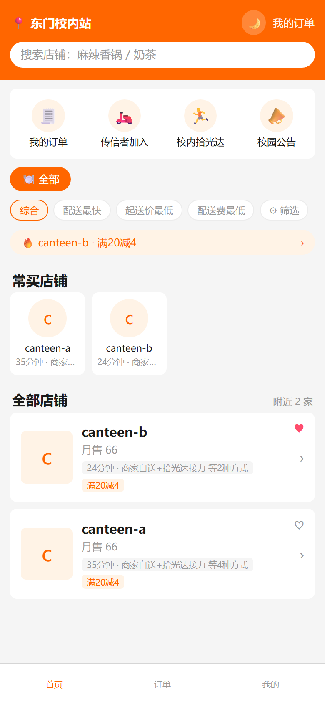
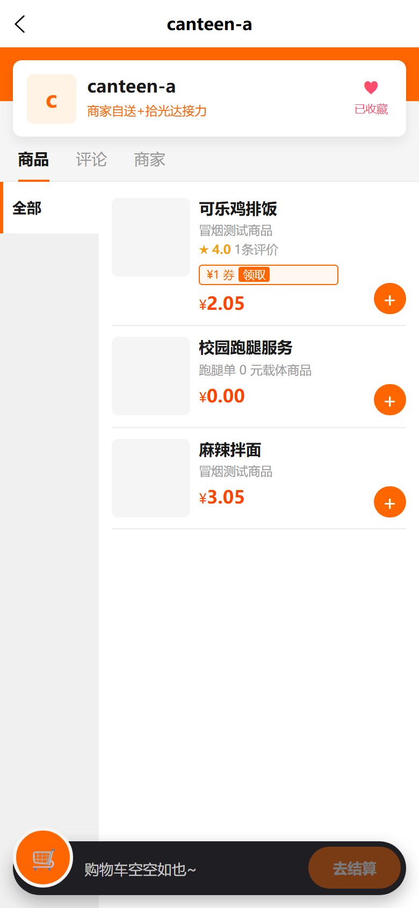

### 2.2 排序与筛选

1. 搜索框下方横排排序：综合（默认）/ 配送最快 / 起送价最低 / 配送费最低；
2. 点「⚙ 筛选」打开底部弹层，可多选「仅营业中」「免配送费」「有优惠」，并限定起送价上限；
3. 条件即时生效，按钮显示「筛选 · N」角标；「重置」清空全部条件；
4. 无匹配店铺时显示「没有符合筛选条件的店铺」。

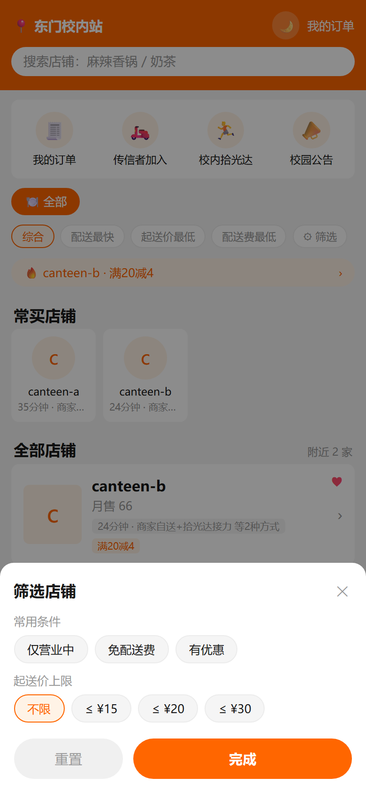
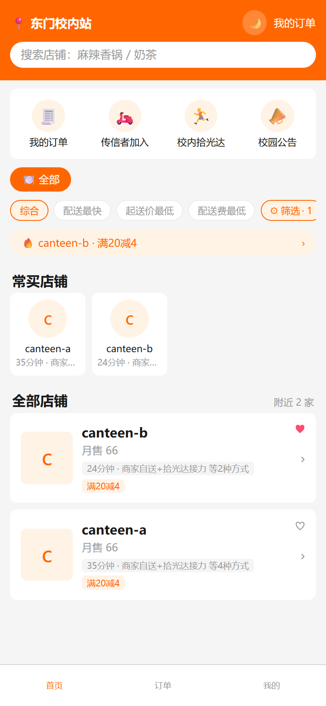

### 2.3 再来一单

1. 「我的订单 → 订单详情 → 再来一单」；
2. 弹层显示原店铺与本单商品；已下架/无库存商品置灰标「已下架，将跳过」，底部提示跳过件数；
3. 点「加入购物车并进店」：系统自动切到原店铺渠道，逐件加购并跳到店铺菜单，购物车显示已加商品；
4. 全部商品不可售时提示「商品均已下架，无法再来一单」；原店铺下线时提示「店铺已下线，暂不支持再来一单」；
5. 未登录点「再来一单」会先跳登录页。

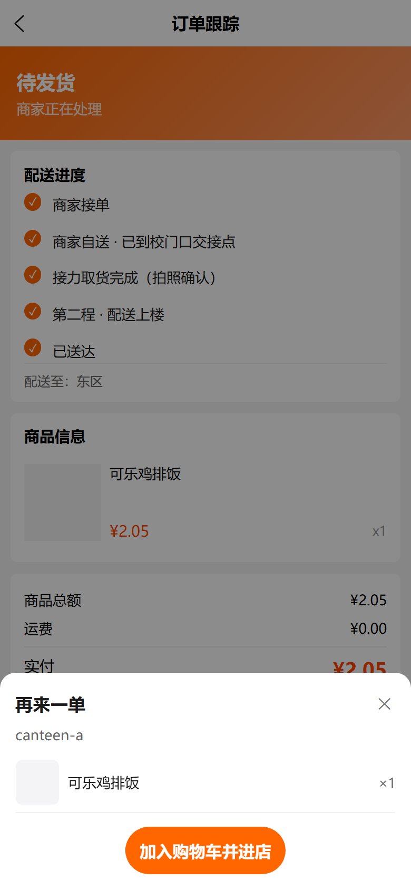
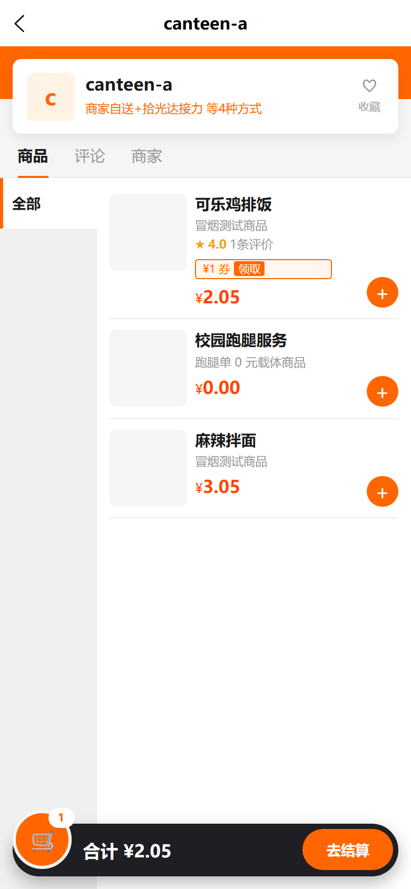

## 3. 预约送达（复核说明）

该能力在结算页已完整实现，本次未改动：

1. 结算页「校园配送」选择分区、宿舍楼后，日期 chips 默认「尽快送达」，可选未来日期；
2. 选日期后出现时段 chips（显示剩余容量），选中后提示「预约单将在时段开始前 30 分钟叫号」；
3. 提交订单写入 `deliverySlotId / deliverySlotText / scheduledFor`，订单状态为预约中；
4. 订单详情「商品信息」上方展示「预约送达：YYYY-MM-DD HH:mm-HH:mm」；
5. 未选时段时提交会被拦截并提示先选择时段。

## 4. 数据与接口

| 项 | 说明 |
|---|---|
| 收藏存储 | 表 `campus_favorite_shop`（`customerId + channelId` 唯一），与当前渠道无关，避免切渠道丢收藏 |
| 查询 `campusFavoriteStores` | 返回收藏渠道 ID 数组（收藏时间升序）；未登录返回 `NOT_LOGGED_IN` |
| 变更 `campusToggleFavoriteStore(channelId)` | 已收藏则取消，未收藏则收藏；返回最新完整数组；非法渠道返回 `CHANNEL_NOT_FOUND` |
| 前端本地键 | `favorite_stores`（收藏 ID 数组）、`recent_stores`（最近进店记录，最多 6 条） |
| 再来一单定位 | 遍历店铺列表 token 调 `getOrdersForChannel(token, { filter: { code } })`，命中即原渠道 |
| 可售校验 | 原渠道商品目录中变体存在、`enabled !== false` 且 `stockLevel` 为 `IN_STOCK/LOW_STOCK/空` |
| 配送费筛选口径 | 仅 `deliveryFee === 0` 算免配送费；`freeShippingThreshold`（满额免运）不计入 |

## 5. 验收记录（2026-10-21）

| 项 | 结果 |
|---|---|
| 插件编译 / vitest | 通过 |
| 未登录查询收藏 | `NOT_LOGGED_IN`（schema 已挂载） |
| 登录态 toggle 三次 | `["113"]` → `["113","114"]` → `["113"]` 正确翻转 |
| 非法渠道 ID | `CHANNEL_NOT_FOUND` |
| 首页点收藏（登录态） | 云端列表 `["114"]` → 点击 canteen-a → `["114","113"]` → 再点 → `["114"]` |
| 首页排序 / 常买 / 筛选 | 5 个排序 chips、2 条常买、筛选角标与结果正常 |
| 再来一单端到端 | 定位 canteen-a → 1 件在售加购成功 → 跳转店铺菜单，购物车 ¥2.05；测试后已清空测试账号购物车 |
| 手机视口截图 | 390×844 dpr=2，共 6 张（见上） |

## 6. 边界与已知限制

- 店铺列表无经纬度与评分字段，故不提供「距离/评分」排序；用配送时长、起送价、配送费替代。
- 「免配送费」只认配送费为 0；「满额免配送费」不是免配送费，避免误导。
- 收藏店铺下架后列表自动隐藏（云端记录保留，不做清理）。
- 游客收藏换设备不同步；登录后仅在云端为空时迁移本地收藏，避免覆盖云端数据。
- 再来一单不自动替换下架商品，只跳过并提示；加购失败会提示仍可手动进店选购。

---

# 第二轮常用功能（搜索 / 商品收藏 / 常买商品 / 订单中心 / 结算补强）

> 上线日期：2026-10-21（第二轮）
> 截图脚本：`node .secrets/common-features-v2-shots.cjs`（Playwright 390×844 dpr=2，输出 `docs/screenshots/common-features-v2/`）
> 后端接口：`campusFavoriteVariants` / `campusToggleFavoriteVariant`（campus-delivery-plugin，登录态）

## 7. 搜索升级

### 7.1 搜索面板（历史 + 热搜）

1. 首页点搜索框（关键词为空）即展开面板：
   - 「搜索历史」：本机最近 10 条，最新在前、自动去重，右侧「清空」可一键删除；
   - 「热搜」：由店铺标签与店铺名生成的 6 个热词，点一下直接搜索。
2. 键盘回车（`confirm-type=search`）提交搜索；点历史/热词等同提交并写入历史。

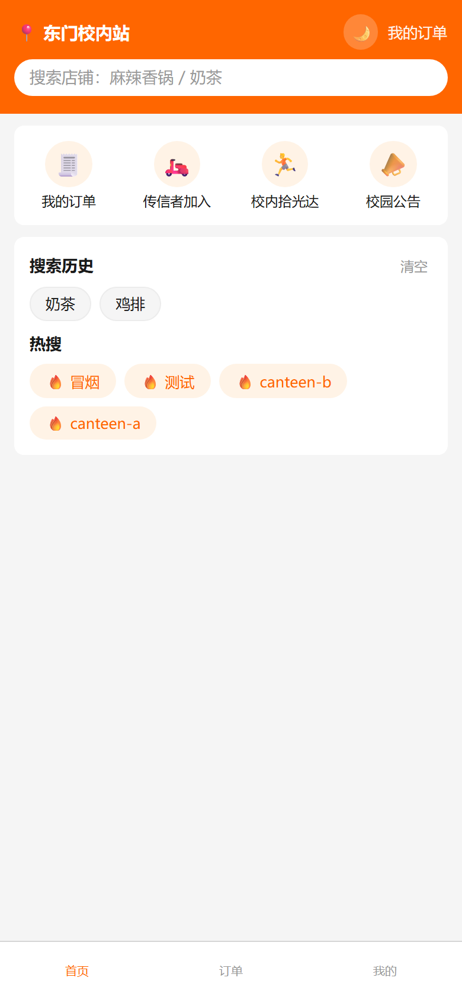

### 7.2 跨店商品搜索

1. 提交关键词后，除店铺过滤外，会并发搜索所有营业中店铺的商品目录（商品名/描述命中，每店最多 6 条、总计上限 24 条）；
2. 结果分「商品 / 店铺」两组：商品行显示主图、商品名、店铺名与价格；
3. 点商品行进入对应店铺菜单，并带 `q=` 关键词，商品区顶部显示「搜索：关键词」chip，可点 ✕ 恢复全量；
4. 无商品且无店铺命中时，展示「热销店铺推荐」（按月售取前 4）。

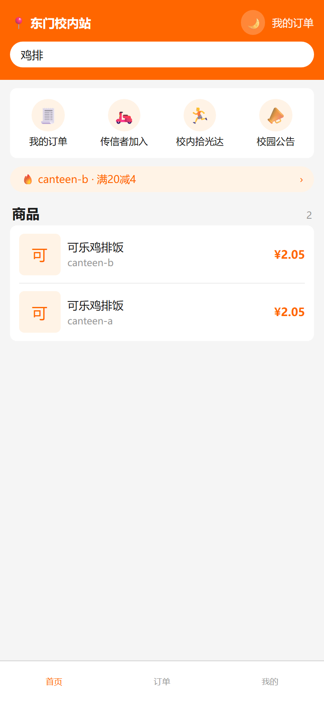
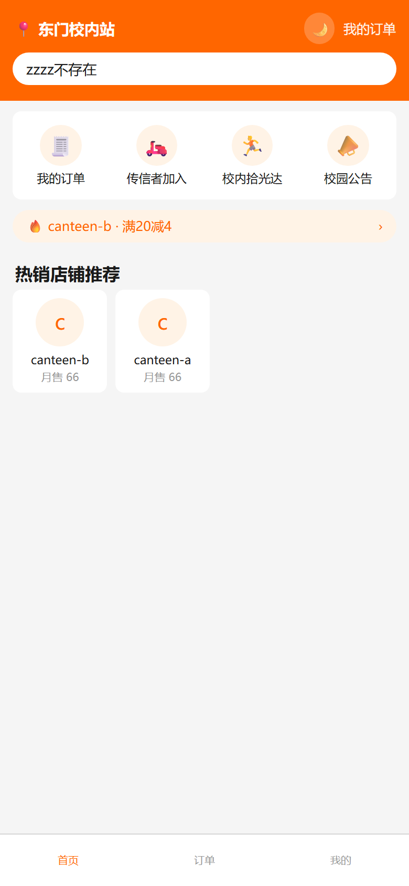

## 8. 商品收藏与常买商品

### 8.1 商品收藏

1. 店铺菜单商品行右上角 ♡ / ♥：任一规格已收藏即显示实心；
2. 点 ♡ 收藏（记录代表规格）、点 ♥ 取消该商品全部已收藏规格，均有 toast；
3. 首页「收藏商品」横排（最多 8 个）展示本机/云端收藏商品，点一下进店并定位该商品；
4. 登录用户云端保存（表 `campus_favorite_variant`），游客仅存本机；登录后云端为空时会把本机收藏补写。

### 8.2 常买商品

1. 下单成功后自动记录本单商品（最多 8 条，按商品去重前置）；
2. 首页「常买商品」横排展示图片、名称、价格、店铺名；
3. 点一下进店并自动加购 1 件，提示「已加购」；商品下架/不可售时提示「加购失败」。

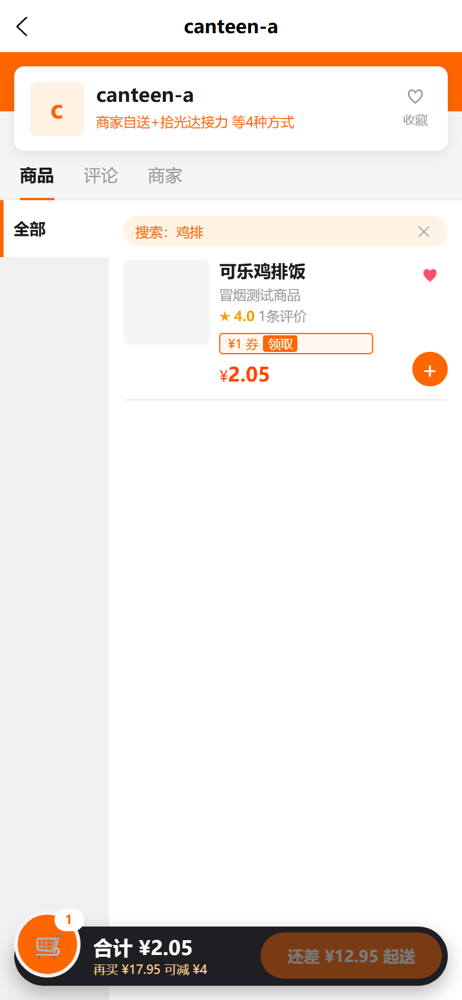
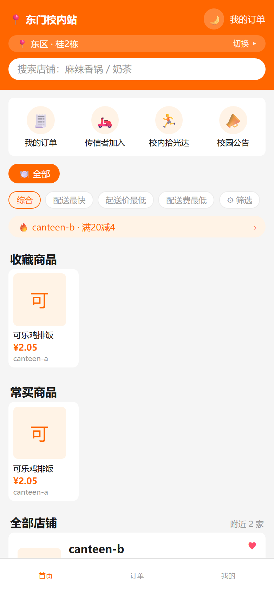

## 9. 订单中心增强

1. 顶部搜索框：本地过滤已加载订单，支持订单号、店铺名、商品名（不额外请求）；
2. 售后聚合条：登录后拉取售后单，「售后处理中 N 单」>0 时展示；点一下只看有售后的订单，再点恢复全部；
3. 订单卡标记：`售后处理中` / `已退款` / `配送异常`，点售后标记直达售后详情；
4. 订单卡展示「送达时段：…」（预约单）；
5. 同一订单同时出现在平台与店铺渠道结果时自动去重，并优先显示店铺名。

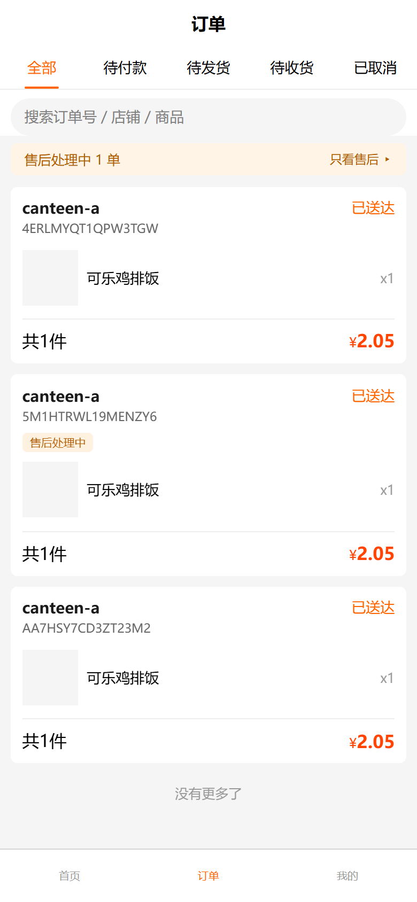

> 说明：测试账号当前无真实售后单，该截图内的「售后处理中 1 单」为截图脚本模拟接口返回，仅用于验证聚合条/标记 UI；正式环境按真实 `myAfterSalesRequests` 数据显示。

## 10. 结算体验补强

### 10.1 起送价硬拦截

1. 结算页商品额 < 起送价时，合计区显示红色「还差 ¥D 起送」；
2. 点「提交订单」弹出「还差一点就起送」，可选「去加购」（返回上一页）或「再想想」（留在本页），**不会提交订单**；
3. 后端 `campusMinOrderProcess` 同口径兜底，绕过前端也无法提交；
4. 店铺菜单购物车栏在未达起送价时按钮显示「还差 ¥D 起送」并置灰，点了只提示。

### 10.2 满减凑单提示

1. 解析店铺 `promoText`（如「满20减4」「满 30 元减 5 元」）；
2. 未达门槛：结算页合计区与店铺购物车栏提示「再买 ¥D 可减 ¥Y」；
3. 已达门槛：提示「已满 ¥T 减 ¥Y」。

### 10.3 首页配送楼栋快捷切换

1. 结算页保存配送目标后，本机记录 `delivery_target`；首页头部显示「📍 分区 · 楼栋」；
2. 点「切换」打开底部弹层：选分区 → 选楼栋 → 保存；优先使用结算页缓存的楼栋数据，缺失时回退渠道接口；
3. 结算页再次进入时优先预选本机最近的楼栋（须属于当前店铺），其次默认校园地址，最后第一分区/首楼。

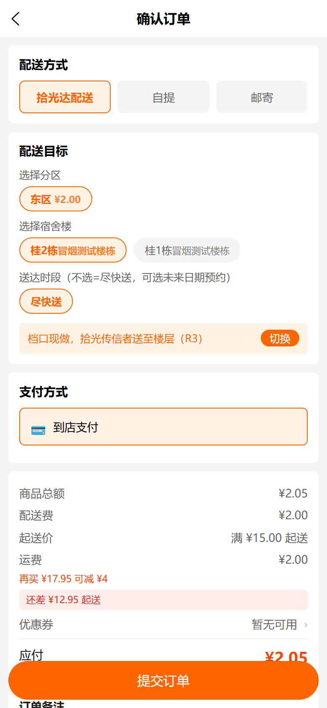
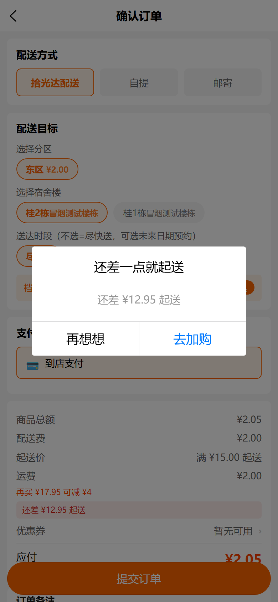
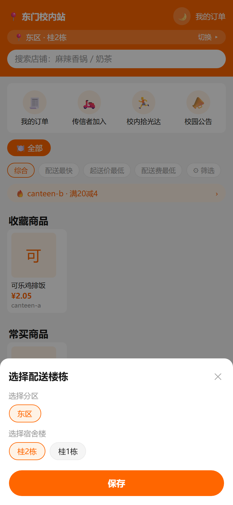

## 11. 数据与接口（第二轮）

| 项 | 说明 |
|---|---|
| 商品收藏表 | `campus_favorite_variant`（`customerId + variantId` 唯一，另存 `channelId` 便于分组） |
| 查询 `campusFavoriteVariants` | 返回 `[{ variantId, channelId }]`（收藏时间升序）；未登录 `NOT_LOGGED_IN` |
| 变更 `campusToggleFavoriteVariant(variantId, channelId)` | 已收藏则取消，未收藏则收藏；校验渠道/商品存在，返回最新完整列表 |
| 前端本地键 | `search_history`（≤10）、`favorite_variants`（含展示元数据）、`recent_items`（≤8）、`delivery_target`、`delivery_target_options` |
| 商品搜索 | 店铺 token 并发 `fetchProductListForChannel` + `Promise.allSettled`，单店失败静默跳过 |
| 满减解析 | `src/utils/promo.ts`，正则 `满\s*X\s*元?\s*减\s*Y\s*元?`，多档按门槛升序 |
| 常买商品写入 | 支付成功跳转前遍历订单行写本机（含 `channelId/channelToken/storeName`） |

## 12. 验收记录（第二轮，2026-10-21）

| 项 | 结果 |
|---|---|
| 插件编译 / vitest | 通过 |
| 未登录 `campusFavoriteVariants` | `FORBIDDEN`（未授权，符合预期） |
| 登录态 toggle（variant 87 / channel 113） | `[{87,113}]` → 再 toggle 返回 `[]`，幂等翻转正常，测试数据已清理 |
| 非法 variant | `VARIANT_NOT_FOUND` |
| 搜索面板 | 历史 2 条、热搜 4 个正常展示 |
| 跨店商品搜索「鸡排」 | 命中 2 家店各 1 条（canteen-a / canteen-b） |
| 无结果搜索 | 0 商品 + 热销店铺 2 家推荐 |
| 收藏/常买横排 | 各 1 条展示，名称与价格正确 |
| 店铺菜单 | `搜索：鸡排` chip、商品心标 1 个、购物车「再买 ¥17.95 可减 ¥4」 |
| 订单中心 | 搜索框正常；模拟售后 1 单聚合条正常；3 单（去重后）展示正常 |
| 结算拦截 | 「还差 ¥12.95 起送」提示 + 弹窗「再想想 / 去加购」，不提交 |
| 满减提示 | 「再买 ¥17.95 可减 ¥4」结算页与菜单一致 |
| 楼栋切换 | 首页显示「东区 · 桂2栋」，弹层分区/楼栋选中正确 |
| 手机视口截图 | 390×844 dpr=2，共 9 张（见上） |
| 测试数据清理 | 测试账号购物车与临时商品收藏已清理 |

## 13. 边界与已知限制（第二轮）

- 商品搜索按店铺逐个拉取整店商品，店铺较多时请求数随之增加；当前单校区店铺规模（2 家）体验良好，后续可后端化统一检索。
- 搜索结果为纯前端过滤，不含拼写纠错/同义词。
- 热搜词由店铺标签与店名生成，非真实搜索热度统计。
- 收藏商品云端只存 `variantId/channelId`，展示元数据（名称/图/价）存本机；换设备后首次进入首页会按渠道商品目录回填（商品下架则显示占位）。
- 常买商品为纯本机记录，换设备不同步。
- 满减提示仅解析 `promoText` 文本，实际优惠仍以平台优惠券/活动计算为准。
- 首页楼栋切换仅写本机偏好；实际下单仍以结算页所选分区/楼栋为准。

---

# 第三轮常用功能（售罄库存 / 领券入口 / 餐具发票 / 待评价与状态刷新）

> 上线日期：2026-10-21（第三轮）
> 截图脚本：`node .secrets/common-features-v3-shots.cjs`（Playwright 390×844 dpr=2，输出 `docs/screenshots/common-features-v3/`）
> 后端变更：Order customField 新增 `tablewareCount`（int，可空）

## 14. 商品售罄 / 库存展示

1. 店铺菜单商品行按 `stockLevel` 展示状态：
   - `OUT_OF_STOCK`（所有规格均售罄）：整行置灰，价格旁显示「售罄」标签，右侧 `+` 置灰；
   - `LOW_STOCK`（存在低库存规格）：显示「仅剩少量」标签，仍可正常加购；
   - `null`（不跟踪库存）/ `IN_STOCK`：不展示标签。
2. 售罄商品点 `+` 只提示「该商品已售罄」，不打开规格弹层、不写入购物车；`addToCart` 内部亦做不可售守卫，防止并发/缓存导致误加。
3. 规格弹层（SkuSheet）同步兼容枚举库存：
   - 售罄规格不可选、按钮禁用，库存文案显示「暂无库存」；
   - 低库存显示「仅剩少量」；数字库存显示「库存 N」，不再出现 `NaN`。

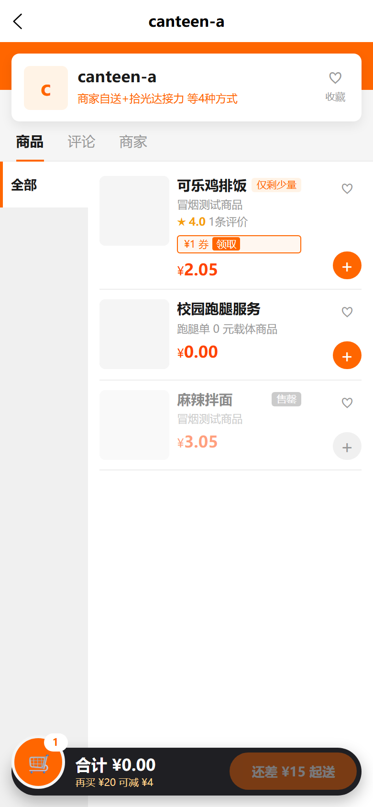

> 说明：测试校区当前商品均为 `IN_STOCK`，截图中「仅剩少量 / 售罄」为截图脚本对接口返回的 `stockLevel` 注入枚举值，用于验证 UI 分支；真实库存由商家后台设置。

## 15. 领券中心入口 + 券角标

1. 首页快捷区新增「领券中心」（🎟️），点击进入 `/pkg-promotion/pages/coupon-centre`；
2. 个人中心资产区新增「领券中心」入口，与「优惠券（我的券包）」并列；
3. 首页入口右上角显示未使用券数量角标（登录态 `myCoupons(status: UNUSED)`，>99 显示 `99+`）；未登录不请求、不显示，请求失败静默置 0，不阻塞店铺列表加载；
4. 首页每次 `onShow`（切回 tab / 从领券中心返回）刷新角标。

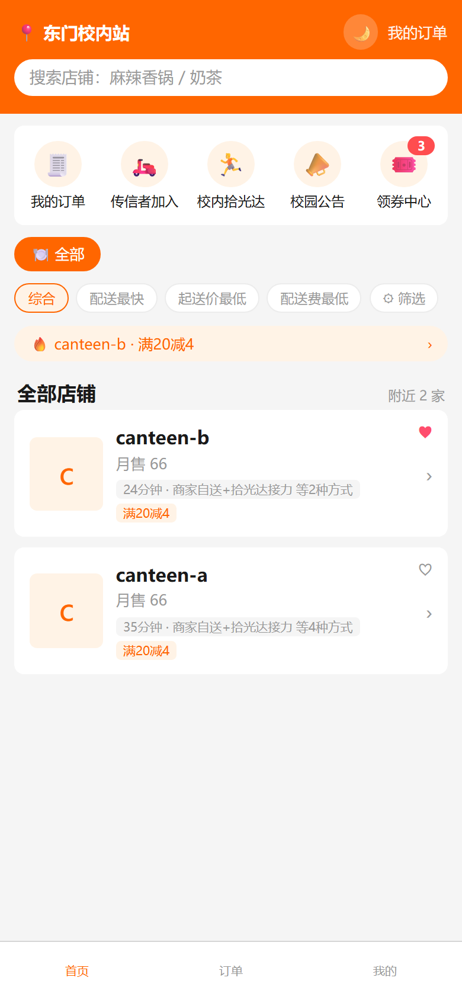
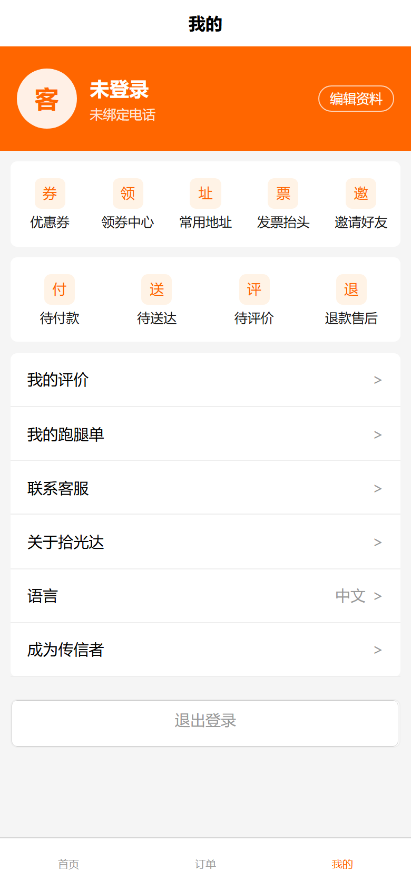

> 说明：测试账号当前未使用券为 0，截图中角标「3」为脚本模拟券数量，用于验证角标样式与位置；真实数量按接口返回。

## 16. 结算页餐具份数 + 发票抬头

### 16.1 餐具份数

1. 结算页「订单备注」下方新增「餐具份数」卡片：无需餐具 / 1–5 份，默认「无需餐具」；
2. 选中项高亮，随订单写入 `Order.customFields.tablewareCount`（int，0=无需餐具）；
3. 商家工作台/小票可按该字段配餐。

### 16.2 发票抬头

1. 「发票」行显示当前选择（默认「不开发票」）；点击打开底部弹层单选；
2. 抬头数据来自顾客 `customFields.invoiceTitles`（与「我的-发票抬头」同一数据源）；
3. 无抬头时点击发票行：提示「暂无发票抬头，请先到「我的-发票抬头」添加」并跳转发票抬头管理页（弹层内不嵌新增表单）；
4. 提交订单前写入：
   - 未选抬头：`invoiceApplied=false, invoiceInfo=null`；
   - 已选抬头：`invoiceApplied=true, invoiceInfo={"titleName","titleType","taxNo","email","appliedAt"}`；
5. 写入与备注、餐具份数在同一次 `setOrderCustomFields` 中完成，位于 `transitionOrderToState(ArrangingPayment)` 之前。

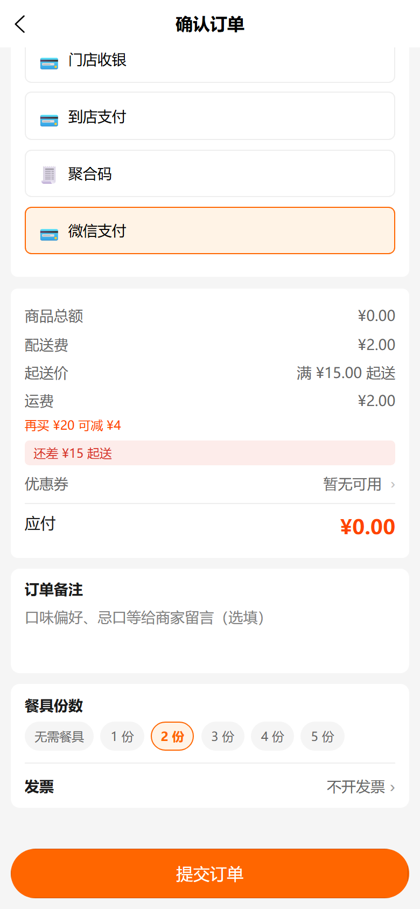
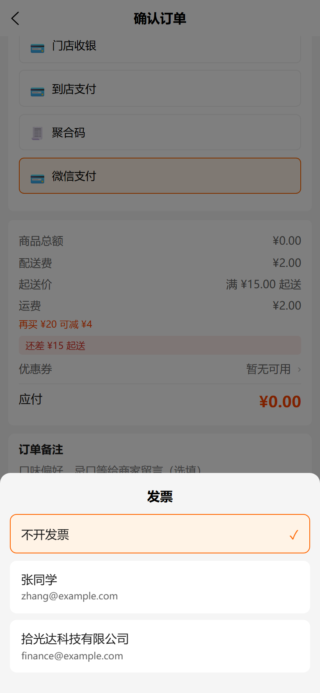
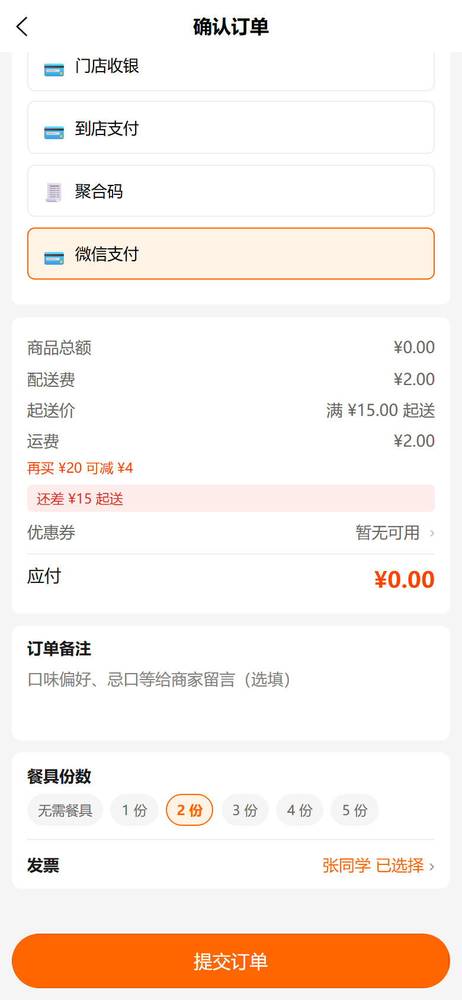

> 说明：测试账号当前无发票抬头，抬头列表为截图脚本注入的模拟数据；接口写入能力已用真实 `setOrderCustomFields` 回归（见 §18）。

## 17. 订单待评价提醒 + 状态自动刷新

### 17.1 待评价聚合

1. 登录后订单页拉取 `myReviews` 构建「已评价 orderLineId 集合」（剔除 deleted）；
2. 已送达（`state=Delivered`）且仍有未评价商品行的订单计入「待评价 N 单」；
3. 顶部绿色聚合条「待评价 N 单 / 只看待评价」：点击只看待评价订单，切换时自动关闭售后筛选（两筛选互斥）；
4. 订单卡底部显示「去评价」按钮，取第一条未评价商品行跳评价页（带 productId/lineId/variantId/名称/图片）；
5. 从评价页返回（`onShow`）重新拉取评价集合，已评价订单按钮即时消失。

### 17.2 状态自动刷新

1. 订单页 `onShow` 启动 30 秒轮询，`onHide/onUnload` 停止；
2. 每轮对各店铺渠道拉取最近 10 单（不带 tab 过滤），仅同步本地订单 `state`，不触发 loading、不改变分页游标；
3. 检测到状态变化时提示「订单状态已更新」（同一轮多次变化只提示一次）；请求失败静默。

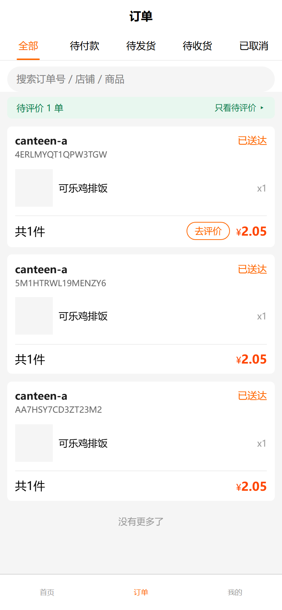
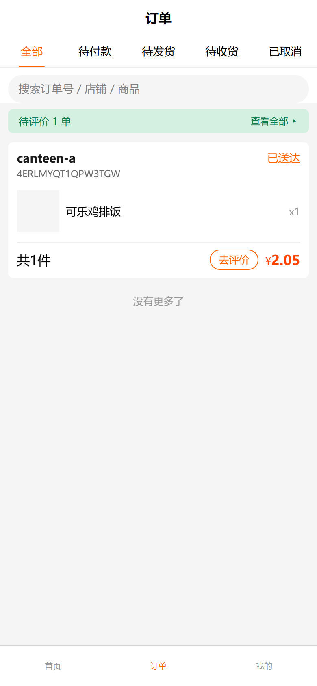

> 说明：测试账号当前无已送达订单，截图脚本将首单 `state` 模拟为 `Delivered` 以验证聚合条/按钮；真实判定按订单状态与评价记录。

## 18. 验收记录（第三轮，2026-10-21）

| 项 | 结果 |
|---|---|
| 后端插件 `pnpm build` | 通过，`lib` 产物已提交 |
| `tablewareCount` 字段上线 | shop-api introspection `OrderCustomFields` 已含 `tablewareCount: Int` |
| `setOrderCustomFields` 写入 | 真实写入 `note/tablewareCount=2/invoiceApplied=true/invoiceInfo` 成功，随后重置为 `null/0/false/null` |
| 商品售罄 UI | 注入 `OUT_OF_STOCK` 后整行置灰、标签「售罄」、`+` 禁用；`LOW_STOCK` 显示「仅剩少量」 |
| 首页领券入口 + 角标 | 快捷区 5 项均分不溢出，角标「3」显示在右上角 |
| 个人中心入口 | 资产区 5 项：优惠券 / 领券中心 / 常用地址 / 发票抬头 / 邀请好友 |
| 结算餐具 | 选「2 份」高亮，默认「无需餐具」 |
| 结算发票 | 弹层含「不开发票 + 2 条抬头」，选中回显「张同学 已选择」 |
| 订单待评价 | 聚合条「待评价 1 单」，首单出现「去评价」；点击后仅剩 1 单 |
| 前端构建/部署 | `pnpm build:h5` 通过（产物 2546 KB），线上入口已更新 |
| 测试数据清理 | 测试账号购物车已清空，`tablewareCount/invoice*` 已重置 |
| 手机视口截图 | 390×844 dpr=2，共 8 张（见上） |

## 19. 边界与已知限制（第三轮）

- 售罄判定以 `stockLevel` 枚举为主，商城未启用库存跟踪（`null`）时无法区分售罄，需商家自行下架商品。
- 售罄商品的「已加购」历史行不会被自动移除，提交时由后端库存校验拦截。
- 发票仅记录抬头快照，不生成/上传 PDF，开票流程仍走商家侧（订单 `invoiceApplied` 后不再重复申请）。
- 餐具份数仅写订单字段，商家工作台打印/展示需另行支持该字段。
- 待评价判定依赖 `myReviews` 全量返回；评价量很大时后续改为后端分页/按订单查询。
- 订单状态轮询为 30 秒固定间隔，仅在订单页可见时运行；退到后台即停止，不消耗流量。
- 「去评价」每次跳转第一条未评价商品行，一单多商品需多次进入评价页。

## 20. 运维记录（2026-10-21）

- 现象：线上 `shop-api` 返回 502，首页正常但接口不可用。
- 根因：`/home/admin/.pm2/logs/vendure-out.log` 增长至 13G，磁盘使用率 100%，PostgreSQL 容器 `could not write lock file postmaster.pid: No space left on device` 后崩溃重启循环，pm2 进程列表同时丢失。
- 处置：
  1. 截断 `vendure-out.log` / `strapi-out.log`（释放 13G），`journalctl --vacuum-size=500M` 再释放 1.8G；
  2. 重启 PostgreSQL 容器，`pm2 resurrect` 恢复 `vendure / nshop / strapi` 三个进程；
  3. 安装并配置 `pm2-logrotate`（`max_size=100M`、`retain=5`、`compress=true`、每日轮转），防止日志再次撑满磁盘。
- 验证：`shop-api` 恢复 200；`activeChannel` 正常返回；磁盘占用回落至 62%。
- 说明：13G 日志源自历史上某次以 `SQL_LOG=1` 启动的进程（TypeORM query 日志），当前进程环境无 `SQL_LOG`，重启后不再刷查询日志。

---

# 第四轮常用功能（商品排序 / 搜索联想 / 营业时间公告 / 订单统计与临期券）

> 上线日期：2026-10-21（第四轮）
> 截图脚本：`node .secrets/common-features-v4-shots.cjs`（Playwright 390×844 dpr=2，输出 `docs/screenshots/common-features-v4/`）
> 后端变更：`Channel.customFields.waimaiBusinessHours`（string）、`Product.customFields.waimaiMonthlySales`（int）；`waimaiStoreList` 透出 `businessHours`

## 21. 店铺菜单商品排序 + 售罄置底

1. 店铺菜单「商品」Tab 顶部新增排序 chips：`综合 / 销量 / 价格 ↑↓`，默认综合（保持后台排序）；
2. **销量**：按 `Product.customFields.waimaiMonthlySales` 降序，未配置按 0 处理；
3. **价格**：取该商品可售规格的最低 `priceWithTax` 升序；再次点击价格切换为降序（箭头同步 `↑ / ↓`）；
4. **售罄恒置底**：所有排序模式下，售罄商品（`stockLevel=OUT_OF_STOCK`）一律排在可售商品之后，且组内仍按当前排序键排序；
5. 首次触发排序且存在售罄商品时，Toast 提示「售罄商品已置底」；
6. 排序为纯本地内存计算，不重新请求接口、不打断滚动位置。

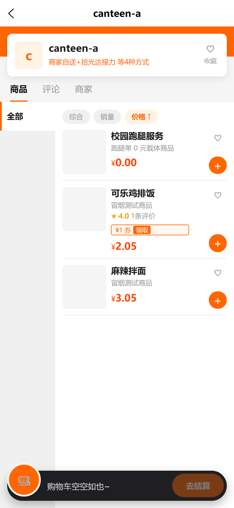

> 说明：`waimaiMonthlySales` 由商家后台（渠道商品 customFields）维护，测试环境已配置 328 / 156 / 12 用于演示。

## 22. 首页搜索联想

1. 搜索框聚焦且已输入关键词时，在原历史/热搜面板位置展示**联想面板**（两者互斥，不会重叠）；
2. 分组规则（均为本地计算，不发请求）：
   - **店铺**：店铺名包含关键词的店铺（最多 4 条），右侧展示配送时长 / 起送价等 meta；
   - **历史**：本地搜索历史中包含关键词的词条（最多 3 条）；
   - **热搜**：本地热搜词中包含关键词的词条（最多 3 条）；
3. 点击任意联想行即用该词直接提交搜索；
4. 无任何匹配时不展示空面板，保持原有店铺列表；
5. 清空输入或失焦后恢复历史/热搜面板与正常列表。

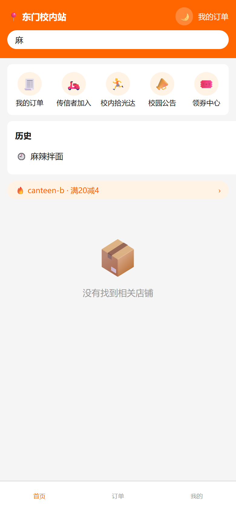

## 23. 店铺营业时间 + 店铺公告

1. 营业时间由渠道配置下发：`Channel.customFields.waimaiBusinessHours` → `waimaiStoreList.businessHours`；
2. 店铺菜单「商家」Tab 展示动态营业时间，未配置时回退文案 `10:00–22:00`（不再是硬编码唯一值）；
3. 店铺公告沿用 `campus_fulfillment_config.storeNotice`，仅在有值时展示「📣 店铺公告」行；
4. 演示数据：`canteen-a` = `10:00-22:00`，`canteen-b` = `11:00-21:30`。

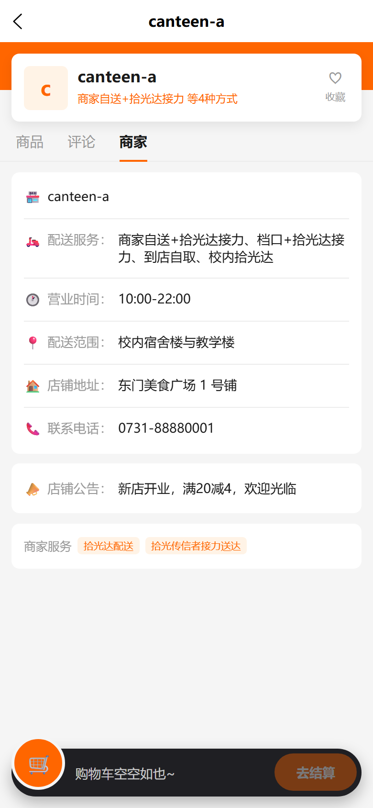

## 24. 个人中心订单统计 + 券临期提醒

### 24.1 个人中心订单角标

1. 「我的」订单快捷区（待付款 / 待送达 / 待评价）右上角显示未处理订单数，>99 显示 `99+`；
2. 统计口径与订单入口 Tab 一致：
   - 待付款：`ArrangingPayment`；
   - 待送达：`PaymentAuthorized` / `PaymentSettled`（与入口 Tab 过滤条件相同）；
   - 待评价：`Delivered` 且存在未评价订单行（剔除已删除评价）；
3. 跨渠道聚合：按 `waimaiStoreList` 的渠道 token 逐店拉取最近 20 单，按订单 id 去重；单店失败不影响其他店，整体失败静默置 0；
4. 每次 `onShow` 刷新，未登录不请求、不展示角标。

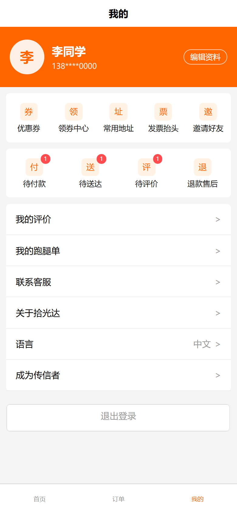

### 24.2 首页临期券提示 + 券包临期标记

1. 首页在优惠横幅下方新增「⏰ N 张券即将过期」提示条（3 天内到期的未使用券），点击直达「我的优惠券」；
2. 数量与首页「领券中心」角标复用同一份 `myCoupons(status: UNUSED)` 数据，避免重复请求；
3. 券包「未使用」Tab 按 `expiredAt` 升序排列（无到期时间排最后）；
4. 3 天内到期的券卡片右上角显示「即将过期」角标。

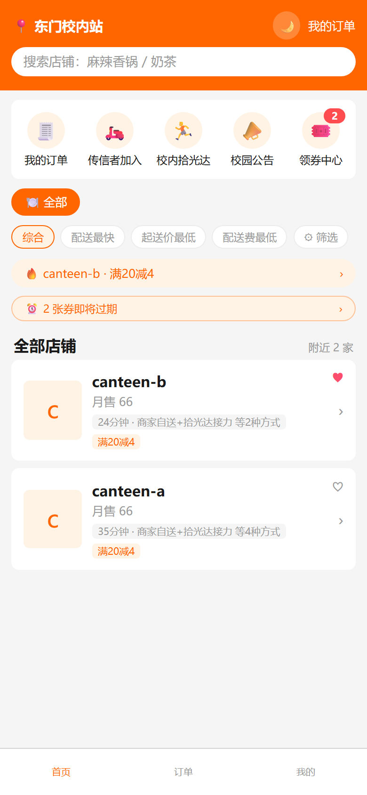
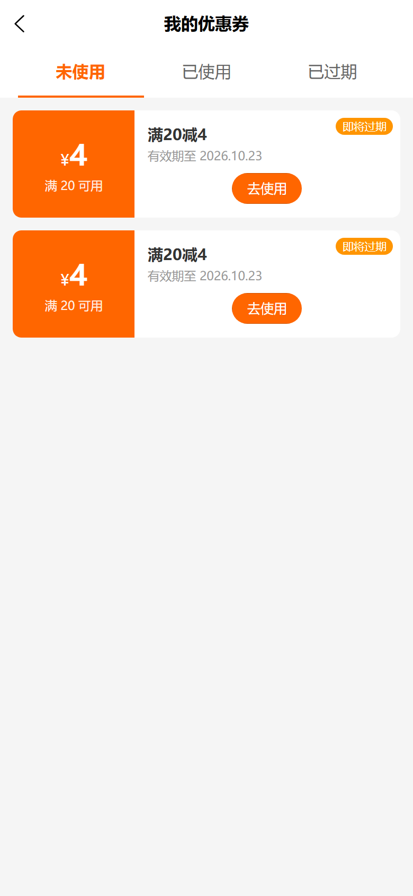

## 25. 验收记录（第四轮，2026-10-21）

| 项 | 结果 |
|---|---|
| 后端插件 `pnpm build` | 通过，提交 `6fdf5c1f2`（字段 + 透出）、`401619c91`（Product customFields 合并修复） |
| `waimaiStoreList.businessHours` | 线上返回 `canteen-a=10:00-22:00`、`canteen-b=11:00-21:30` |
| `Product.customFields.waimaiMonthlySales` | introspection 可见，线上商品查询返回 `null`（未配置商品）不报错 |
| 菜单排序 | chips `综合 / 销量 / 价格 ↑` 均展示；点价格后商品顺序变化（¥0.00 → ¥2.05 → ¥3.05） |
| 售罄置底 | 逻辑内置（当前测试商品无售罄，售罄分支由 `OUT_OF_STOCK` 判定） |
| 搜索联想 | 输入「麻」后面板展开，分组「历史」含「麻辣拌面」，点击可搜索 |
| 营业时间/公告 | 商家 Tab 显示 `10:00-22:00`，公告「新店开业，满20减4，欢迎光临」 |
| 个人中心角标 | 待付款 1 / 待送达 1 / 待评价 1 |
| 首页临期券 | 提示条「2 张券即将过期」，领券中心角标 2 |
| 券包临期 | 「即将过期」2 张，按到期时间升序 |
| 前端构建/部署 | `pnpm build:h5` 通过，产物校验 2556 KB，线上入口 `index-DcL6Ph0B.js` 已更新 |
| 线上回归 | 首页 200；`assets/index-BqSorris.js`、`pages-shop-menu.CaOE8lIz.js`、`waimai.BZrkQLRO.js` 均含新功能代码 |
| 数据修正 | 演示店铺公告/地址/电话由测试乱码改为正式文案（仅演示渠道 113/114） |
| 手机视口截图 | 390×844 dpr=2，共 6 张（见上） |

## 26. 边界与已知限制（第四轮）

- `waimaiMonthlySales` 为手工维护的静态月销，不随订单实时累加；如需实时销量需在订单完成后回写商品字段。
- 排序仅作用于当前已加载的商品列表（单店商品量为单页全量），不做服务端分页排序。
- 搜索联想为本地匹配，依赖已加载的店铺列表与本地历史/热搜；未加载的店铺不会出现在联想中。
- 营业时间为单段字符串展示，不解析多时段（如午市/晚市分开），也不参与「营业中/休息中」判定（该判定沿用原配置）。
- 订单角标最多统计各渠道最近 20 单，历史积压的未付款旧单可能不计入。
- 临期券阈值固定 3 天，暂未做成后台可配。


---

# 第五轮常用功能（商品详情 / 订单进度与费用 / 分享 / 凑单推荐）

> 上线日期：2026-10-21（第五轮）
> 截图脚本：`node .secrets/common-features-v5-shots.cjs`（Playwright 390×844 dpr=2，输出 `docs/screenshots/common-features-v5/`）
> 前端改动文件：`src/components/SkuSheet.vue`、`src/pages/shop/menu.vue`、`src/pkg-order/pages/order-detail.vue`、`src/utils/share.ts`（新增）、`src/locale/zh-Hans.json`、`src/locale/en.json`
> 无后端改动（复用现有 shop-api 字段）

## 27. 商品详情弹层

1. 店铺菜单点击任意商品（单规格 / 多规格一致）先打开详情弹层，不再直接加购；
2. 弹层内容：
   - 左上商品主图（200rpx）、商品名；
   - 标签行：评分 `★ 4.0`、评价数、`月售 328`（无数据自动隐藏）；
   - 价格（当前规格）、库存/售罄状态、已选提示；
   - **商品详情**：`description` 纯文本化展示（剥离 HTML 标签，避免富文本注入）；
   - 规格分组、数量加减、底部「加入购物车 / 立即购买」；
3. 右上角 `↗` 分享商品、`✕` 关闭；
4. 售罄商品点击仍走原「已售罄」Toast，不打开弹层。

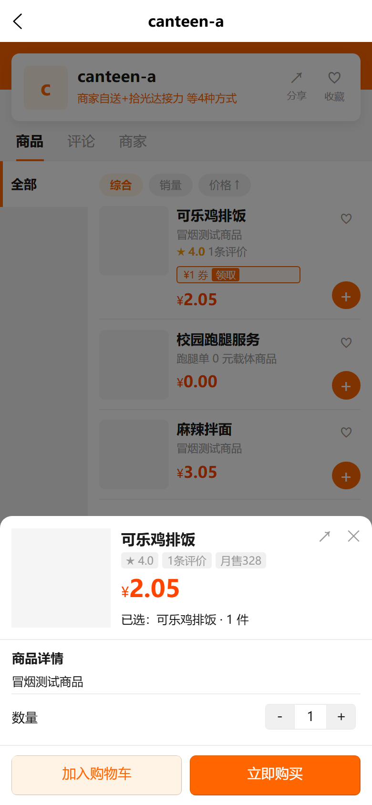

## 28. 订单详情增强：订单进度 + 费用明细

### 28.1 订单进度时间轴（非校园路线订单）

- 四步节点：`提交订单 → 支付成功 → 商家备餐 / 配送中 → 已送达`；
- 推导规则：
  - 提交订单：始终完成，时间取 `createdAt`；
  - 支付成功：`PaymentAuthorized / PaymentSettled / Shipped / PartiallyDelivered / Delivered / Completed`，时间取首笔支付 `payments[0].createdAt`；
  - 配送中：上述状态或 `customFields.deliveryStatus ∈ {assigned, in_progress, delivered}`；
  - 已送达：`Delivered / PartiallyDelivered / Completed` 或 `deliveryStatus = delivered`；
- 已取消 / 修改中订单改为两步：`提交订单 → 订单已取消`；
- 校园路线订单（`campusRoute` 有值）继续使用原有校园 R2 时间轴，不重复展示。

### 28.2 费用明细

- 商品总额、配送费（0 元显示「免配送费」）；
- **逐条优惠**：`order.discounts[]` 按 `description` 展示（如「满20减4」），金额右对齐绿色；
- 实付金额（`totalWithTax`）；
- 底部「共优惠 ¥4.00」（优惠合计 > 0 时展示）；
- 保留原优惠券码、订单编号、下单时间、支付方式。

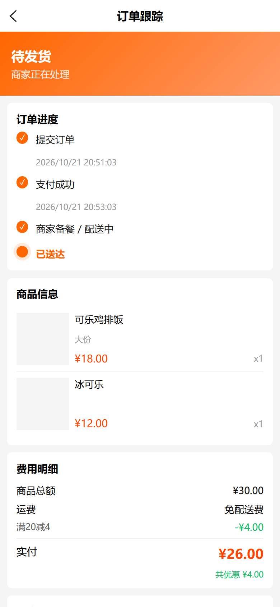
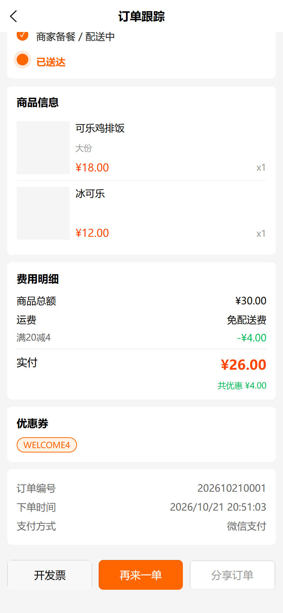

## 29. 分享店铺 / 商品 / 订单

1. 新增 `src/utils/share.ts`：
   - `absoluteUrl(path)`：站内路由 → 当前站点绝对地址（hash 路由，兼容子路径部署）；
   - `sharePage({title, desc, path, image})`：微信内调用 JS-SDK（`updateAppMessageShareData` / `updateTimelineShareData`，旧版 API 兜底）；非微信环境复制链接并提示「链接已复制」；返回实际渠道 `wechat | copy`；
2. 店铺菜单店铺卡片新增 `↗ 分享`（与收藏并排）：分享标题=店铺名，链接带 `token/name/routes/cid`，好友打开直达该店；
3. 商品详情弹层右上 `↗`：分享标题=商品名，描述=「来自 XX 的推荐」，直达店铺；
4. 订单详情底部「分享订单」：标题=「我的外卖订单 {code}」，链接直达订单详情；
5. JS-SDK 签名失败（非公众号域名/未授权）自动降级为复制链接，不阻断交互。

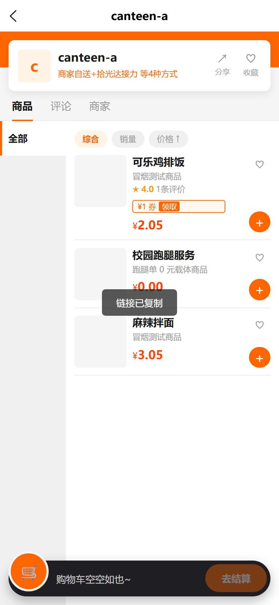

## 30. 凑单推荐

1. 触发条件（购物车非空且满足其一）：
   - 未达起送价：`cartTotal < minOrderAmount`，优先展示「还差 ¥X 起送」；
   - 已达起送但未满足下一档满减：解析店铺 `promoText`，展示「还差 ¥X 可减 ¥Y」；
2. 位置：店铺页底部购物车条上方悬浮卡片，标题「凑单推荐」+ 右侧差额提示；
3. 推荐商品：当前已加载商品中，可售且价格 > 0，取最低价规格、排除已在购物车的商品、按价格升序取前 8 个；
4. 点击卡片即加购 1 件并 Toast「已加入购物车」，差额实时重算；达成门槛后卡片自动消失；
5. 购物车为空或无门槛时不展示。

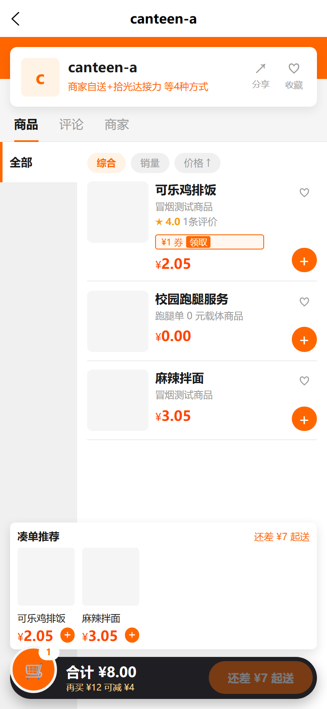

## 31. 验收记录与边界（第五轮，2026-10-21）

| 项 | 结果 |
|---|---|
| 商品详情弹层 | 名称「可乐鸡排饭」，标签 `★ 4.0` / `1条评价` / `月售328`，详情「冒烟测试商品」，分享按钮存在 |
| 订单进度 | 四步齐全「提交订单/支付成功/商家备餐·配送中/已送达」，时间正常 |
| 费用明细 | 商品 ¥30.00、免配送费、满20减4 -¥4.00、实付 ¥26.00、共优惠 ¥4.00 |
| 凑单推荐 | 模拟购物车 ¥8（起送 ¥15）→ 提示「还差 ¥7 起送」，推荐可乐鸡排饭 / 麻辣拌面 |
| 分享 | 分享按钮存在，非微信环境弹出「链接已复制」 |
| i18n | `zh-Hans.json` / `en.json` 均补齐新增词条并通过 JSON 校验 |
| 前端构建/部署 | `pnpm build:h5` 通过，产物校验 2569 KB，已部署 |
| 手机视口截图 | 390×844 dpr=2，共 5 张（07–11） |

边界与已知限制：
- 商品详情描述为纯文本（后端为 HTML 描述），图片详情/富文本图文暂不渲染；
- 订单进度时间轴基于订单状态推导，未接入骑手实时轨迹（校园路线订单另有跟踪页）；
- 分享在非微信环境走复制链接；微信内卡片需公众号 JS 安全域名与签名服务可用；
- 凑单推荐只从当前店铺已加载商品中挑选，不跨店推荐；满减门槛解析自 `promoText` 文案，非结构化配置；
- 单规格商品也进入详情弹层（原为直接加购），交互多一步，已在手册注明。

---

# 第六轮常用功能（消息中心 / 跨店购物车 / 备注模板 / 收藏管理）

> 上线日期：2026-10-21（第六轮）
> 截图脚本：`node .secrets/common-features-v6-shots.cjs`（Playwright 390×844 dpr=2，输出 `docs/screenshots/common-features-v6/`）
> 新增页面：`src/pkg-user/pages/messages.vue`、`src/pkg-order/pages/cart.vue`、`src/pkg-user/pages/favorites.vue`
> 新增 store：`src/stores/messages.ts`
> 修改文件：`src/pages/home/index.vue`、`src/pages/profile/index.vue`、`src/pkg-order/pages/checkout.vue`、`src/api/queries/order.ts`、`src/api/mutations/cart.ts`、`src/pages.json`、`src/locale/zh-Hans.json`、`src/locale/en.json`、`src/locale/uni-app.zh-Hans.json`、`src/locale/uni-app.en.json`
> 后端：无改动，全部复用现有 shop-api（`waimaiStoreList`、`myOrders`、`myCoupons`、`myReviews`、`activeOrder`、`removeAllOrderLines`）

## 32. 消息通知中心

### 32.1 入口

- 首页右上角铃铛 `🔔`，未读数红色角标（> 99 不截断，最多展示三位）；
- 「我的」页面菜单新增「消息中心」，右侧红色未读数；
- 首页 / 我的页每次 `onShow` 都会刷新消息（不轮询、无推送）。

### 32.2 聚合口径（不新增后端接口）

| 消息类型 | 来源 | 判定条件 | 点击跳转 |
|---|---|---|---|
| 待付款 | 各店铺渠道 `myOrders` | `state = ArrangingPayment` | 订单详情 |
| 配送中 | 同上 | `state ∈ {PaymentAuthorized, PaymentSettled}` | 订单详情 |
| 待评价 | 同上 + `myReviews` | `state = Delivered` 且存在未评价 `orderLine` | 订单详情 |
| 券即将过期 | `myCoupons(UNUSED)` | `expiredAt` 距今 ≤ 3 天且未过期 | 券包（我的券） |

- 订单按**店铺渠道逐个查询**（会话全局 + `vendure-token` 隔离），按订单 `id` 去重；
- 展示顺序按时间倒序（订单取 `updatedAt`，券取 `expiredAt`），最多 50 条；
- 每店取最近 20 单，历史积压的老单可能不出现。

### 32.3 已读管理

- 消息 key：订单 `order-{id}-{state}`、券 `coupon-{id}`；订单状态变化后会生成新 key → 重新变为未读；
- 点击卡片：标记已读 + 跳转；右上「全部已读」一键清空未读；
- 已读 key 存本地 `waimai_msg_read`，不跨设备同步；
- 未登录：空态「登录后查看消息」+ 去登录按钮。

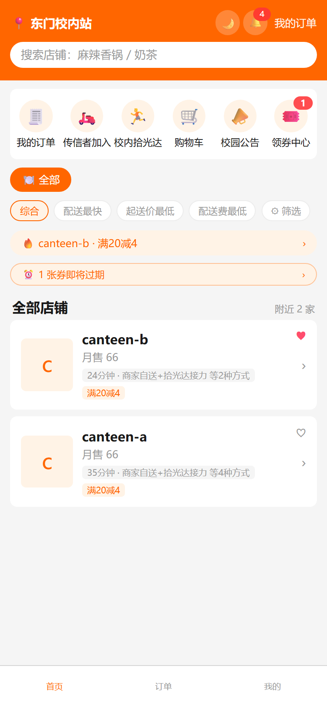
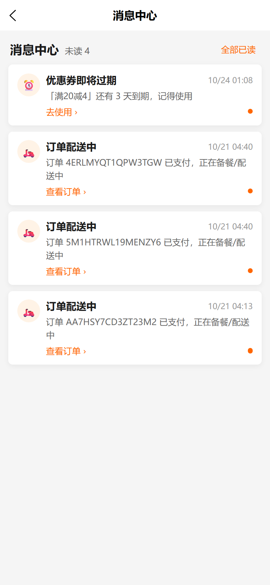

## 33. 跨店购物车管理页

1. 入口：首页快捷区「🛒 购物车」、「我的」菜单「购物车」；
2. 数据口径：Vendure `activeOrder` 按渠道隔离，页面用**独立 GraphQLClient 逐店读取**（`getActiveOrderForChannel`），只展示当前有商品行的店铺；
3. 每张店铺卡片：
   - 店铺头：logo / 店名 / 件数 / 「清空」；
   - 商品行：缩略图、名称、规格、行小计、数量；
   - 底部：商品合计（`subTotalWithTax`）、差额提示（`还差 ¥X 起送` / `已达起送价`）；
4. 操作：
   - 「继续加购」→ 带 `token/name/routes/cid` 回店铺菜单；
   - 「清空」→ 二次确认后调用 `removeAllOrderLinesForChannel`（仅清该店，不影响其他店）；
   - 「去结算」→ 未达起送价 Toast 拦截；达成则 `switchTenant(token)` + `cart.setOrder(order)` 后跳结算页（携带 `routes/minOrder/dfee/cid/shop/token`）；
5. 离开页面自动 `backToDefault()` 恢复站点默认渠道，避免影响订单/个人中心聚合。

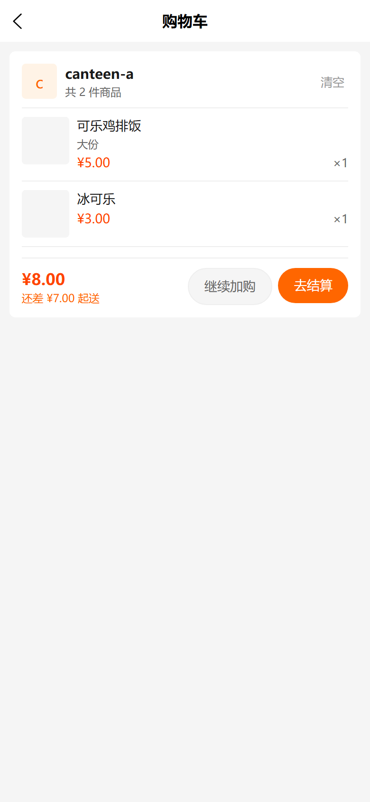

## 34. 订单备注模板

1. 结算页「订单备注」卡片新增常用模板 chips：
   - 内置 5 条：`不要辣 / 少盐 / 不要香菜 / 多放酱 / 不需要餐具`（走 i18n）；
   - 自定义模板：最多 8 条，存本地 `order_note_templates`，与内置文案去重；
2. 交互：
   - 点 chip 追加到备注（多条以「；」拼接），已存在的再点即移除；总长上限 200 字；
   - chip 右侧「+ 添加」打开「常用备注」管理弹层：自定义列表可删除、输入框 + 「添加」、「完成」关闭；
   - 顶部「管理常用」也可打开同一弹层；
3. 兼容：不使用模板时可直接手输，模板为空时输入区不受影响；自定义模板不跨设备同步。

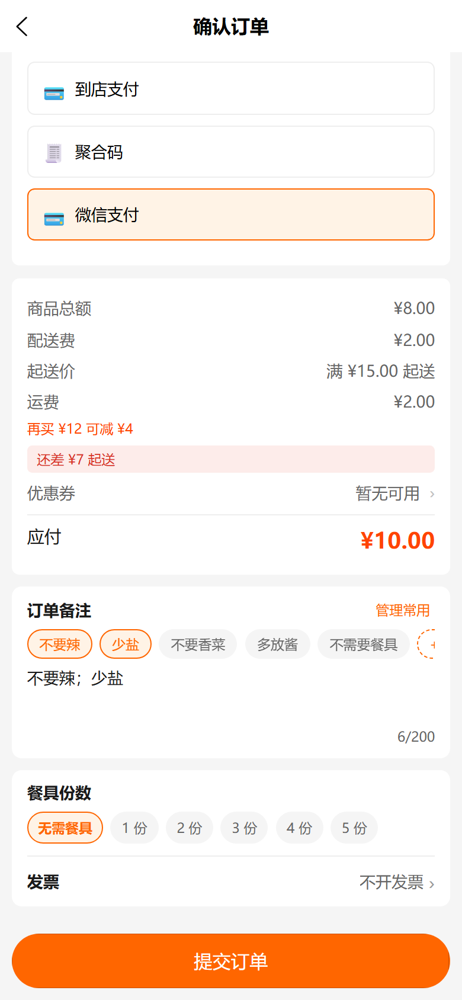
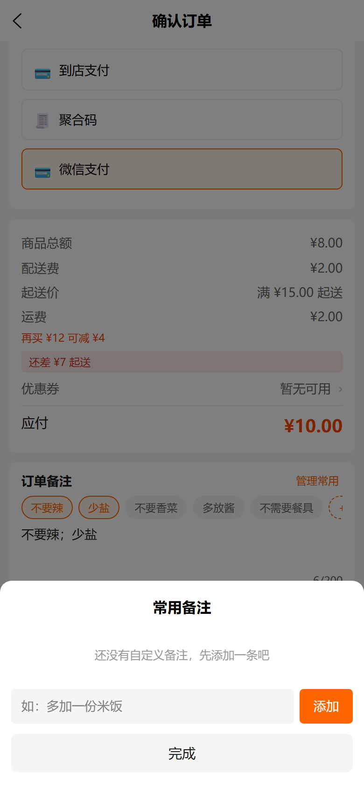

## 35. 收藏管理页

1. 入口：「我的」→「我的收藏」；
2. 两个 tab 带计数：`收藏店铺 N` / `收藏商品 N`；
3. 收藏店铺：
   - 用 `waimaiStoreList` 与本地收藏 `channelId` 取交集，只展示仍在营业列表中的店；
   - 展示店名、营业时间/配送方式（`businessHours` + routes 摘要）、起送价；休息中显示「休息中」；
   - 「取消收藏」即时移除；点击卡片进店；
4. 收藏商品：
   - 两列卡片：名称、店铺名、价格快照；点击进店并带 `&q=商品名` 定位搜索；
   - 「取消收藏」即时移除；空态引导回首页；
5. 数据仍沿用本地 `favorite_stores` / `favorite_variants`，登录后由 `favorites.loadRemote()` 与云端收藏合并。

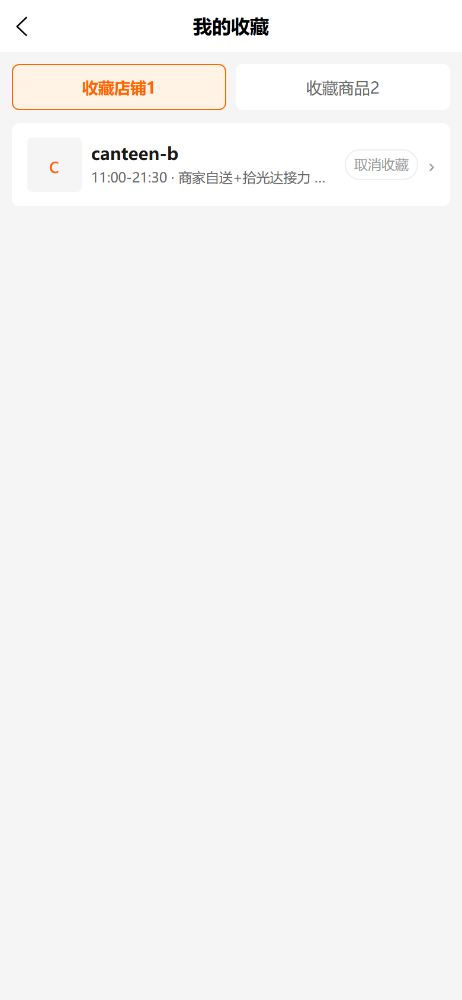
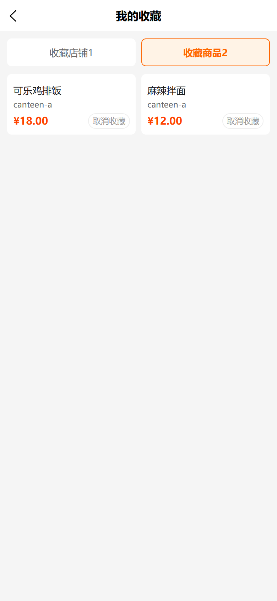

## 36. 验收记录与边界（第六轮，2026-10-21）

| 项 | 结果 |
|---|---|
| 首页入口 | `{"bell":true,"badge":"4","quick":["我的订单","传信者加入","校内拾光达","购物车","校园公告","领券中心"]}` |
| 消息中心 | 4 张卡片（1 张临期券 + 3 张配送中订单），头部「未读 4」；点击/全部已读逻辑正常 |
| 跨店购物车 | `{"cards":1,"store":"canteen-a","lines":["可乐鸡排饭","冰可乐"],"gap":"还差 ¥7.00 起送","total":"¥8.00"}` |
| 备注模板 | chips = 内置 5 条 + `+ 添加`；点选后 `active=["不要辣","少盐"]`、备注「不要辣；少盐」、字数 6/200 |
| 备注管理弹层 | `{"open":true,"title":"常用备注"}`，空态文案「还没有自定义备注」+ 输入框 + 添加/完成 |
| 收藏管理 | 店铺 tab `["收藏店铺1","收藏商品2"]`、店铺 `canteen-b`；商品 tab `["可乐鸡排饭","麻辣拌面"]` |
| i18n | `zh-Hans.json` / `en.json` / `uni-app.*.json` 四份均补齐并通过 `JSON.parse` 校验 |
| 前端构建/部署 | `pnpm build:h5` 通过（产物 2608 KB），`node .secrets/deploy-waimai.mjs` 部署成功 |
| 线上回归 | 首页 200；入口 `assets/index-BBFQCqd0.js`；新页面 chunk `pkg-user-pages-messages.4fN8WEwA.js` / `pkg-user-pages-favorites.CfFMTJCd.js` / `pkg-order-pages-cart.CNUui-Kr.js` 均含新增 i18n key；首页 chunk 含 `bell-badge`，我的页 chunk 含三条新菜单路由，结算 chunk 含 `note-sheet` |
| 手机视口截图 | 390×844 dpr=2，共 7 张（12–18） |

边界与已知限制：
- 消息为**拉取式聚合**，无系统推送/订阅消息；已读状态仅存本地，换设备会重新显示未读；
- 订单类消息每店只取最近 20 单、总条数上限 50，历史老单可能不出现；`Shipped / PartiallyDelivered` 状态暂未归入「配送中」；
- 购物车差额按**商品小计**对比起送价（不含运费与优惠），与实际结算门槛可能有差异；
- 购物车页按店铺数逐店请求（并行），店铺较多时首屏请求数相应增加；
- 备注自定义模板上限 8 条、本机存储；备注总长 200 字由前端截断；
- 收藏商品卡片的价格/名称是收藏时的本地快照，实时价格以进店后为准；已下架商品仍会展示快照，点进店后由店铺页面兜底。

---

# 第七轮常用功能（售后中心 / 开票闭环 / 评价增强 / 帮助中心）

> 上线日期：2026-10-21（第七轮）
> 截图脚本：`node .secrets/common-features-v7-shots.cjs`（Playwright 390×844 dpr=2，输出 `docs/screenshots/common-features-v7/`）
> 新增页面：`src/pkg-order/pages/after-sales.vue`、`src/pkg-user/pages/help.vue`
> 修改文件：`src/pkg-order/pages/order-detail.vue`、`src/pkg-order/pages/my-reviews.vue`、`src/pages/profile/index.vue`、`src/pages.json`、`src/locale/zh-Hans.json`、`src/locale/en.json`、`src/locale/uni-app.zh-Hans.json`、`src/locale/uni-app.en.json`
> 后端：无改动，复用 `myAfterSalesRequests` / `orderByCode` / `activeCustomer(invoiceTitles)` / `myReviews`

## 37. 售后中心（我的售后）

### 37.1 入口与角标

- 「我的 → 我的售后」；菜单右侧红色角标 = 处理中单量（`Pending / Approved / Received / Appealed`），失败静默不展示；
- 进入页面即刷新，按 `createdAt` 倒序展示最近 20 条（与 `fetchMyAfterSales` 的 take 一致）。

### 37.2 状态筛选

| Tab | 口径 |
|---|---|
| 全部 | 全部售后单 |
| 处理中 | `Pending / Approved / Received / Appealed` |
| 已退款 | `Refunded` |
| 已结束 | `Rejected / Closed / RefundFailed` |

- 每个 tab 带计数；空列表文案区分「还没有售后申请」与「该状态下暂无记录」。

### 37.3 卡片信息

- 状态标签（商家审核中 / 已同意 / 已收货 / 已退款 / 商家已拒绝 / 申诉中 / 已关闭）、申请时间；
- 「仅退款」类型、退款原因、关联订单号、申请描述首行（超 26 字截断）；
- 退款金额、沟通条数；有凭证时展示前 3 张缩略图；
- 已退款卡片显示「退款完成于 {时间}」；点击整卡进售后详情。

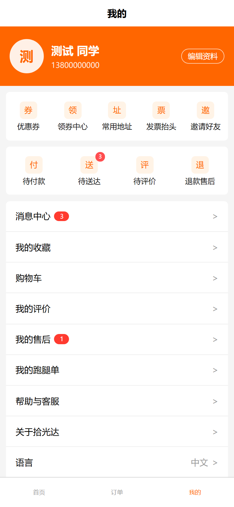
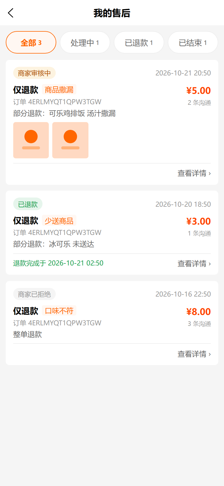
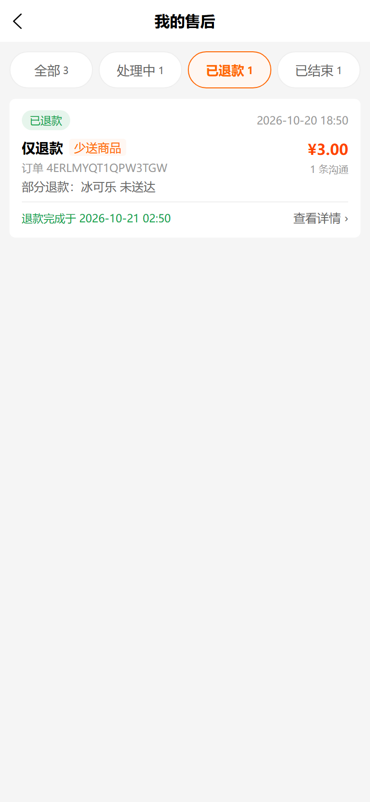

## 38. 订单开票闭环

1. **申请入口**：订单详情底部「开发票」（未申请时）→ 弹层选择已存抬头、填写接收邮箱后提交，写回 `invoiceApplied / invoiceInfo`（沿用订单 customFields，无新接口）；
2. **抬头来源**：`activeCustomer.customFields.invoiceTitles`（与「发票抬头」管理页同一份数据）；弹层内新增「管理抬头」入口，跳转抬头管理后返回可重新选择；
3. **已申请展示**：订单详情新增发票信息卡，逐行展示发票类型（企业/个人）、抬头名称、税号、接收邮箱、申请时间，右上「复制」可一键复制整段信息；
4. **完成态提示**：信息卡底部固定提示「电子发票将在 3 个工作日内发送至上述邮箱」；
5. 兼容：历史订单 `invoiceInfo` 为 JSON 字符串或对象均可解析，缺字段自动隐藏对应行。

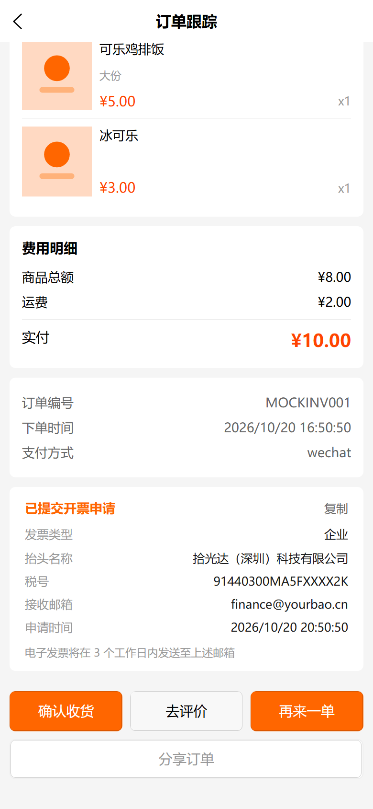
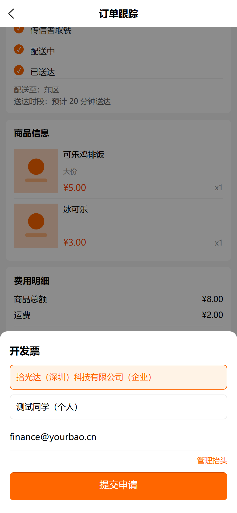

## 39. 评价晒单增强（我的评价）

1. 新增状态筛选：`全部 / 审核中 / 已通过 / 未通过`，带计数；
2. 评价卡片增强：
   - 匿名评价显示「匿名评价」标记；
   - 新增标签行（如「口味赞 / 分量足 / 配送快」）；
   - 图片最多展示 3 张，超出显示「+N 张」；点击图片调用 `uni.previewImage` 大图预览；
   - 追评中的图片同样支持缩略图与预览；
   - 保留商家回复、追评、删除评价（未删除且非追评才可删）。
3. 评价创建页未改动，仍为星级 + 文案 + 图片 + 匿名开关。

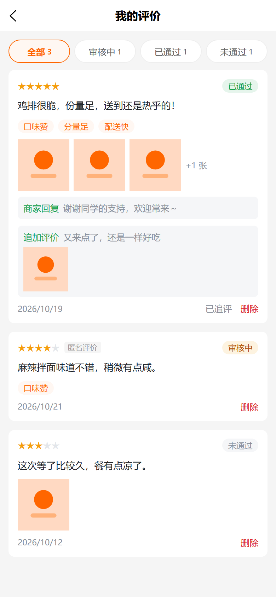

## 40. 帮助与客服中心

1. 入口：「我的 → 帮助与客服」（登录与否均可访问）；原「联系客服」菜单项由本页替代；
2. 顶部为客服区：
   - 配置了 `VITE_SERVICE_PHONE` 时显示「客服热线 + 号码」，点击 `uni.makePhoneCall` 拨号；
   - 未配置时展示兜底提示「如需紧急处理，请在订单详情联系商家或平台客服」，不显示空号码按钮；
3. 四个快捷入口：我的售后 / 我的评价 / 发票抬头 / 我的订单；
4. 常见问题 5 组共 10 条（支付与优惠、配送与订单、退款与售后、发票、账号），手风琴展开，单条展开互斥；
5. 全部文案走 i18n（`help.*`），支持中英文切换。

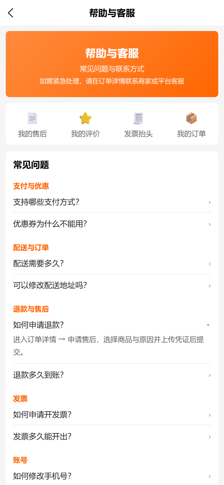

## 41. 验收记录与边界（第七轮，2026-10-21）

| 项 | 结果 |
|---|---|
| 我的页入口 | `{"help":true,"afterSales":true,"badge":true}`，售后角标「1」，客服热线菜单已替换为「帮助与客服」 |
| 售后列表 | tab 计数「全部 3 / 处理中 1 / 已退款 1 / 已结束 1」；三张卡片金额 `¥5.00 / ¥3.00 / ¥8.00`；凭证缩略图 2 张 |
| 售后筛选 | 已退款 tab 仅剩「少送商品」卡片（`onlyRefunded=true`） |
| 开票信息卡 | 类型/抬头/税号/邮箱/申请时间/复制全部命中，`{"applied":true,"title":true,"tax":true,"email":true,"copy":true}` |
| 开发票弹层 | 弹层可见，含「管理抬头」，抬头列表含企业抬头与「个人」 |
| 我的评价 | 四个筛选 tab 命中；标签、匿名标记、商家回复、追评图片均正常；图片超出显示「+N 张」 |
| 帮助与客服 | 5 个 FAQ 分组命中，展开答案命中；四个快捷入口中文文案正常；未配置热线时展示兜底提示 |
| i18n | `zh-Hans.json` / `en.json` / `uni-app.*.json` 补齐 `afterSalesList` / `help` / `myReviews` 新键 / `orderDetail` 发票键 / `profile.myAfterSales` / `nav.afterSales` / `nav.help` |
| 前端构建/部署 | `pnpm build:h5` 通过（产物 2633 KB），`node .secrets/deploy-waimai.mjs` 部署成功 |
| 手机视口截图 | 390×844 dpr=2，共 7 张（19–25） |

边界与已知限制：
- 售后列表只取最近 20 条，历史单需从订单详情进入；
- 售后状态文案为前端映射，后端新增状态会原样显示英文枚举；
- 开票仅记录申请（`invoiceApplied/invoiceInfo`），开票状态与发票文件仍由后台线下处理，前端不展示进度；
- 抬头管理为跳转页面，返回后需重新打开开票弹层；
- 「+N 张」只作提示，点击缩略图预览的是全部图片（含未展示的）；
- 帮助中心 FAQ 为内置文案，后台暂不可配置；客服热线依赖构建期 `VITE_SERVICE_PHONE`；
- 我的页用户名兜底：无 `firstName` 时显示邮箱前缀，避免已登录仍显示「未登录」。

---

# 第八轮常用功能（地址标签 / 券包增强 / 骑手信息 / 店内搜索）

> 上线日期：2026-10-21（第八轮）
> 截图脚本：`node .secrets/common-features-v8-shots.cjs`（Playwright 390×844 dpr=2，输出 `docs/screenshots/common-features-v8/`）
> 新增文件：`src/utils/addressLabel.ts`
> 修改文件：`src/pkg-user/pages/address-book.vue`、`src/pkg-order/pages/checkout.vue`、`src/pkg-promotion/pages/my-coupons.vue`、`src/pkg-order/pages/order-detail.vue`、`src/pages/shop/menu.vue`、`src/locale/zh-Hans.json`、`src/locale/en.json`
> 后端：无改动，复用 `activeCustomer.addresses` / `campusZones` / `campusBuildings` / `myCoupons` / `campusOrderRider`

## 42. 地址簿标签与复制

1. 标签来源：本地 `address_labels`（`{ addressId: 'home' | 'school' | 'company' }`），不写后端，不跨设备同步；
2. 地址卡片标题行新增标签 chip：
   - 已设置：显示「家 / 学校 / 公司」（当前语言）；
   - 未设置：显示虚线「＋标签」，点击弹出 ActionSheet 选择家/学校/公司或「清除标签」；
3. 操作行新增「复制」：复制「姓名 电话 完整地址（含分区 + 楼栋 + 房间）」，便于发给骑手或填表；
4. 结算页地址卡与地址选择弹层同步展示同一标签（读同一份本地数据）；
5. 分区/楼栋失效的地址仍标「待更新」，不展示标签操作。

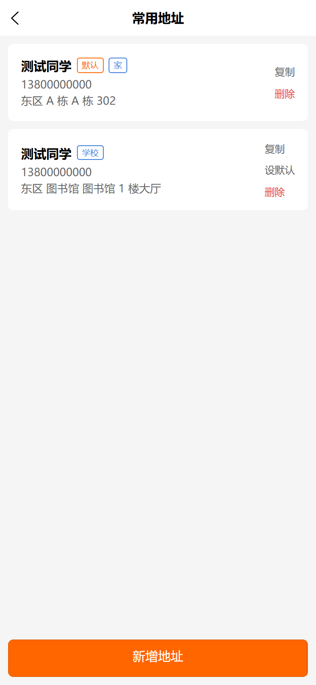

## 43. 券包增强（分类计数 + 临期提醒）

1. Tab 计数：未使用 / 已使用 / 已过期的 tab 标题右侧显示数量（按已加载列表计算，切 tab 后补齐）；
2. 临期横幅：未使用 tab 下，若有券 3 天内到期，顶部展示「N 张券将在 3 天内到期，尽快使用」；
3. 券卡片新增：
   - 「还剩 N 天」/「今天到期」提示（仅未使用且未过期）；
   - 3 天内到期的券保留「即将过期」角标；
   - 已使用/已过期券仍为灰度卡、无「去使用」按钮；
4. 口径：`isExpiringSoon` = 未过期且到期时间距现在 ≤ 3 天（按当天 0 点比较下限）。

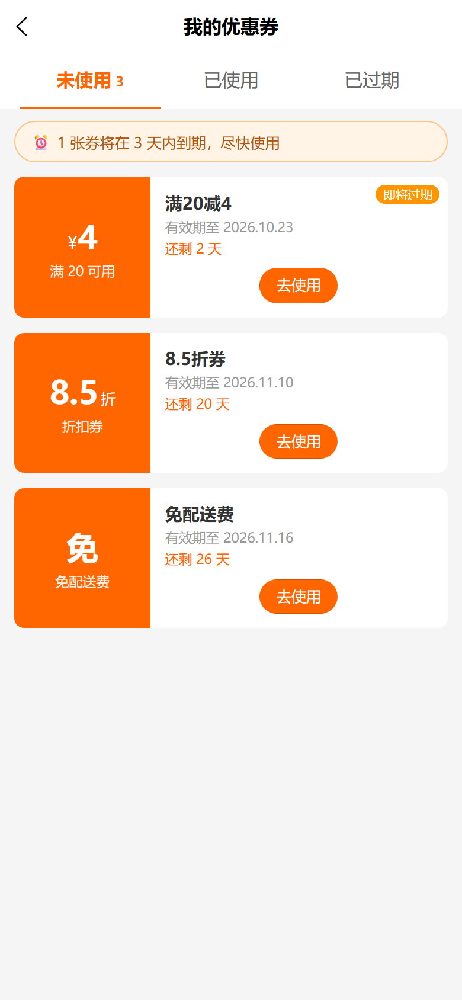


## 44. 骑手信息与催单

1. 订单详情骑手卡在原有「姓名 + 信用分 + 联系商家」基础上新增：
   - 「距你 {距离}」：< 1km 用米（取整），否则公里保留 1 位；
   - 「约 N 分钟送达」：取 `campusOrderRider.etaMinutes`；
   - 两项均来自 `campusOrderRider` 的 `distanceMeters / etaMinutes`，缺失自动隐藏；
2. 催单区新增提示文案「催单后骑手会收到提醒，请耐心等待」，位于催单按钮下方；
3. 已催单仍显示「已催单」红色标签，按钮隐藏；催单逻辑沿用原实现（`urgeOrder` 写 `urged`）。


## 45. 店内搜索与筛选

1. 商品面板顶部新增搜索框（`搜索店内商品`），输入即本地过滤，不发请求；
2. 搜索建议（输入为空时展示）：
   - 搜索历史：复用 `search_history`（与首页搜索共用，最多 10 条，可一键清空）；
   - 热门搜索：店内销量前 6 的商品名，名额不足用分类名补齐；
   - 点击词条直接填入并写入历史；
3. 筛选 chips（与排序分行）：
   - 「有优惠」：仅展示带可领/专属券的商品；
   - 「仅看有货」：隐藏全部规格售罄的商品；
4. 与既有能力叠加：`q` 参数（首页搜索/收藏进店定位）、分类、排序（综合/销量/价格升降）同时生效；
5. 空结果沿用「该分类下暂无商品」空态。


## 46. 验收记录与边界（第八轮，2026-10-21）

| 项 | 结果 |
|---|---|
| 地址标签 | `{"home":true,"school":true,"copy":true,"defaultTag":true}`；两条地址分别显示「家 / 学校」chip，复制入口在操作行 |
| 券包 | `{"counts":true,"banner":true,"days":true}`；未使用 3 张、横幅「1 张券将在 3 天内到期」、卡片「还剩 2 天」 |
| 券包切 tab | 已使用 tab 命中「满15减2」卡片，临期横幅消失 |
| 骑手信息 | `{"name":true,"distance":true,"eta":true,"urge":true,"hint":true}`；显示「距你 620 m」「约 7 分钟送达」与催单提示 |
| 店内搜索 | 搜索框、历史、热门三块命中，历史 3 条、热门 3 条；筛选 chips 正常 |
| 搜索过滤 | 输入「可乐」后建议区收起，列表仅剩含关键词商品，清除按钮可用 |
| 仅看有货 | 切换后列表不再出现「已售罄」商品 |
| i18n | `zh-Hans.json` / `en.json` 补齐 `addressBook`（7 键）、`myCoupons`（3 键）、`orderDetail`（3 键）、`menu`（5 键） |
| 前端构建/部署 | `pnpm build:h5` 通过（产物 2642 KB），`node .secrets/deploy-waimai.mjs` 部署成功 |
| 手机视口截图 | 390×844 dpr=2，共 7 张（26–32） |

边界与已知限制：
- 地址标签仅存本机，换设备/清缓存后丢失；删除地址后标签残留（不影响展示）；
- 复制内容含分区与楼栋，若地址失效则复制的是「地址已失效」提示文案；
- 券 tab 计数基于已加载列表，首次进入只加载当前 tab，其余 tab 显示 0 直到切换；
- 骑手距离/ETA 依赖后端实时字段，未上报定位时仅显示姓名与信用分；
- 催单为单次写入 `urged`，前端不做频率限制（后端已幂等）；
- 店内搜索为前端过滤（已在店铺页加载的 100 个商品内），不调用搜索接口；
- 热门搜索按店内销量推导，不含跨店热搜。

# 第九轮常用功能（订单追踪 / 再来一单 / 预约单 / 店铺动态）

## 43 订单列表：预约单聚合与快捷操作

入口：底部 Tab「订单」。

- 列表顶部新增「预约单 N 单」聚合条，展示带送达时段且未完成的订单；点击只看预约单，再次点击恢复全部（与「待评价」「售后中」互斥）。
- 订单卡新增快捷操作：
  - 配送中（`deliveryStatus = assigned / in_progress` 且有配送路线）→「追踪骑手」，直达全屏骑手地图；
  - 已送达 / 已取消 →「再来一单」，进入订单详情并自动打开复购弹层。
- 订单卡内「送达时段：…」沿用 `customFields.deliverySlotText`。

截图：[33-orders-scheduled-quick.png](screenshots/common-features-v9/33-orders-scheduled-quick.png)

## 44 订单追踪地图

入口：订单列表「追踪骑手」，或订单详情「实时追踪 ›」。

- 页面展示腾讯地图 + 骑手实时位置、配送目的地、骑行轨迹连线；
- 顶部为订单编号与「跟随中」状态，底部面板展示骑手姓名、信用分、预计送达、距你距离与配送节点（骑手已接单 → 已取餐 → 配送中 → 已送达）；
- 定位数据来自 `campusOrderRider`，前端 10s 轮询（送达后自动停止）。

截图：[37-rider-tracking.png](screenshots/common-features-v9/37-rider-tracking.png)

## 45 再来一单（复购）

入口：订单列表「再来一单」或订单详情「再来一单」。

- 跨店铺定位原订单所属店铺（按 `code` 逐渠道查询）；
- 拉取该店在售商品，逐一核对原订单商品：可售行正常展示，下架/售罄行置灰并标注「已下架，将跳过」；
- 底部汇总提示「有 N 件商品已下架，将跳过」；点击「加入购物车并进店」后切店、批量加购并进入店铺菜单。
- 全部商品不可售时提示「商品均已下架」，不执行加购。

截图：[35-order-reorder-modal.png](screenshots/common-features-v9/35-order-reorder-modal.png)

## 46 定时配送 / 预约单

入口：结算页「配送目标 → 送达时段」。

- 时段分两行：第一行「尽快送 / 明天 / 后天…」日期 chip，第二行具体时段 chip（含余量「剩 N 位」）；
- 选择未来日期与具体时段后，底部出现预约提示「预约单将在送达时段前 30 分钟自动进入配送调度」；
- 提交时 `campusSetDeliveryTarget(zoneId, buildingId, route, slotId)` 写入 `deliverySlotId / deliverySlotText / scheduledFor`；
- 订单详情顶部展示蓝色「预约配送 · 时段」提醒卡，配送进度首节点体现预约态；订单列表展示送达时段并支持预约单聚合筛选。

截图：[38-checkout-slot.png](screenshots/common-features-v9/38-checkout-slot.png)、[34-order-detail-scheduled.png](screenshots/common-features-v9/34-order-detail-scheduled.png)

## 47 店铺关注与动态

入口：我的 → 我的收藏 →「店铺动态」Tab。

- Tab 带计数，动态中的新品数量以红点角标展示；
- 逐个拉取已关注店铺商品，与本地 `follow_seen_products` 基线比对：首见店铺只建基线不误报，之后新增商品标记「新品」；
- 每家店铺展示「上新 N 件」+ 新品卡（红色「新品」角标）与销量前 3 的热销卡（「热销」角标）；
- 「全部已读」将当前商品写入基线并清空新品角标；点击店铺或商品卡片可带关键词进店。

截图：[36-favorites-dynamics.png](screenshots/common-features-v9/36-favorites-dynamics.png)

## 48 验收记录与边界

验收方式：Playwright 390×844 dpr=2 移动视口，mock `shop-api`（店铺、订单、骑手、券包、时段、收藏商品）。

| 项目 | 结果 |
|---|---|
| 订单列表 | `{"cards":2,"slotBar":"预约单 1 单只看预约单 ▸","trackBtn":true,"reorderBtn":true}` |
| 订单详情预约卡 | 横幅「预约配送 今天 19:00-19:30」+ 提示文案，时间线 5 节点、骑手「张小骑」 |
| 再来一单 | 弹层店铺「川味小馆」、2 行商品、1 行下架、「有 1 件商品已下架，将跳过」 |
| 店铺动态 | tab「收藏店铺2 / 收藏商品0 / 店铺动态2」，2 家店、2 个新品角标、「上新 1 件」、「全部已读」 |
| 骑手追踪 | 地图页正常，骑手「张小骑」、ETA「约 7 分钟」、节点 4 个 |
| 结算预约 | 日期 3 chip、时段 2 chip，选中「11:00-11:30 剩8位」，预约提示正常 |
| i18n | `orders`（5 键）、`orderDetail`（2 键）、`favorites`（7 键）中英双语补齐 |
| 构建/部署 | `pnpm build:h5` 通过（产物 2654 KB），`node .secrets/deploy-waimai.mjs` 部署成功 |
| 手机视口截图 | 390×844 dpr=2，共 6 张（33–38） |

边界与已知限制：
- 预约时段来自店铺 `campusShopSlots`，店铺未配置时仅显示「尽快送」；
- 预约单 `scheduledFor` 前 30 分钟才放量入厅，期间商家看板单独归入「预约单」栏；
- 再来一单仅处理商品下架/售罄，不处理价格变动与规格变更（加购按原变体）；
- 追踪地图依赖后端骑手定位上报，无定位时沿用订单详情骑手卡；
- 店铺动态基于本机基线，换设备后首轮只建基线不显示新品；
- 动态商品最多取 12 家关注店铺、每家 4 个新品 + 3 个热销，超出部分暂不展示。

# 第十轮常用功能（券码兑换 / 地址粘贴识别 / 口味偏好 / 足迹与常买）

## 49 优惠券兑换码

入口：我的 → 我的优惠券（券包顶部「有券码？去兑换 ›」）。

- 弹层输入券码（自动转大写、最长 32 位），点「立即兑换」调用后端 `redeemCouponByCode(claimCode)`；
- 成功：关闭弹层、清空输入、自动切回「未使用」并重新拉取券列表，toast「兑换成功，已放入券包」；
- 失败：后端英文错误统一映射为中文提示（券码无效 / 非本店券码 / 已兑换 / 已领完 / 已过期 / 未开始 / 暂不可兑换），弹层不关闭便于改码重试；
- 兑换限领与库存沿用券模板配置，由后端校验，前端不重复拦截。

截图：[39-coupons-redeem-entry.png](screenshots/common-features-v10/39-coupons-redeem-entry.png)、[40-coupons-redeem-error.png](screenshots/common-features-v10/40-coupons-redeem-error.png)

## 50 地址粘贴智能识别

入口：我的 → 常用地址 → 新增/编辑地址（顶部橙色「粘贴地址自动识别」卡）。

- 复制「姓名 电话 地址」后点「粘贴识别」，自动读剪贴板并拆分：联系人、手机号、门牌；
- 手机号支持带空格/横线（如 `139-1234-5678`），姓名取号码前最后一段并去掉「收货人/电话」等前缀；
- 地址文本按当前校区分区/楼栋名称匹配，命中后自动选中分区、加载并选中楼栋，剩余文本写入房号（最长 60 字）；
- 浏览器拒绝读剪贴板或内容为空时，弹出「手动粘贴」面板兜底，粘贴后点「识别并填写」；
- 只填识别到的字段，未识别字段保持原值；填充完成 toast「已识别并填写，请核对」，保存仍需用户手动点击。

截图：[41-address-paste-parse.png](screenshots/common-features-v10/41-address-paste-parse.png)

## 51 口味与忌口偏好

入口：结算页 → 订单备注 →「口味偏好」chips。

- 四个偏好：不要辣 / 少辣 / 不要香菜 / 不要葱蒜，单选/多选即时生效；
- 「不要辣」与「少辣」互斥，后选的自动替换，避免备注出现矛盾要求；
- 选择结果写入本地 `taste_preferences`，下次结算自动回填并同步进订单备注；
- 同步规则：先移除备注中已有口味段，再按选中顺序前置，其余自由输入与常用备注保留；总长仍受 200 字限制；
- 口味段随下单写入 `customFields.note`，商家端订单备注可见。

截图：[42-checkout-taste.png](screenshots/common-features-v10/42-checkout-taste.png)

## 52 浏览足迹与常买清单

入口：我的 → 足迹与常买。

- 「浏览足迹」：本地记录 `browse_footprint`，在店铺菜单点商品或加购时写入（商品/规格/价格/店铺/渠道/路线），同商品去重置顶，最多保留 40 条；
- 点击足迹行带 `q=商品名` 回到对应店铺菜单并定位商品；「清空」二次确认后清空本地记录；
- 「常买清单」：按平台 + 各店铺渠道逐渠道拉取我的订单（每渠道 20 单），按变体聚合购买次数与最近购买时间，跳过已取消订单，按次数倒序取前 20；
- 行内展示「买过 N 次」与最近时间，点「加购」切店并带 `add=变体ID` 进店加购；「刷新」强制重算。

截图：[43-history-footprint.png](screenshots/common-features-v10/43-history-footprint.png)、[44-history-frequent.png](screenshots/common-features-v10/44-history-frequent.png)

## 53 验收记录与边界（第十轮，2026-10-22）

验收方式：Playwright 390×844 dpr=2 移动视口，mock `shop-api`（店铺、券包、兑换、校区、订单、结算）。

| 项目 | 结果 |
|---|---|
| 券包兑换入口 | 入口文案「有券码？去兑换」，tab「未使用2 / 已使用 / 已过期」 |
| 兑换失败提示 | 输入 `BAD999` → 「券码无效，请检查后重试」，弹层保持打开 |
| 兑换成功 | 输入 `GOOD123` → 弹层关闭、券列表重载（2 张） |
| 地址粘贴识别 | 联系人「李雷」、电话「13912345678」、分区「东区」、楼栋「图书馆」、房号「302」 |
| 口味偏好 | 默认「不要辣」且备注为「不要辣」；点「少辣」后仅「少辣」，备注同步「少辣」 |
| 浏览足迹 | tab「浏览足迹2 / 常买清单」，2 行，首行「藤椒鸡腿饭」 |
| 常买清单 | 3 行，首行「珍珠鲜奶茶 · 买过 3 次」，提示「按历史订单购买次数排序」 |
| i18n | `addressEdit`（9 键）、`myCoupons`（19 键）、`checkout`（6 键）、`history`（17 键）、`profile.history`、`nav.history` 中英双语补齐 |
| 构建/部署 | `pnpm build:h5` 通过（产物 2680 KB），`node .secrets/deploy-waimai.mjs` 部署成功 |
| 手机视口截图 | 390×844 dpr=2，共 6 张（39–44） |

边界与已知限制：
- 券码兑换依赖券模板已配置 `claimCode` 且处于可领状态，本店券码才可兑换；
- 地址识别为规则解析（手机号 + 关键词匹配），不含地图/POI 校验；无手机号且无姓名时视为无法识别，转手动粘贴；
- 口味偏好仅存本机，换设备不同步；写入的是备注文本，不做商家端结构化忌口字段；
- 浏览足迹按商品（变体）去重，最多 40 条；清空后不可恢复；
- 常买清单依赖历史订单接口，跨渠道串行查询失败时跳过该渠道；仅统计已下单商品，不含购物车与取消单。

# 第十一轮常用功能（营业状态 / 凑单 / 最优券 / 预计送达）

## 54 营业状态与打烊提醒

入口：首页店铺列表、店铺菜单页、购物车。

- 首页按店铺 `businessHours` 实时计算，店名旁显示「已打烊」（红）或「即将打烊」（橙，打烊前 30 分钟内）；
- 店铺菜单页在店铺卡下方显示状态条：打烊「本店已打烊 · 今日/明日 HH:mm 开始营业，可先加购」；即将打烊「还有 N 分钟打烊，请尽快下单」；
- 打烊仅拦截提交：菜单页底部按钮变「已打烊」，购物车该店「去结算」置灰并 toast 提示，仍可浏览与加购；
- 营业时间解析支持多时段（`10:00–14:00, 17:00–21:00`）、全角冒号/波浪线/「至」等写法与跨零点时段（`18:00-02:00`）；未配置营业时间按营业处理，不误伤；
- 首页「只看营业中」筛选同步排除打烊店铺。

截图：[45-home-store-status.png](screenshots/common-features-v11/45-home-store-status.png)、[46-menu-closed-banner.png](screenshots/common-features-v11/46-menu-closed-banner.png)

## 55 凑单助手

入口：购物车、店铺菜单页购物车条。

- 购物车每家店展示凑单进度：未达起送价显示「还差 ¥X 起送」，按钮变「去凑单」；已达起送价但未达免配送费门槛时显示进度条与「再买 ¥X 免配送费」，达标转绿「已免配送费」；
- 店铺菜单页购物车条按「起送差额 → 满减差额 → 免配送费差额」优先级提示，商家无门槛配置时不占位；
- 打烊店铺的结算按钮同时置灰，凑单与浏览不受影响。

截图：[47-cart-topup-progress.png](screenshots/common-features-v11/47-cart-topup-progress.png)

## 56 最优优惠券智能推荐

入口：结算页 → 优惠券。

- 结算页在优惠券行上方提示「换用最优券可再省 ¥X 一键换券」，点击直接切换到估算优惠最大的券；
- 选券弹层按当前小计 + 运费估算每张券的「可省 ¥X」并降序排列，最优券打「最优」橙色标签；
- 已挂券与最优券同额时不提示，差额不足 ¥1 不提示，避免打扰；
- 门槛未达的券保留在列表中并显示原因，不参与最优推荐；未登录或无可用券时提示行不渲染。

截图：[48a-checkout-coupon-tip.png](screenshots/common-features-v11/48a-checkout-coupon-tip.png)、[48b-checkout-coupon-best.png](screenshots/common-features-v11/48b-checkout-coupon-best.png)

## 57 预计送达倒计时

入口：订单列表（待发货/待收货订单卡）、订单详情。

- 待配送（PaymentAuthorized）/配送中（PaymentSettled）订单按「下单时间 + 店铺 deliveryMinutes」估算，展示「预计 HH:mm 送达 · 还有 N 分钟」，每 30 秒刷新；
- 超过预计时间转红「预计送达已超时 N 分钟」，详情页显示「配送超时，可联系商家或点击催单」；
- 预约单（含 `deliverySlotText`）与已送达/已取消/待付款订单不显示倒计时，避免与预约时段冲突；
- 店铺未配置配送时长时按 40 分钟兜底；订单列表按店铺名映射配送时长，详情页优先按渠道匹配。

截图：[49-orders-eta.png](screenshots/common-features-v11/49-orders-eta.png)、[50-order-detail-eta.png](screenshots/common-features-v11/50-order-detail-eta.png)

## 58 验收记录与边界（第十一轮，2026-10-22）

验收方式：Playwright 390×844 dpr=2 移动视口，测试学生登录，店铺/购物车/订单/券为脚本注入的模拟响应（手册已注明）。

| 项目 | 结果 |
|---|---|
| 首页营业状态 | 徽标「已打烊」「即将打烊」各 1 个，样式区分红/橙 |
| 店铺打烊提示 | 状态条「本店已打烊 · 明日 00:00 开始营业，可先加购」，结算按钮「已打烊」 |
| 购物车凑单 | 2 家店：川味小馆「还差 ¥10.00 起送 / 去凑单 / 已打烊」；青柠奶茶「已免配送费 / 去结算」 |
| 最优券提示 | 「换用最优券可再省 ¥14 一键换券」 |
| 选券弹层 | 3 张券排序 满60减18 / 8.5折 / 满20减4，分别「可省 ¥18 / ¥9 / ¥4」，首张带「最优」 |
| 订单倒计时 | 「预计 07:22 送达 · 还有 7 分钟」；超时单「预计送达已超时 41 分钟」红色 |
| 订单详情 | 「预计 07:37 送达 · 还有 22 分钟」+ 估算说明 |
| i18n | `home`（2）、`menu`（5）、`cart`（5）、`checkout`（3）、`orders`（4）、`orderDetail`（4）中英双语补齐 |
| 构建/部署 | `pnpm build:h5` 通过（产物 2692 KB），`node .secrets/deploy-waimai.mjs` 部署成功 |
| 手机视口截图 | 390×844 dpr=2，共 7 张（45–50，含 48a/48b） |

边界与已知限制：
- 营业状态依赖后台填写 `businessHours` 文本，格式不合法时按未配置处理（视为营业）；
- 打烊状态只在前端计算，未与服务器时间校验，手机时间明显偏差时提示可能不准；
- 凑单门槛取店铺配置（`minOrderAmount`/`freeShippingThreshold`），两者都未配置时不显示进度；
- 最优券为本地估算（满减/折扣按门槛与上限计），最终以提交订单时后端核销结果为准；
- 预计送达为估算值，无骑手实时位置参与；预约单、已送达与取消单不显示；未配置配送时长按 40 分钟。

# 第十二轮常用功能（阶梯满减 / 失效巡查 / 规格记忆）

## 59 阶梯满减面板

入口：店铺菜单页店铺卡、购物车每家店卡片。

- 解析店铺 `promoText` 中全部「满 X 减 Y」档位（支持中文逗号/顿号/斜杠分隔），逐档展示为 chip；
- 已达成档位置亮（品牌色实线）；未达成的最近一档显示虚线边框并标注「再买 ¥X」；
- 购物车按当前小计实时计算，切换档位无需刷新接口；无满减配置的店铺不显示该面板；
- 金额展示整数优先（满30减5），避免小数为 0 时出现「满30.00减5.00」。

截图：[51-menu-promo-tiers.png](screenshots/common-features-v12/51-menu-promo-tiers.png)

## 60 购物车失效巡查

入口：购物车 → 商品行角标 + 店铺卡「清理失效 N 件」。

- 三种失效：已下架（变体 `enabled=false`）、已售罄（`stockLevel=OUT_OF_STOCK`）、已变价（与上次打开购物车时的单价快照比对）；
- 下架/售罄行置灰并划线，若存在则「去结算」拦截并提示「请先清理失效商品」；
- 变价行保留可结算，展示当前价与划线原价（原 ¥X），仅提示不自动移除；
- 点击「清理失效 N 件」二次确认后逐行调用 `removeOrderLine` 移除，全部成功后重载购物车并 toast；
- 单价快照存本地 `cart_line_prices`（`token:variantId`），每次打开购物车刷新为当前价。

截图：[53-cart-invalid-inspect.png](screenshots/common-features-v12/53-cart-invalid-inspect.png)

## 61 规格记忆

入口：店铺菜单页 → 点商品「选规格」。

- 记录每件商品上次选择的变体（本地 `sku_memory`，最多 200 条，超限淘汰最早记录）；
- 再次打开规格弹层时默认选中上次规格（如「加量份」），价格、已选文案同步；
- 上次规格已下架/售罄（`enabled=false` 或 `OUT_OF_STOCK`）时回退为第一个可用规格；
- 加入购物车 / 立即购买成功后写入记忆；菜单商品查询补充 `optionGroups`，使单规格店也能显示规格选项。

截图：[52-menu-sku-memory.png](screenshots/common-features-v12/52-menu-sku-memory.png)

## 62 验收记录与边界（第十二轮，2026-10-22）

验收方式：Playwright 390×844 dpr=2 移动视口，测试学生登录，店铺/购物车/商品为脚本注入的模拟响应。

| 项目 | 结果 |
|---|---|
| 阶梯满减（店铺页） | 3 档：满30减5（达成）、满50减12（达成）、满80减25「再买 ¥9」（虚线） |
| 阶梯满减（购物车） | 同 3 档，金额格式与店铺页一致 |
| 失效标记 | 4 行：已售罄 / 已下架 / 已变价 各 1，正常行 1 |
| 清理入口 | 「清理失效 2 件」（只计下架/售罄，变价不计） |
| 变价提示 | 小食拼盘 ¥8.00 + 划线「原 ¥6.00」 |
| 结算拦截 | 存在失效行时主按钮置灰，点击提示「请先清理失效商品」 |
| 规格记忆 | 弹层默认选中「加量份」，价格 ¥32.00，文案「已选：加量份 · 1 件」 |
| i18n | `menu`（2）、`cart`（10）中英双语补齐 |
| 构建/部署 | `pnpm build:h5` 通过（产物 2701 KB），`node .secrets/deploy-waimai.mjs` 部署成功 |
| 手机视口截图 | 390×844 dpr=2，共 3 张（51–53） |

边界与已知限制：
- 满减档位依赖 `promoText` 文本格式，无法解析的文案只作为普通标签展示；
- 变价判断基于本地单价快照，首次打开购物车时没有快照，不会提示；清缓存后需重新积累一次；
- 清理失效仅移除下架/售罄行，变价行需用户自行确认；清理失败（网络/权限）会 toast 并保留原状；
- 规格记忆存本机，换设备不同步；商品删除或多规格组合不可售时会回退默认规格。

# 第十三轮常用功能（消费统计 / 收藏降价 / 店铺公告 / 时段推荐）

## 63 消费统计账单

入口：我的 → 消费统计（登录后可见）。

- 跨渠道聚合：平台渠道 + 店铺列表里每个店铺渠道并行查询订单，按订单 id 去重合并（每渠道取最近 50 单）；
- 统计口径：仅计入已支付 / 配送中 / 已完成的订单（`PaymentAuthorized`、`PaymentSettled`、`Shipped`、`PartiallyShipped`、`Delivered` 等），排除已取消与待付款；金额取订单 `totalWithTax`；
- 汇总卡：累计消费、订单数、客单价（累计 ÷ 单数）、本月消费；
- 近 6 个月趋势：按月汇总，柱高按最大值归一（最高柱 100%），柱顶展示金额（千元取 k）；
- 常点店铺 TOP3：按渠道聚合，单量降序 → 金额降序；
- 最近订单：最近 5 单，展示店铺、日期、订单号、金额（静态展示，不跳转）；
- 未登录展示登录提示；无有效订单展示空态；接口失败静默空态，不阻塞页面。

截图：[63-profile-spending-entry.png](screenshots/common-features-v13/63-profile-spending-entry.png)、[64-spending-summary.png](screenshots/common-features-v13/64-spending-summary.png)、[65-spending-top.png](screenshots/common-features-v13/65-spending-top.png)

## 64 收藏商品降价提醒

入口：我的收藏 → 收藏商品。

- 收藏时记录价格快照到本地 `fav_price_snapshots`（最多 300 条，超出淘汰最早）；
- 打开收藏页时按渠道拉取商品，用最新 `priceWithTax` 覆盖本地价，与快照对比；
- 当前价低于快照价时：价格后展示划线原价，卡片底部展示橙色「降价 ¥X」角标；Tab 标题追加「· ↓N」角标；
- 老收藏首次打开时以当前价建立基线，避免误报降价；取消收藏同时清除快照；
- 接口失败保留旧价，不误报；降价判断在本地完成，无服务端推送。

截图：[66-favorites-price-drop.png](screenshots/common-features-v13/66-favorites-price-drop.png)

## 65 店铺公告与信息卡

入口：店铺菜单页 → 公告条 / 自动弹层。

- 店铺有 `storeNotice` 时，店铺卡下方展示公告条：单行省略 + 「查看 ›」；
- 点击公告条打开公告弹层（标题「店铺公告」、完整正文、全宽「知道了」按钮，点遮罩可关闭）；
- 首次进店每日自动弹一次：本地 key `store_notice_seen_<token>_<年-月-日>`，当日已读不再弹，次日再进店会再弹；
- 公告为空时不展示公告条、不弹窗；商家 Tab 现有店铺信息卡（地址 / 电话 / 营业时间 / 活动）保持不变。

截图：[67-shop-notice-bar.png](screenshots/common-features-v13/67-shop-notice-bar.png)、[68-shop-notice-modal.png](screenshots/common-features-v13/68-shop-notice-modal.png)

## 66 时段推荐店铺

入口：首页搜索框下方（快捷入口与类目之间）。

- 按本地时间分五段：早餐 06–10、午餐 10–14、下午茶 14–17、晚餐 17–21、夜宵 21–02（跨零点）；
- 标题「现在适合吃 · {早餐|午餐|下午茶|晚餐|夜宵}」，横滑展示最多 4 家推荐店铺，副文案优先店铺活动，其次配送信息；
- 打分：命中该时段标签 +100、有活动 +20、月售/100、已打烊 -50、暂停营业 -100，降序取前 4；
- 「查看全部 ›」在首页类目里有对应标签时出现，点击切到该类目并滚到店铺列表；
- 每分钟刷新时段；输入关键词或打开搜索面板时该区块自动隐藏。

截图：[69-home-meal.png](screenshots/common-features-v13/69-home-meal.png)

## 67 验收记录与边界（第十三轮，2026-10-22）

验收方式：Playwright 390×844 dpr=2 移动视口，测试账号登录，订单/店铺/商品为脚本注入的模拟响应；构建产物本地 serve 后截图，部署后再核对线上 chunk。

| 项目 | 结果 |
|---|---|
| 消费统计入口 | 我的页「消费统计」位于「我的收藏」上方，登录后可见 |
| 消费统计汇总 | 累计 ¥180.00 / 订单数 5 / 客单价 ¥36.00 / 本月 ¥90.00（断言通过） |
| 月度趋势 | 5–10 月 6 根柱，8–10 月有值（¥42 / ¥48 / ¥90），柱高与最大值归一 |
| 常点店铺 TOP3 | 食堂A窗口 3 单 ¥102.00 → 平台 2 单 ¥78.00（断言首位为食堂A窗口） |
| 最近订单 | 5 条，日期/订单号/金额正确 |
| 收藏降价 | 当前 ¥15.00 + 划线 ¥20.00 + 角标「降价 ¥5.00」（断言通过）；Tab 角标「· ↓1」 |
| 店铺公告条 | 展示完整公告首行并省略，右侧「查看 ›」 |
| 公告弹层 | 首次进店自动弹出（当日未读），标题/正文/「知道了」全宽按钮正常 |
| 时段推荐 | 标题「现在适合吃 · 早餐」，4 家店铺横滑；当前时段由运行时间决定 |
| i18n | `nav.spending`、`home`（7）、`menu`（3）、`profile`（1）、`favorites`（2）、`spending`（15）中英双语补齐 |
| 构建/部署 | `pnpm build:h5` 通过（产物 2723 KB），`node .secrets/deploy-waimai.mjs` 部署成功 |
| 线上回归 | `index-BDsloY4W.js` 含 `pkg-user/pages/spending`、「现在适合吃」「店铺公告」「降价 ¥」；`pages-shop-menu.CPafKL8Q.js` 含 `store_notice_seen_` |
| 手机视口截图 | 390×844 dpr=2，共 7 张（63–69） |

边界与已知限制：
- 消费统计每渠道只取最近 50 单，超长历史（>50 单/店）不会全量计入；订单详情页不做跳转（仅静态展示）；
- 统计按订单支付金额 `totalWithTax` 计，退款单若状态仍为已完成会计入，未做退款抵扣；
- 降价提醒存本机，换设备/清缓存后重新建立基线；价格以打开收藏页时的最新商品价为准，不主动推送；
- 店铺公告每日一次的标记也存本机，清缓存后会再弹一次；
- 时段推荐按设备本地时间判断，跨时区/修改系统时间会影响结果；无匹配标签的店铺仍可能因活动/月售进入推荐。

## 68 收藏店铺置顶

入口：我的收藏 → 收藏店铺。

- 店铺卡右侧新增「置顶 / 取消置顶」按钮（取消收藏按钮左侧），置顶后店名旁显示橙色「置顶」小标签，按钮高亮为橙色；
- 置顶店铺按点击顺序排在收藏列表最前，其余店铺保持原顺序；
- 置顶关系存本地 `fav_store_pins`（channelId 数组），不进云端收藏，换设备/清缓存后不保留；
- 取消收藏店铺时置顶标记残留但无副作用（仅对收藏列表生效）；店铺动态 Tab 的前 12 家取自同一列表，置顶店动态也靠前。

截图：[70-favorites-pin.png](screenshots/common-features-v14/70-favorites-pin.png)

## 69 结算页优惠明细

入口：确认订单 → 汇总区（优惠券行与应付行之间）。

- 当前订单存在优惠（`order.discounts`：店铺券、满减、立减等活动）时，显示「优惠明细」行，右侧红字「已省 ¥X」；
- 点击「优惠明细」行展开/收起逐项明细：左侧优惠描述，右侧红色「-¥X」；
- 「已省 ¥X」为全部优惠项金额合计；无优惠时整块隐藏，不影响其他行。

截图：[71-checkout-fee-detail.png](screenshots/common-features-v14/71-checkout-fee-detail.png)

## 70 支付结果页订单分享

入口：支付结果页 → 「分享订单」按钮（「查看订单」下方，生成过订单才显示）。

- 点击后拉取订单详情，组装摘要文本并复制到剪贴板，提示「订单信息已复制，快去粘贴分享吧」；
- 摘要包含：订单号、商品清单（品名 × 数量）、实付金额、送达时段（有 `deliverySlotText` 时）；
- 订单详情拉取失败或多笔订单场景退化为仅复制订单号，不阻塞。

分享文本示例：

```
【有宝外卖】订单分享
订单号: WM261022090001
商品：香辣鸡腿堡 x1、黄金鸡块 x2
实付：¥43.00
送达时段：11:00-11:30
```

截图：[72-pay-result-share.png](screenshots/common-features-v14/72-pay-result-share.png)

## 71 首页猜你喜欢

入口：首页「常买商品」区块下方。

- 基于浏览足迹（我的足迹同一份数据 `browse_footprint`）+ 常买记录 + 店铺月售综合打分的个性化商品推荐，横滑展示最多 8 张商品卡（图/名/价/店名）；
- 打分：常买基础分 3 > 足迹基础分 1，均乘近期衰减（约 3 天半衰期），叠加店铺月售/100 热度加成；同商品多来源分数累加；
- 与「收藏商品」「常买商品」区块自动去重：已在其中展示的 variant 不再出现在猜你喜欢；
- 点击商品卡进店：有 variantId 直接定位并自动加购，否则带商品名搜索进店；店铺已打烊/下线时静默忽略；
- 无足迹或候选全部去重后为空时整块隐藏；输入搜索关键词时自动隐藏，返回首页（onShow）时重读足迹刷新。

截图：[73-home-guess.png](screenshots/common-features-v14/73-home-guess.png)

## 72 验收记录与边界（第十四轮，2026-10-22）

验收方式：Playwright 390×844 dpr=2 移动视口，店铺/商品/订单为脚本注入的模拟响应；构建产物本地 serve 后截图，部署后再核对线上 chunk。

| 项目 | 结果 |
|---|---|
| 收藏置顶排序 | 注入 3 家收藏 + 置顶 9002，首卡为「茶茶铺」（断言通过） |
| 置顶标识 | 店名旁「置顶」标签渲染，按钮态文案「取消置顶」 |
| 置顶持久化 | `fav_store_pins` 写入 `["9002"]`（断言通过） |
| 优惠明细行 | 汇总区显示「优惠明细 已省 ¥3.00」，点击展开 |
| 逐项明细 | 2 条：「店铺券 · 满20减2 -¥2.00」「新人立减1元 -¥1.00」（断言通过） |
| 订单分享按钮 | 支付结果页「分享订单」按钮渲染并可点击 |
| 分享剪贴板 | 含订单号/商品/实付 ¥43.00/送达时段 11:00-11:30（断言通过） |
| 猜你喜欢 | 区块渲染，含足迹商品「招牌珍珠奶茶」「牛肉板面」 |
| 猜你喜欢去重 | 常买中的「香辣鸡腿堡」未在猜你喜欢出现（断言通过） |
| i18n | `home.guessTitle`、`checkout.feeDetail/feeSaved`、`payResult.share*`（6 条）、`favorites.pin*`（5 条）中英双语补齐 |
| 构建/部署 | `pnpm build:h5` 通过（产物 2731 KB），`node .secrets/deploy-waimai.mjs` 部署成功 |
| 手机视口截图 | 390×844 dpr=2，共 4 张（70–73） |

边界与已知限制：
- 置顶关系仅存本机，不随账号云端同步；取消收藏后置顶标记残留但无副作用；
- 优惠明细数据来自订单 `discounts` 快照，金额以服务端计算为准，本地仅做展示与求和；
- 订单分享复制的是纯文本摘要，不含图片/小程序卡片；多笔订单仅展开首笔详情，其余以订单号列出；
- 猜你喜欢依赖本机浏览足迹，换设备/清缓存后从零积累；打分为端上启发式，不涉及服务端推荐算法；
- 猜你喜欢候选最多取足迹 40 条 + 常买 8 条，全部被收藏/常买去重命中时区块隐藏。

# 第十五轮常用功能（收藏一键加购 / 足迹增强 / 热销榜 / 联系骑手）

## 73 收藏商品一键加购

入口：我的 → 收藏 → 商品收藏卡。

- 每张收藏商品卡新增「加购」实心胶囊按钮（价格行右侧，与「删除」并排）；
- 一键将 1 份商品加入其所属店铺购物车：跨店请求固定 `vendure-token` 指向商品店铺渠道（`addItemToOrderInChannel`），与当前所在店铺无关；
- 加购成功：全局购物车角标即时刷新（`useCartStore().setOrder`），toast「已加入购物车」；失败 toast 展示服务端原因（如售罄/下架）；
- 店铺信息缺失（channelToken 拿不到）时 toast「该店铺信息已失效」，不发请求。

截图：[74a-favorites-add-cart.png](screenshots/common-features-v15/74a-favorites-add-cart.png)、[74b-favorites-add-cart-toast.png](screenshots/common-features-v15/74b-favorites-add-cart-toast.png)

## 74 足迹管理增强（单条删除 + 按店铺聚合）

入口：我的 → 我的足迹。

- 视图切换：足迹列表顶部新增「按店铺 / 按时间」胶囊切换按钮，默认按时间（与原行为一致）；
- 按店铺聚合：同一店铺的足迹归入一组，组头显示店铺名 + 条数徽标，组按组内最新浏览时间排序；聚合视图下行内不再重复显示店名；
- 单条删除：每条足迹行尾新增「×」按钮，点击立即删除该条（`removeFootprint` 按 productId+variantId 精确移除）并 toast「已删除」，无需确认；
- 「清空」按钮行为不变（仍二次确认）。

截图：[75a-history-footprint-delete.png](screenshots/common-features-v15/75a-history-footprint-delete.png)、[75b-history-footprint-by-store.png](screenshots/common-features-v15/75b-history-footprint-by-store.png)

## 75 首页热销榜

入口：首页「猜你喜欢」下方常驻区块。

- 全平台店铺按月售 Top8 横滑展示（复用猜你喜欢卡片样式），显示店名 + 「月售 {n}」；
- 前三名左上角金/银/铜圆形排名角标（1 橙红 / 2 橙 / 3 琥珀）；
- 输入搜索关键词时区块自动隐藏，清空搜索后恢复；与搜索无结果兜底「热销店铺推荐」（Top4）并存互不影响。

截图：[76-home-hot-sale.png](screenshots/common-features-v15/76-home-hot-sale.png)

## 76 订单联系骑手

入口：订单详情页骑手卡（配送中订单）。

- 骑手卡操作区改为纵向双按钮：有骑手电话时显示「联系骑手」，点击直接拨号（`uni.makePhoneCall`）；「联系商家」按钮保持原位；
- 后端 `campusOrderRider` 新增返回 `phone`（骑手 Customer 的 phoneNumber，脱敏策略不变）；schema 增加可空 `phone: String` 字段；
- 兼容性：骑手电话为空或后端未升级时按钮自动隐藏，前端无需与后端同版本发布。

截图：[77-order-detail-contact-rider.png](screenshots/common-features-v15/77-order-detail-contact-rider.png)

## 77 验收记录与边界（第十五轮，2026-10-22）

验收方式：Playwright 390×844 dpr=2 移动视口，登录走线上测试账号，收藏/足迹/购物车/骑手为脚本注入或模拟响应；构建产物本地 serve 后截图，前端部署后核对线上 chunk。

| 项目 | 结果 |
|---|---|
| 收藏加购按钮 | 商品收藏卡渲染「加购」实心胶囊（断言通过） |
| 一键加购成功 | toast「已加入购物车」，跨店请求固定 vendure-token，购物车角标刷新 |
| 足迹单条删除 | 点「×」后行数 5→4，toast「已删除」（断言通过） |
| 按店铺聚合 | 切换后组头「川味小馆 3件 / 青柠奶茶 2件」，按钮态翻转为「按时间」（断言通过） |
| 首页热销榜 | 常驻区块渲染，月售 Top8 横滑，前三角标 1/2/3（断言通过） |
| 联系骑手 | 骑手卡双按钮「联系骑手 / 联系商家」，mock phone 拨号（断言通过） |
| 后端 schema | 线上 `campusOrderRider` 已接受 `phone` 字段（匿名 FORBIDDEN 为预期鉴权响应） |
| i18n | `favorites.addCart*`（3）、`history.groupByStore/byTime/removed/itemCount/unknownStore`（5）、`home.hotSaleTitle`、`orderDetail.contactRider` 中英双语补齐 |
| 构建/部署 | `pnpm build:h5` 通过，`deploy-waimai.mjs` 部署成功；插件 `tsc` 通过，lib 替换 + pm2 restart 成功 |
| 手机视口截图 | 390×844 dpr=2，共 5 张（74a/74b/75a/75b/76/77） |

边界与已知限制：
- 一键加购固定数量 1；已加购同规格再次点击由服务端默认叠加数量（与店内加购一致）；
- 足迹单条删除仅删本机记录，不影响常买清单（常买来自历史订单聚合）；
- 按店铺聚合按 `channelToken` 分店，历史足迹缺失 token 时归入「其他店铺」组；
- 热销榜排序依据店铺 `monthlySales` 快照，与店铺详情页月售数可能存在分钟级时差；
- 骑手电话以骑手注册 Customer 的 `phoneNumber` 为准，未登记手机号的骑手不显示「联系骑手」按钮。

# 第十六轮常用功能（购物车步进器 / 常点搭配 / 评价草稿 / 收藏分组）

## 78 购物车单行数量增减与删除

入口：购物车（底部 Tab 或店铺页「购物车」）。

- 每个有效商品行尾由只读「×N」升级为步进器：`− 数量 ＋`，右侧新增 🗑 删除按钮；
- 点击 `＋ / −` 跨店调整该行数量（`adjustOrderLineForChannel` 固定 `vendure-token` 指向店铺渠道），金额、起送差额、满减档位、免配送费进度实时联动；
- 数量为 1 时再点 `−` 直接删除该行；点 🗑 立即删除该行（不二次确认）；
- 调整/删除成功后用服务端返回的 Order 原地替换该店卡片，同时刷新本机单价快照，避免自家调量被误判为「已变价」；该店最后一行删完则整张店铺卡移除；
- 失效行（已下架/售罄/变价）仍显示只读 `×N`，需点「清理失效」处理；单行请求期间按钮半透明防连点，失败 toast 展示服务端原因。

截图：[78-cart-line-stepper.png](screenshots/common-features-v16/78-cart-line-stepper.png)、[78b-cart-qty-increased.png](screenshots/common-features-v16/78b-cart-qty-increased.png)、[78c-cart-line-removed.png](screenshots/common-features-v16/78c-cart-line-removed.png)

## 79 店铺「常点搭配」一键加购

入口：店铺页公告条下方（登录且有历史订单时显示）。

- 取本店最近 20 笔非取消订单，统计「当前在售商品两两共同出现」的频次，取最高的一对生成搭配卡；
- 卡片展示两项商品图/名/价与合计金额，并标注「近 {n} 单里最常一起点」；
- 点「一键加购」依次把两项各 1 份加入本店购物车；全部成功 toast「已加入两件商品」，部分成功 toast「部分加购成功」，全失败 toast「加购失败」；
- 无历史订单、无可售搭配或未登录时整卡隐藏，不影响店铺页其他区块。

截图：[79-menu-combo.png](screenshots/common-features-v16/79-menu-combo.png)、[79b-menu-combo-added.png](screenshots/common-features-v16/79b-menu-combo-added.png)

## 80 评价草稿自动保存

入口：订单 → 写评价 / 追评。

- 评分、标签、文字、匿名开关任一变化后 400ms 防抖写入本机草稿，键按「订单行 + 评价类型」区分（`review_draft:<orderLineId>:main`，追评后缀为 reviewId）；
- 再次进入评价页自动回填星级/标签/文字/匿名，顶部显示「已恢复上次未提交的评价草稿」，可点「清空草稿」一键还原默认值；
- 提交成功后清除草稿并置位标记，返回时不会把已提交内容重新写回；草稿为空（全默认值）时自动清除；
- 草稿只存本机，换设备/清缓存不保留；图片不进入草稿。

截图：[80-review-draft-restored.png](screenshots/common-features-v16/80-review-draft-restored.png)、[80b-review-draft-cleared.png](screenshots/common-features-v16/80b-review-draft-cleared.png)

## 81 收藏店铺自定义分组

入口：我的 → 收藏 → 收藏店铺。

- 列表顶部新增分组筛选 chips：「全部」+ 各自定义分组 + 「未分组 N」（存在未分组店铺时显示）；
- 店铺名右侧显示当前分组标签；未分组显示虚线「＋分组」，点击弹出操作表：选择已有分组（当前组带 ✓）/「新建分组」/「取消分组」；
- 新建分组弹层输入组名（最多 8 字），确定后立即写入并 toast「已设置分组」；当前筛选的分组被删空时自动回到「全部」；
- 分组关系存本机 `fav_store_groups`（channelId → 组名），不进云端收藏，换设备/清缓存不保留；置顶排序、店铺动态等既有能力不受影响。

截图：[81-fav-store-groups.png](screenshots/common-features-v16/81-fav-store-groups.png)、[81b-fav-group-filtered.png](screenshots/common-features-v16/81b-fav-group-filtered.png)、[81c-fav-group-editor.png](screenshots/common-features-v16/81c-fav-group-editor.png)、[81d-fav-group-created.png](screenshots/common-features-v16/81d-fav-group-created.png)

## 82 验收记录与边界（第十六轮，2026-10-22）

验收方式：Playwright 390×844 dpr=2 移动视口，本地 serve 最新构建产物，店铺/商品/订单/购物车为脚本注入的模拟响应。

| 项目 | 结果 |
|---|---|
| 购物车步进器 | 2 张店铺卡 3 行商品，渲染 3 组步进器（6 个减/加按钮）与 3 个删除按钮（断言通过） |
| 数量增加 | 点首行「＋」后数量 1→2，行金额 ¥20.00 保持不变，toast 无异常（断言通过） |
| 单行删除 | 点 🗑 后行数 3→2，toast「已删除该商品」（断言通过） |
| 常点搭配卡 | 标题「常点搭配」、提示「近 3 单里最常一起点」、两项商品与合计 ¥26.00（断言通过） |
| 一键加购 | 点击后两项均加入购物车，toast「已加入两件商品」（断言通过） |
| 评价草稿回填 | 注入 4 星 + 标签 + 文字草稿，进入页面显示恢复提示、4 星点亮、文字回填（断言通过） |
| 清空草稿 | 点「清空草稿」后提示条消失、文字清空（断言通过） |
| 收藏分组筛选 | 3 家收藏分入「午餐/奶茶」，chips 渲染「全部 / 午餐 / 奶茶」；点「午餐」后列表 3→2（断言通过） |
| 新建分组 | 操作表含「新建分组」，弹层输入「夜宵」确定后 chips 变为「全部 / 午餐 / 夜宵 / 奶茶」（断言通过） |
| i18n | `cart.lineDeleted/qtyFail/removeFail`、`menu.combo*`（5）、`reviewCreate.draftRestored/draftClear`、`favorites.group*`（11）中英双语补齐 |
| 构建/部署 | `pnpm build:h5` 通过，`deploy-waimai.mjs` 部署成功 |
| 手机视口截图 | 390×844 dpr=2，共 11 张（78/78b/78c/79/79b/80/80b/81/81b/81c/81d） |

边界与已知限制：
- 购物车调量/删除只作用于当前店铺渠道的购物车，不跨店合并；失效行不提供步进器，需走「清理失效」；
- 常点搭配只统计最近 20 笔订单、且在售商品之间的两两共现，新品/单一商品订单不会产生搭配；搭配仅一项命中时不出卡；
- 评价草稿存本机，图片与已上传结果不缓存；同一订单行再次评价会覆盖旧草稿；
- 收藏分组仅本机保存，不随账号同步；组名为纯文本（最多 8 字），同名组自动合并为同一组；
- 本轮为纯前端改动，后端无需发布。

## 83 会员中心

入口：我的 → 会员中心（登录后）。

- 顶部会员卡展示当前等级徽标、等级序号、积分余额、成长值进度条，以及「距下一等级还差多少成长值」；已达最高等级时显示「已达最高等级」；
- 权益区按后端会员配置展示：积分加速倍率、单笔积分抵现上限、专属折扣（未配置的权益自动隐藏），并保留「更多权益持续上线」；
- 会员信息、签到状态、任务列表三路并行拉取，任一失败显示「会员信息加载失败 + 重新加载」，不阻塞其他入口；
- 未登录时显示登录引导，登录后自动刷新；从签到/任务返回时重新拉取最新积分与成长值。

截图：[82-profile-member-entry.png](screenshots/common-features-v17/82-profile-member-entry.png)、[83-member-center.png](screenshots/common-features-v17/83-member-center.png)

## 84 每日签到

入口：会员中心 → 每日签到卡片。

- 卡片展示近 7 天签到节奏（已签到圆点打 ✓，今天高亮日期），副标题显示连续签到天数；
- 点「立即签到」调用 `checkin`，成功后积分/成长值即时到账、连续天数 +1、按钮置灰为「今日已签到」；
- 已签到当天重复请求由后端拒绝，前端直接禁用按钮；签到失败 toast 提示稍后再试；
- 连续签到天数由后端按自然日计算，本地不做补签与断签逻辑。

截图：[84-member-checked-in.png](screenshots/common-features-v17/84-member-checked-in.png)

## 85 积分任务

入口：会员中心 → 积分任务。

- 展示后端下发的 8 类任务：分享店铺/商品、每日登录、完善资料、绑定手机、成长等级达标、首单、累计下单、累计消费；
- 每行显示任务名、奖励（积分 + 成长值），未达成任务附带达成提示（如「在个人资料中绑定手机号」）；
- 状态三态：可领取时按钮为「领取」，领取中显示「领取中…」，已领取/未达成置灰；点击领取成功后按钮立即变为「已领取」并刷新积分与成长值；
- 每日任务按自然日重置，一次性任务（绑定手机/首单/里程碑）领取后不再出现可领取态。

截图：[85-member-task-claimed.png](screenshots/common-features-v17/85-member-task-claimed.png)

## 86 积分明细

入口：会员中心 → 积分明细。

- 流水按时间倒序展示：类型标题（签到奖励/任务奖励/下单奖励/积分获取/积分使用/积分调整/积分过期）、时间、变动积分（正数橙色带 `+`、负数深色）、变动后余额；
- 支持触底分页，每页 20 条，加载中/没有更多有明确底部提示；
- 未登录显示登录引导，无记录显示空态。

截图：[86-points-history.png](screenshots/common-features-v17/86-points-history.png)

## 87 意见反馈

入口：我的 → 意见反馈（帮助与客服下方）。

- 表单支持类型（体验建议/功能异常/其他）、标题（≤20 字）、详细描述（≤500 字）、最多 3 张图片、联系方式；
- 联系方式默认带出账号手机号或邮箱，可手动修改；标题与描述为空时前端拦截并 toast 提示；
- 提交成功后清空标题/描述/图片，列表立即刷新；
- 「我的反馈」展示历史记录：类型、时间、内容、图片（可点开预览）、状态（待处理/处理中/已处理）与官方回复；有回复未读时自动调用 `markFeedbacksRead` 标记已读。

截图：[82b-profile-feedback-entry.png](screenshots/common-features-v17/82b-profile-feedback-entry.png)、[87-feedback-form.png](screenshots/common-features-v17/87-feedback-form.png)、[88-feedback-submitted.png](screenshots/common-features-v17/88-feedback-submitted.png)

## 88 验收记录与边界（第十七轮，2026-10-22）

验收方式：Playwright 390×844 dpr=2 移动视口，本地 serve 最新构建产物；会员/签到/任务/积分/反馈为脚本注入的模拟 GraphQL 响应（接口字段与线上 schema 已逐项核对）。

| 项目 | 结果 |
|---|---|
| 个人中心入口 | 「会员中心」「意见反馈」两个菜单项均渲染，位置在消息中心/帮助与客服附近（断言通过） |
| 会员卡 | 等级「银卡会员 Lv.2」、积分 2860、成长值 1560、进度条约 52%、距金卡 1440（断言通过） |
| 会员权益 | 展示「积分加速 1.2 倍」「单笔积分抵现上限 30%」「专属折扣 5%」三项 + 更多权益提示（断言通过） |
| 每日签到 | 连续 3 天圆点打 ✓；点「立即签到」后按钮变「今日已签到」、连续 4 天、积分 2860→2880（断言通过） |
| 积分任务 | 8 项任务全部渲染；点首个可领取任务后按钮变「已领取」、积分 2880→2890、已领取态 2→3（断言通过） |
| 积分明细 | 6 条流水覆盖签到/任务/下单/使用/过期，余额与正负号、颜色正确，底部「没有更多了」（断言通过） |
| 意见反馈提交 | 填写标题「希望增加夜间配送提示」+ 描述，提交后列表条数 2→3、新记录置顶且状态「待处理」（断言通过） |
| 反馈回复展示 | 历史记录展示「官方回复」与回复正文、已处理状态（断言通过） |
| i18n | `member`（48 条）、`pointsHistory`（13 条）、`feedback`（27 条）与 `profile.member/feedback`、`nav.member/pointsHistory/feedback` 中英双语同步；英文页「Daily check-in / Member benefits / Points tasks」正常（断言通过） |
| 构建/部署 | `pnpm build:h5` 通过，`deploy-waimai.mjs` 部署成功，线上 chunk 含新文案 |
| 手机视口截图 | 390×844 dpr=2，共 9 张（82/82b/83/84/85/86/87/88/89，其中 89 为英文） |

边界与已知限制：
- 会员等级名称、权益倍率均由后端会员插件配置决定，前端只做展示与千分比换算（倍率 1200 → 1.2 倍，比例 300 → 30%）；
- 签到不支持补签，断签后连续天数由后端重新累计；签到与任务奖励的积分/成长值以后端返回为准，前端不本地累加；
- 任务列表顺序与类型由后端下发，前端仅对已知 8 类任务做中英文案映射，未知任务编码回退显示原始编码；
- 意见反馈图片走既有上传通道，联系方式仅在后端可回访时使用；反馈状态与回复只能由后台更新，用户端只读；
- 积分明细分页每次 20 条，只支持触底加载，不做下拉刷新；
- 本轮为纯前端改动，后端会员/签到/反馈插件线上已启用，无需发布后端。

## 89 余额中心

入口：我的 → 我的余额；个人中心资产区「发票」直达发票中心。

- 顶部余额卡展示可用余额、冻结金额（>0 时显示「冻结中 ¥x」），两个操作按钮：在线充值、兑换充值卡；
- 余额流水：类型（余额充值/余额支付/余额退款/余额冻结/余额解冻/余额调整）、时间、变动金额（正数橙色带 `+`、负数深色）、变动后余额，触底分页每页 20 条；
- 充值记录：在线充值单列表，状态「待支付/已到账/已取消」，待支付可直接「继续支付」；
- 在线充值：4 个快捷金额（¥50/100/200/500）+ 自定义金额（上限 ¥50000），确认后创建充值单并拉起微信支付；支付发起失败或取消均 toast 提示，成功后 1.5s 自动刷新余额与流水；
- 兑换充值卡：输入卡号 + 卡密（无卡密可留空），成功后提示到账金额并刷新；失败提示检查卡号。

截图：[91-wallet-balance.png](screenshots/common-features-v18/91-wallet-balance.png)、[92-wallet-recharge-sheet.png](screenshots/common-features-v18/92-wallet-recharge-sheet.png)、[93-wallet-orders.png](screenshots/common-features-v18/93-wallet-orders.png)

## 90 积分商城

入口：我的 → 积分商城；会员中心 → 积分商城。

- 顶部展示「我的积分」与「兑换记录」入口；分段筛选：全部 / 虚拟好礼 / 实物好礼；
- 商品卡展示图片、名称、类型（虚拟/实物）、限兑件数与「库存 n」，积分价 + 可选现金补差；售罄显示「已兑完」，达个人上限显示「已达兑换上限」并置灰按钮；
- 兑换弹层：数量步进器（同时受库存与个人剩余额度限制）、实物商品需选择收货地址（无地址自动跳地址簿，多地址用系统选择器切换）、合计展示「积分 + 现金补差」；
- 提交后：无现金补差直接成功并跳转兑换记录；有补差则拉起微信支付；
- 兑换记录：状态筛选（全部/待支付/待发货/已发货/已完成）、商品快照与规格、积分与现金合计、收货地址、物流单号、退款状态；待支付单支持「去支付」与「取消兑换」（取消后积分原路退回）。

截图：[94-points-mall.png](screenshots/common-features-v18/94-points-mall.png)、[95-points-exchange-sheet.png](screenshots/common-features-v18/95-points-exchange-sheet.png)、[96-points-orders.png](screenshots/common-features-v18/96-points-orders.png)

## 91 发票中心

入口：我的 → 发票中心；个人中心资产区「发票」（原「发票抬头」入口上移到发票中心，抬头管理在申请弹层内进入）。

- 开票记录：合并「插件开具的发票」（状态：已开票/开票中/开票失败/已作废/已红冲/部分红冲）与「已申请订单」（商家线下开具，状态「已申请」），按时间倒序；
- 已开票记录可「查看 / 下载 PDF」（H5 新窗口打开，产物为空时调用 `downloadInvoicePdf` 刷新）；
- 可开票订单：已支付/已发货/已完成且未申请过的订单，展示店铺、金额、下单时间；
- 申请开票：优先选择已保存的发票抬头（最多 5 条，可跳转抬头管理），也可手动填写个人/企业抬头；企业必填纳税人识别号，接收邮箱必填且做格式校验；重复申请被后端拦截时提示「该订单已申请过开票」。

截图：[97-invoice-records.png](screenshots/common-features-v18/97-invoice-records.png)、[98-invoice-apply.png](screenshots/common-features-v18/98-invoice-apply.png)、[99-invoice-apply-sheet.png](screenshots/common-features-v18/99-invoice-apply-sheet.png)

## 92 电子小票

入口：订单详情底部操作区「电子小票」。

- 小票版式：店名、标题「电子消费小票 / ELECTRONIC RECEIPT」、订单号、下单时间、订单状态、送达时段、支付方式；
- 商品明细（名称、规格、数量、金额），费用区：商品小计、配送费（0 元显示「免配送费」）、优惠明细、实付合计；
- 收货人姓名/电话/地址；页脚提示可前往发票中心申请发票；
- 「复制小票」将纯文本小票写入剪贴板（含全部明细与费用），便于留档/报销；
- 订单不存在或未登录时显示空态提示。

截图：[100-e-receipt.png](screenshots/common-features-v18/100-e-receipt.png)

## 93 验收记录与边界（第十八轮，2026-10-22）

验收方式：Playwright 390×844 dpr=2 移动视口，本地 serve 最新构建产物；余额/积分/发票/订单为脚本注入的模拟 GraphQL 响应（查询字段已逐项对照线上 schema 实测通过）。

| 项目 | 结果 |
|---|---|
| 个人中心入口 | 「我的余额」「积分商城」「发票中心」三个菜单项渲染，资产区「发票」进入发票中心（断言通过） |
| 余额中心 | 余额 ¥128.50、流水 6 条（充值/支付/退款/调整正负号与余额正确）、「没有更多了」底部提示（断言通过） |
| 在线充值弹层 | 快捷金额 + 自定义金额、支付按钮文案「支付 ¥x」（断言通过） |
| 充值记录 | 已到账/待支付两种状态渲染，待支付显示「继续支付」（断言通过） |
| 积分商城 | 积分 1860、4 件商品、售罄「已兑完」、限兑件数、积分 + 现金补差展示（断言通过） |
| 兑换弹层 | 商品快照、数量步进器、收货地址、合计 800 积分、确认按钮（断言通过） |
| 兑换记录 | 待发货/已发货/已完成三态、物流单号、收货地址（断言通过） |
| 发票中心 | 已开票（含发票号）、开票中、已申请（订单号）三类记录；仅已开票记录展示 PDF 按钮（断言通过） |
| 申请开票 | 可开票订单列表 → 弹层带出发票抬头（企业 + 税号）、手动填写区、提交按钮（断言通过） |
| 电子小票 | 店名、订单号、2 条商品明细、小计/配送费/优惠/实付、支付方式、收货地址、复制/返回按钮（断言通过） |
| 接口核对 | 线上 `myBalanceWithFrozen` / `myBalanceTransactions` / `myRechargeOrders` / `myRechargeHistory` / `pointsProducts` / `myPointsOrders` / `myInvoices` 均返回 200 且无 schema 错误 |
| i18n | `wallet`（34 条）、`pointsMall`（27 条）、`pointsOrders`（27 条）、`invoiceCenter`（43 条）、`receipt`（33 条）与 `profile.wallet/pointsMall/invoiceCenter`、`nav.*` 中英双语同步 |
| 构建/部署 | `pnpm build:h5` 通过，`deploy-waimai.mjs` 部署成功，线上 5 个新页面 chunk 均 200 |
| 手机视口截图 | 390×844 dpr=2，共 11 张（90-100，存放 `docs/screenshots/common-features-v18/`） |

边界与已知限制：
- 余额/充值使用后端 `recharge-card-plugin`，金额全部以「分」为单位，前端仅做展示换算；在线充值依赖微信支付通道，非微信环境会提示「请在微信中打开完成支付」；
- 充值卡兑换的卡密为可选（加密批次才需要），兑换失败统一提示检查卡号，具体错误码由后端返回；
- 积分商品由后台「积分商城」配置，未配置时列表为空态；虚拟商品无需收货地址，实物商品必须有地址；库存/限兑以服务端判定为准，前端仅做按钮置灰；
- 积分兑换的现金补差走微信支付，取消待支付兑换单后积分由后端原路退回；
- 发票中心合并两类数据：插件开具的发票（`myInvoices`）与商家线下开票的订单（订单 `invoiceApplied/invoiceInfo`）；PDF 由后端 `downloadInvoicePdf` 生成，未生成前仅「已开票」状态展示入口；
- 电子小票为前端本地渲染（订单详情数据实时查询），不做服务端存档；复制内容为纯文本，不包含营销二维码；
- 本轮为纯前端改动，复用线上已启用的余额/积分商城/发票插件，无需发布后端。

## 94 限时秒杀

入口：首页「限时秒杀」活动入口（快捷区下方四宫格）。

- 按店铺渠道逐个拉取进行中的秒杀活动（`activeFlashSaleActivities`），并用 `products(filter.id)` 批量补商品名/图/原价；已结束场次过滤不展示；
- 卡片展示店铺、商品名、秒杀价、划线原价、折扣角标、已抢进度条与「已抢 a/b」、结束倒计时（秒级刷新）；
- 「立即抢」：未登录先跳登录；已登录先按店铺渠道加购变体，再调用 `applyFlashSale(activityId)` 应用秒杀价，成功后跳购物车结算；
- 失败文案按后端 message 分流：售罄「已抢光」、达限购「已达限购数量」、变体下架「商品已下架」、其他统一「抢购失败」；
- 售罄场次按钮置灰显示「已抢光」。

截图：[102-flash-sale.png](screenshots/common-features-v19/102-flash-sale.png)

## 95 拼团专区

入口：首页「拼团专区」活动入口。

- 双 Tab：「可参与拼团 / 我的拼团」；
- 可参与：按店铺渠道拉取进行中的拼团（`activeGroupBuyActivities`）并补商品信息；卡片展示成团价、原价、成团人数、成团进度条与「已参团 a/b」、结束倒计时、团长优惠额；
- 按钮语义：当前参团人数为 0 显示「我要开团」（isLeader=true），否则「参与拼团」（isLeader=false）；操作流程同为「加购 → `joinGroupBuy(activityId, orderId, isLeader)` → 跳购物车」；
- 我的拼团：`myGroupBuyOrders(isLeader=true/false)` 合并去重，展示活动名、订单号、团长/团员身份、成团进度、状态（待成团 / 已成团 / 未成团）；
- 失败文案：满员「该团已满员」、活动结束「活动已结束」、变体下架「商品已下架」。

截图：[103-group-buy.png](screenshots/common-features-v19/103-group-buy.png)、[104-group-buy-mine.png](screenshots/common-features-v19/104-group-buy-mine.png)

## 96 整点抢券

入口：首页「整点抢券」活动入口；页面底部可跳「我的优惠券」。

- 顶部展示场次名、副标题、规则、按场次起止计算的阶段倒计时（未开始 → 距开始 / 进行中 → 距结束 / 已结束）；
- 券卡按券类型渲染：满减（¥4 满 20 可用）、折扣（8.5 折）、免配送费（免），并展示领取后有效天数与剩余张数；
- 按钮状态四态：立即抢 / 已抢光（soldOut）/ 已抢（个人已达 `perUserLimit`）/ 未开始或已结束；
- 抢券调用 `claimFlashCoupon(templateId)`，按返回 `status` 映射提示：OK / 未登录 / 未开始 / 已结束 / 达限 / 已抢光；
- 活动未配置时展示空态并提供「查看我的优惠券」跳转。

截图：[105-coupon-flash.png](screenshots/common-features-v19/105-coupon-flash.png)

## 97 积分抽奖

入口：首页「积分抽奖」活动入口；会员中心「积分抽奖」卡片。

- 顶部展示当前积分；奖池按 `myLotteryPrizes` 渲染为三列网格（奖品图/名 + 按奖品模式展示单次积分消耗）；
- 消耗说明按 `lotteryCostConfig.mode` 区分：fixed（每次固定消耗 n 积分，0 则显示免费）/ perPrize（按中奖奖品扣积分，未中奖不扣）；
- 「立即抽奖」：未登录先跳登录；开奖期间奖格高亮滚动（≥0.9s），落点定位到后端返回 `prizeIndex` 并弹出中奖弹窗（奖品图/名 + 本次消耗），关闭后刷新积分与记录；
- 失败文案：积分不足 / 奖池未配置 / 其他统一「抽奖失败」；
- 我的中奖记录：每页 10 条，展示奖品名、时间、消耗积分，「查看更多」累加加载。

截图：[106-lottery.png](screenshots/common-features-v19/106-lottery.png)、[107-lottery-result.png](screenshots/common-features-v19/107-lottery-result.png)、[108-member-lottery.png](screenshots/common-features-v19/108-member-lottery.png)

## 98 验收记录与边界（第十九轮，2026-10-22）

验收方式：Playwright 390×844 dpr=2 移动视口，本地 serve 最新构建产物；秒杀/拼团/抢券/抽奖/会员数据为脚本注入的模拟 GraphQL 响应（查询与 mutation 文档已逐条对线上 schema 校验）。

| 项目 | 结果 |
|---|---|
| 首页活动入口 | 「限时秒杀 / 拼团专区 / 整点抢券 / 积分抽奖」四宫格渲染，图标与文案不挤压（断言通过） |
| 限时秒杀 | 三张卡片：¥12.90 秒杀价 + 原价 ¥26.00 + 省 50%、进度 62/100、倒计时；售罄卡按钮「已抢光」置灰（断言通过） |
| 拼团专区 | 成团价 ¥19.90、3 人团、进度 2/3、团长优惠 ¥2.00、「参与拼团」；0 人团显示「我要开团」（断言通过） |
| 我的拼团 | 团长/团员身份、订单号、待成团 / 已成团状态（断言通过） |
| 整点抢券 | 三张券卡（满减/折扣/免配送费）、剩余张数、按钮「立即抢 / 已抢光 / 已抢」、场次倒计时（断言通过） |
| 积分抽奖 | 积分 320、6 个奖品格、固定消耗 50 积分提示、中奖记录 3 条（断言通过） |
| 中奖弹窗 | 「恭喜中奖 / 藤椒鸡腿饭 / 本次消耗 50 积分」、积分由 320 递减为 270（断言通过） |
| 会员页入口 | 「积分抽奖 / 积分转盘抽好礼」卡片展示（断言通过） |
| 接口核对 | 线上校验 `activeFlashSaleActivities`、`activeGroupBuyActivities`、`myGroupBuyOrders`、`couponFlashSaleActivity`、`myLotteryPrizes`、`lotteryCostConfig`、`myLotteryRecords`、`applyFlashSale`、`joinGroupBuy`、`claimFlashCoupon`、`drawLottery` 均为 200 且无 schema 错误 |
| i18n | `flashSale`（18 条）、`groupBuy`（31 条）、`couponFlash`（19 条）、`lottery`（23 条）与 `home.act*`、`member.lottery*`、`nav.*` 中英双语同步 |
| 构建/部署 | `pnpm build:h5` 通过（两次构建均成功），`deploy-waimai.mjs` 部署成功，线上 4 个新页面 chunk 均 200 |
| 手机视口截图 | 390×844 dpr=2，共 8 张（101-108，存放 `docs/screenshots/common-features-v19/`） |

边界与已知限制：
- 秒杀/拼团活动严格按「店铺渠道」隔离：列表、加购、应用活动价/参团都必须带该店铺的 `vendure-token`，因此使用独立 GraphQL 客户端，不受当前站点默认渠道影响；
- 秒杀下单是「加购 + applyFlashSale」两步，活动库存与限购由后端在下单/创建订单时最终校验，前端只做展示与按钮置灰；
- 拼团以「当前参团人数为 0」判定开团（isLeader=true），成团失败自动退款由后端定时任务处理，前端不轮询；
- 抢券按活动级 `perUserLimit` 判断「已抢」，券模板级限领仍以后端 `claimFlashCoupon` 返回为准；
- 抽奖消耗与扣减全部由后端按 `lotteryCostConfig` 执行，前端仅按返回的奖品 `consume` 做展示与本地积分即时扣减；
- 线上当前秒杀/拼团/抢券/抽奖数据均为空（后台未配置活动），页面为空态；截图使用模拟响应，后台配置活动后即真实展示；
- 本轮为纯前端改动，复用线上已启用的秒杀/拼团/券/抽奖插件，无需发布后端。

## 99 购券商城

入口：领券中心顶部「购券商城」；「我的购券」页右上角「去购券商城」。

- 顶部活动 hero：活动名（无活动时用「购券商城」）、副标题、活动剩余倒计时（秒级刷新，结束显示「活动已结束」）；
- 首单立减条：`firstBuyEligible=true` 时展示「首单购券立减 ¥x」；
- 双 Tab「单券 / 券包」：
  - 单券卡：左侧票根按券类型渲染面额（满减/无门槛 ¥x、折扣 x 折、免配送费「免」）与门槛，右侧展示名称、标签、描述、售价、划线原价、已售数量；
  - 券包卡：名称、描述、售价、券张数（按 `items.quantity` 汇总）、已售数量；
- 「立即购买」打开支付弹层：券名、应付金额、账户余额（`getMyBalance().myBalanceWithFrozen.balance`），可选「余额支付 / 微信支付」；
  - 余额支付：`createCouponSaleOrder` → `payCouponSaleWithBalance`，成功后跳「我的购券」；
  - 微信支付：`createCouponSaleOrder` → `createWechatCouponPayment(saleOrderId,'H5')`，复用统一收银台 `handlePayment`（jsapi 走 WeixinJSBridge，H5 走 payUrl 跳转）；
- 失败文案：余额不足 / 不可售 / 达购买上限 / 其他统一「支付失败，请重试」。

截图：[109-coupon-mall.png](screenshots/common-features-v20/109-coupon-mall.png)、[110-coupon-mall-bundle.png](screenshots/common-features-v20/110-coupon-mall-bundle.png)、[111-coupon-mall-pay.png](screenshots/common-features-v20/111-coupon-mall-pay.png)

## 100 我的购券

入口：领券中心「我的购券」、购券商城右上角「我的购券 ›」、每日领券右上角「我的券包」。

- 顶部汇总当前渠道的购券记录，Tab 四态：全部 / 待支付 / 已支付 / 已关闭（已取消 + 已退款），Tab 带数量角标；
- 卡片展示：单券/券包类型、状态（待支付 / 已支付 / 已取消 / 已退款 / 随单待付）、券名（由券目录 `templates`/`bundles` 映射 templateId/bundleId）、单号、创建时间、金额；已支付补充支付时间；
- 操作：
  - 待支付（在线购券）：取消订单（`cancelCouponSaleOrder`）、去支付（余额或微信）；
  - 已支付：申请退款（`refundCouponSaleOrder`）；
  - 随单待付（加价购挂到购物车订单的券费）：仅展示说明「随主订单支付，不支持单独退款」；
- 未登录展示登录引导；无记录展示空态并提供「去购券商城」。

截图：[112-coupon-sale-orders.png](screenshots/common-features-v20/112-coupon-sale-orders.png)

## 101 每日领券

入口：领券中心「每日领券」。

- 顶部 hero：活动名、副标题、活动阶段（未开始 / 距结束倒计时 / 已结束）；
- 规则条：活动 `rules` 文案；
- 券卡按券类型渲染面额与门槛，并展示剩余张数（`totalCount - claimedCount`）；
- 按钮四态：立即领取 / 今日已领 / 已领完 / 未开始（或已结束）；
- 领取调用 `claimDailyCoupon(templateId)`，按返回 `status` 映射：OK（成功并置为今日已领）、ALREADY_CLAIMED、SOLD_OUT、NOT_STARTED、ENDED、PER_USER_LIMIT、MEMBER_LEVEL_BLOCKED、INACTIVE/NOT_IN_ACTIVITY；
- 活动未配置时展示空态并提供「去购券商城」；未登录点领取先跳登录。

截图：[113-daily-coupon.png](screenshots/common-features-v20/113-daily-coupon.png)

## 102 积分兑券

入口：领券中心第三个 Tab「积分兑券」。

- 领券中心顶部新增三入口：购券商城 / 每日领券 / 我的购券；
- 「积分兑券」Tab 拉取 `pointsMallTemplates`（后端按 `pointsPrice` 升序、仅 POINTS/ONLINE 场景、已启用且在有效窗口内），卡片展示面额、门槛、名称、描述与所需积分；
- 「积分兑换」先二次确认「使用 n 积分兑换「券名」？」，确认后调用 `exchangeCouponWithPoints(templateId)`；
- 成功 toast「兑换成功」，券自动进入券包；失败按 message 分流：积分不足 / 已达兑换上限 / 已领完 / 其他统一「兑换失败，请稍后重试」。

截图：[114-coupon-centre-points.png](screenshots/common-features-v20/114-coupon-centre-points.png)

## 103 加价购挂券（购物车）

入口：购物车每个店铺卡片底部「加价购好券」。

- 按店铺渠道分别拉取 `couponSaleCatalogue.templates` 与本店 `myCouponSaleOrders`，仅把 `payMode=ORDER_SURCHARGE`、`status=PENDING` 且 `orderId` 等于当前 activeOrder 的记录视为「已挂」；
- 券 chip 展示券面额与加价售价（如「¥10券 ¥5.99」），已挂 chip 高亮并打勾；
- 点击 chip：已挂则 `detachCouponFromOrder`（移除 surcharge），未挂则 `attachCouponToOrder`（新增 surcharge 到本单）；操作后重新拉取 activeOrder 与挂券状态，并在 chip 下方汇总「已加购 n 张 · ¥x」；
- 券费以 surcharge 形式计入订单，结算页总金额自动包含；主订单支付成功后由后端统一结算加价购券（发券），无需额外支付动作；
- 失败文案：已在本单 / 暂不可加购 / 其他统一「操作失败，请重试」。

截图：[115-cart-addon.png](screenshots/common-features-v20/115-cart-addon.png)、[116-cart-addon-attach.png](screenshots/common-features-v20/116-cart-addon-attach.png)

## 104 验收记录与边界（第二十轮，2026-10-22）

验收方式：Playwright 390×844 dpr=2 移动视口，本地 serve 最新构建产物；购券/每日领券/积分券/加价购数据为脚本注入的模拟 GraphQL 响应（13 条 query/mutation 文档已逐条对线上 schema 校验通过）。

| 项目 | 结果 |
|---|---|
| 购券商城 | 4 张单券卡、活动位「午市购券节」+ 倒计时、首单立减 ¥5.00、券包 Tab 显示「含 5 张券」（断言通过） |
| 支付弹层 | 券名「满50减10元券」、余额 ¥123.45、余额/微信两种支付方式（断言通过） |
| 我的购券 | 4 条记录、类型单券/券包、状态待支付/已支付/已退款/随单待付、券包名称映射正确；待支付筛选 2 条（断言通过） |
| 每日领券 | 3 张券卡、倒计时 02:59:51、按钮「立即领取 / 今日已领 / 已领完」、剩余张数（断言通过） |
| 积分兑券 | 领券中心三入口、第三 Tab 4 张券、所需积分 300、按钮「积分兑换」（断言通过） |
| 加价购 | 购物车 1 店 4 个券 chip、初始已挂 1 张 ¥3.99；点击未挂券后变 2 张、合计 ¥9.98（断言通过） |
| 接口核对 | 线上校验 `couponSaleCatalogue`、`myCouponSaleOrders`、`couponDailyClaimActivity`、`pointsMallTemplates`、`createCouponSaleOrder`、`payCouponSaleWithBalance`、`createWechatCouponPayment`、`cancelCouponSaleOrder`、`refundCouponSaleOrder`、`claimDailyCoupon`、`exchangeCouponWithPoints`、`attachCouponToOrder`、`detachCouponFromOrder` 均无 schema 错误 |
| i18n | 新增 `couponMall`（34 条）、`couponSaleOrders`（41 条）、`dailyCoupon`（26 条），`couponCentre` 扩至 31 条、`cart.addon*` 11 条，`nav.*` 4 条，中英双语同步 |
| 构建/部署 | `pnpm build:h5` 通过，`deploy-waimai.mjs` 部署成功，线上 3 个新页面 chunk 均 200 |
| 手机视口截图 | 390×844 dpr=2，共 8 张（109-116，存放 `docs/screenshots/common-features-v20/`） |

边界与已知限制：
- 购券/加价购均按店铺渠道隔离：商城目录、我的购券、挂券/摘券使用独立 GraphQL 客户端固定 `vendure-token`，购物车按店铺分组时不会串店；
- 购券金额单位为分，前端统一 `/100` 展示；首单立减、购买上限、券包券张数均由后端计算，前端只做展示；
- 加价购券费是订单级 surcharge，购物车仅提示「结算时计入」，实际总额以结算页 `order.totalWithTax` 为准；主单支付成功后才发券，主单取消/退款时按后端规则处理；
- 每日领券的「今日已领」「已领完」由后端 `claimedToday`/`soldOut` 返回，前端领取成功后仅本地置位，不做乐观计数；
- 积分兑券成功后不返回剩余积分，前端不自行扣减，切回会员中心/积分明细时以后端数据为准；
- 线上当前购券商城目录、每日领券活动、积分券模板均为空（后台未配置），页面为空态；截图使用模拟响应，后台配置后即真实展示；
- 本轮为纯前端改动，复用线上已启用的券/余额/微信支付插件，无需发布后端。

## 105 消息中心接后端

入口：我的 → 消息中心；首页右上角铃铛（未读角标）。

- 消息列表改为读取后端 `myMessages(options:{take:50})`，返回 `items[{ id, messageId, title, body, readAt, createdAt }]` 与 `totalItems`；
- 未读数读取 `myUnreadMessageCount`，首页铃铛、「我的」菜单红点、页面头部「未读 n」三处共用同一 store（`useMessagesStore`），任意页面 `onShow` 刷新即同步；
- 点击消息：未读则调用 `markMessageRead(id)` 回写服务端并本地置已读；卡片标题按关键词匹配图标（订单🧾 / 券🎫 / 其他📣）；点击「展开全文」切换 2 行截断与全文；
- 「全部已读」并发调用 `markMessageRead`，成功后清空未读并隐藏按钮；
- 未登录展示登录引导；无消息展示空态；消息正文按纯文本渲染（`white-space: pre-wrap`），不注入 HTML。

截图：[117-messages-list.png](screenshots/common-features-v21/117-messages-list.png)、[118-messages-need-login.png](screenshots/common-features-v21/118-messages-need-login.png)、[119-messages-empty.png](screenshots/common-features-v21/119-messages-empty.png)

## 106 分享裂变领券

入口：领券中心顶部第四入口「分享裂变」（也可从分享链接 `?invite=邀请码` 直接进入）。

- 活动区读取 `couponFissionActivity`（匿名可看，未配置/未开始/已结束后端返回 null → 空态 + 「去领券中心」）；
- hero 展示活动名、副标题与「剩余 x 天 hh:mm:ss」倒计时（每秒刷新）；规则区展示后端 `rules`；
- 双券卡：好友领（`inviteeTemplate`）/ 你得（`inviterTemplate`），按 FIXED/FULL/PERCENT/FREE_SHIPPING 渲染面额与门槛；
- 领奖：输入邀请码后调用 `claimFissionReward(inviteCode)`，按 `status` 映射提示：OK / ALREADY_REWARDED（该好友已助力）/ SELF_SHARE（不能用自己的码）/ BLOCKED_NEW_CUSTOMER（仅限新客）/ SOLD_OUT / NO_INVITER（邀请码无效）/ INACTIVE / NOT_LOGGED_IN（引导登录）；成功后清空输入并刷新活动；
- 我的邀请码：前端按后端规则 `F + base36(customerId).toUpperCase()` 生成（如 customerId=12345 → `F9IX`），支持一键复制与分享；分享链接携带 `?invite=` 参数，好友打开即自动填入。

截图：[120-coupon-fission.png](screenshots/common-features-v21/120-coupon-fission.png)、[121-coupon-fission-empty.png](screenshots/common-features-v21/121-coupon-fission-empty.png)

## 107 推广 / 分销中心

入口：我的 → 推广中心。

- 未申请：展示申请卡片（权益三条 + 选填上级推广码），调用 `applyDistributor(referredByCode)`，成功后重新拉取资料；
- 已申请：hero 展示审核状态（已通过/审核中/已冻结）、可提现余额、累计佣金、冻结中；
- 推广码区展示 `referralCode`，支持复制与分享（分享链接 `?ref=` 自动填入上级码）；
- 团队区读取 `myTeamSummary`：直推 / 间推 / 团队总数 / 订单数 / 订单金额 / 团队佣金；
- 「佣金明细」读取 `myCommissionRecords`：类型（直推/间推）、状态（待结算/已确认/已入账/已取消）、金额、订单号、订单金额、佣金比例（后端按万分比存，前端 `/100` 转百分数，如 1000 → 10%）、日期；
- 「提现记录」读取 `myWithdrawalRequests`：方式（支付宝/微信/银行卡）、状态（审核中/已通过/已驳回/已打款）、金额、申请与打款日期；
- 「申请提现」弹层：输入金额（元 → 分取整）、选择方式、填写收款账号，前端校验有效金额、不超可提现余额、账号必填后调用 `requestWithdrawal`；失败按后端 message 分流（低于最低提现额 / 余额不足 / 其他）。

截图：[122-distribution-apply.png](screenshots/common-features-v21/122-distribution-apply.png)、[123-distribution-overview.png](screenshots/common-features-v21/123-distribution-overview.png)、[124-distribution-commission.png](screenshots/common-features-v21/124-distribution-commission.png)、[125-distribution-withdraw.png](screenshots/common-features-v21/125-distribution-withdraw.png)

## 108 预售专区

入口：首页活动宫格「预售专区」。

- 按店铺渠道聚合：先取 `waimaiStoreList`，再逐店调用 `activePreSaleActivities`（固定 `vendure-token`），并用 `products(options)` 批量补全商品名、主图与变体原价；
- 卡片展示：预售模式（定金预售 / 全款预售）、店铺名、商品名、预售价与原价、定金与预估尾款、进度条「已订 a/b」、距结束倒计时、预计到货日期；售罄置灰按钮；
- 「立即预订」：先 `addItemToOrder`（该店铺渠道）加购 1 件，再 `applyPreSale(activityId)` 应用预售价与期次快照，最后重新拉取该渠道 activeOrder 写入购物车并跳转购物车；
- 失败文案：已售罄 / 已达限购 / 商品不在购物车（变体已下架）/ 活动不在可预订时间 / 未登录跳登录 / 其他「预订失败」；
- 列表过滤已结束活动，只展示当前可订。

截图：[126-pre-sale-list.png](screenshots/common-features-v21/126-pre-sale-list.png)、[127-pre-sale-empty.png](screenshots/common-features-v21/127-pre-sale-empty.png)

## 109 验收记录与边界（第二十一轮，2026-10-22）

验收方式：Playwright 390×844 dpr=2 移动视口，本地 serve 最新构建产物；消息/裂变/分销/预售数据为脚本注入的模拟 GraphQL 响应（查询与 mutation 文档已对线上 schema 校验通过）。交互回归另行断言 3 条链路：全部已读、邀请码领奖、预售预订。

| 项目 | 结果 |
|---|---|
| 消息中心 | 3 条消息、未读 2、全部已读按钮、订单/券/公告三类图标（断言通过） |
| 消息已读回写 | 点击「全部已读」→ 未读数归零、按钮隐藏、`markMessageRead` 逐条调用（断言通过） |
| 消息未登录/空态 | 未登录展示登录引导；后端 0 条时展示「暂无消息」（断言通过） |
| 分享裂变 | 活动名「邀请好友 · 双方得券」、倒计时 02:59:49、规则 3 条、双券卡 ¥10/满25、¥15/满50、我的邀请码 F9IX（断言通过） |
| 裂变领奖 | 输入邀请码点击领取 → 「领取成功，券已放入卡包」提示（断言通过） |
| 裂变空态 | 活动返回 null 时展示「当前暂无分享裂变活动」+ 去领券中心（断言通过） |
| 推广申请 | 未申请时展示权益三条、上级码输入框、立即申请按钮（断言通过） |
| 推广概览 | 状态「已通过」、可提现 ¥86.00、累计 ¥128.00、冻结 ¥12.00、推广码 JOHO88、团队 6/14/20、37 单 ¥2688.00（断言通过） |
| 佣金明细 | 3 条记录（直推×2 + 间推×1），比例 10%/10%/3%，状态已入账/已确认/待结算（断言通过） |
| 提现 | 提现记录 Tab + 申请提现弹层（可提现余额 ¥86.00、金额输入、支付宝/微信/银行卡、收款账号）（断言通过） |
| 预售专区 | 2 个活动（定金预售 ¥68/定金 ¥20/尾款 ¥48/已订 62/100；全款预售 ¥128/已订 50/50 售罄）、倒计时与预计到货（断言通过） |
| 预售预订 | 点击「立即预订」→ 加购 + `applyPreSale` → 「预订成功」并跳购物车（断言通过） |
| 预售空态 | 无活动时展示「暂无进行中的预售活动」（断言通过） |
| 接口核对 | 线上校验 `myMessages`、`myUnreadMessageCount`、`markMessageRead`、`couponFissionActivity`、`claimFissionReward`、`myDistributorProfile`、`myCommissionRecords`、`myWithdrawalRequests`、`myTeamSummary`、`applyDistributor`、`requestWithdrawal`、`activePreSaleActivities`、`applyPreSale` 均无 schema 错误 |
| i18n | 新增 `fission`（36 条）、`preSale`（24 条）、`distribution`（67 条），`messages` 重构为服务端消息（12 条），`home.actPreSale`、`profile.distribution`、`couponCentre.entryFission`、`nav.*` 3 条，中英双语同步 |
| 构建/部署 | `pnpm build:h5` 通过，`deploy-waimai.mjs` 部署成功，线上新增页面 chunk 均 200 |
| 手机视口截图 | 390×844 dpr=2，共 11 张（117-127，存放 `docs/screenshots/common-features-v21/`） |

边界与已知限制：
- 消息中心未读数与列表分两次请求（`Promise.allSettled`），未读数失败时回退为列表内 `readAt == null` 计数；消息列表一次取 50 条，暂不做分页加载；
- 已读回写为服务端持久化，失败仅告警不回滚本地状态，下次进入以服务端为准；
- 裂变邀请码由前端按 `F+base36(customerId)` 生成，与后端可逆码规则一致；若后台为个别客户配置了自定义 `inviteCode`，以后端校验为准，前端展示的可逆码仍可通过；
- 分销佣金比例后端按万分比存储，前端仅做 `/100` 展示转换；提现金额前端元→分 `Math.round`，实际最低额以平台配置为准；
- 预售预订依赖「先加购再应用预售」的两步流程：若同店铺购物车已有其他商品，预售会整单应用预售价（后端按活动价重算预售变体行），下单前请在购物车确认；
- 线上当前消息、裂变活动、推广员资料、预售活动均可能为空（后台未配置），页面为空态；截图使用模拟响应，后台配置后即真实展示；
- 本轮为纯前端改动，复用线上已启用的 message / coupon-fission / distribution / pre-sale 插件，无需发布后端。

## 110 尾款账单（预售 / 分期 / 租赁）

入口：订单详情「支付计划 · 查看账单」（仅该订单存在支付计划时出现），或直接访问 `/pkg-order/pages/payment-schedule?orderId=<订单ID>&code=<订单号>`。

- 顶部总览：账单类型（预售 / 分期 / 租赁）、账单状态（待开始 / 进行中 / 已完成 / 已违约 / 已取消）、已付金额 / 总额、已付进度条、发货承诺时间；违约单额外展示违约原因（买家逾期 / 卖家未发货 / 拼团失败）；
- 期次列表按 `seq` 顺序展示：期次序号、款项类型（定金 / 尾款 / 首付 / 分期 / 租金 / 买断）、应付金额、期次状态（未解锁 / 待支付 / 已支付 / 已逾期 / 已没收 / 已退款 / 已免除）、应付至时间或支付时间、逾期违约金；
- 「余额支付」按钮仅在期次状态为 `payable` / `overdue` / `locked` 且账单未取消时展示；`locked` 期次点击提示「尚未解锁」，由后端在支付时刻按触发条件（到点 / 到间隔）补偿解锁；
- 支付弹层：展示本期应付（含违约金）、账户余额（`myBalanceWithFrozen.balance`），余额不足时展示「余额不足，去充值」跳钱包；调用 `paySchedulePeriod(orderId, seq, 'balance-pay')`，成功后刷新账单与余额；
- 失败分流：该期已支付 / 暂不可支付 / 尚未解锁 / 余额不足，均有对应中文提示；
- 「取消账单」：普通（诚意金）单提示未付期次终止、已付按规则退回；法定定金单（`depositRule.kind === 'legal_deposit'`）提示定金不退，弹窗确认后以 `confirmForfeit=true` 调用 `cancelSchedule`；
- 订单无支付计划时展示空态「该订单暂无分期或尾款账单」。

截图：[128-payment-schedule.png](screenshots/common-features-v22/128-payment-schedule.png)、[129-payment-schedule-pay-sheet.png](screenshots/common-features-v22/129-payment-schedule-pay-sheet.png)、[130-payment-schedule-empty.png](screenshots/common-features-v22/130-payment-schedule-empty.png)

## 111 店铺直播

入口：首页活动宫格「店铺直播」。

### 111.1 直播列表

- 三个分组 Tab：直播中（`status=live`）/ 预告（`status=upcoming`，映射后端 `scheduled`）/ 回放（`status=replay`，映射后端 `ended`）；
- 按店铺渠道聚合：先取 `waimaiStoreList`（过滤暂停店铺），再逐店用固定 `vendure-token` 调用 `liveRooms(status)`，单店失败不影响其他店铺；
- 卡片展示：封面（无封面时用名称首字占位）、状态角标、店铺名、直播标题、简介、观看/点赞数（预告展示开播时间）、右侧动作文案（进入直播间 / 已预约 / 看回放）。

### 111.2 直播间

- 播放区：直播中优先使用 `enterLiveRoom` 下发的 `playUrl`，回放使用 `replayUrl`；均无地址时展示封面 + 状态占位文案（直播尚未开始 / 暂无回放 / 正在进入直播间）；
- 房间信息：标题、主播（`streamerName`，缺省「店铺主播」）、开播时间或预告开播时间、简介、外部平台同播入口（`platforms`，点击跳 webview）；
- 商品墙读取 `liveRoomProducts(id)`：图片（缺省首字占位）、名称、价格、「加购」按钮；
- 加购链路：`addItemToOrder`（该店铺渠道）→ `setOrderLiveRoom(roomId)` 标记订单来源直播间（直播佣金归因，失败不阻断）→ 重新拉取该渠道 activeOrder 写入购物车 → 提示「已加入购物车」；仅直播中可加购，预告/回放按钮置灰显示「未开播」；
- 失败分流：未登录跳登录 / 库存不足 / 其他「加购失败」。

截图：[131-live-list.png](screenshots/common-features-v22/131-live-list.png)、[132-live-list-upcoming.png](screenshots/common-features-v22/132-live-list-upcoming.png)、[133-live-room.png](screenshots/common-features-v22/133-live-room.png)

## 112 账单代付

入口：我的 → 账单代付。

- 规则区读取 `billPayConfig`：单笔限额（最低 ~ 最高）、单日累计限额、报价方式（自动报价含有效期分钟数 / 人工报价）、会员折扣百分比、满减阈值列表（阈值文案为 `LocalizedText`，按当前语言逐级回退）；
- 提交代买单：填写商户名称（必填）、账单金额（元，前端 `Math.round(元×100)` 转分）、备注（选填），前端校验必填、金额有效且落在 `[minAmount, maxAmount]`，调用 `createBillPayOrder`；提交成功后清空表单并刷新列表；
- 「我的代买单」读取 `billPayOrders({ take: 50 })`：商户名、状态徽标（待报价 / 待支付 / 已支付 / 服务中 / 已完成 / 已结算 / 已取消 / 已退款）、账单金额、应付金额（未报价显示「待报价」）、备注、报价说明、报价有效期、单号；
- 「去支付」仅在 `QUOTED` 状态展示，支付弹层展示应付金额、优惠明细合计（`discountDetail` 求和）、账户余额：
  - 余额支付 `payBillPayOrderWithBalance(id)`，即时结算，成功后刷新列表与余额；
  - 微信支付 `createWechatBillPayment(id, tradeType)`：默认先按 `JSAPI` 请求，普通浏览器取不到 openid 时回落 `H5`；JSAPI 走 WeixinJSBridge 收银台同步返回，H5 为跳转支付、返回页面时刷新；
- 「取消」在 `PENDING_QUOTE` / `QUOTED` 状态可用，二次确认后调用 `cancelBillPayOrder(id)`；
- 未登录展示登录引导。

截图：[134-bill-pay.png](screenshots/common-features-v22/134-bill-pay.png)、[135-bill-pay-pay-sheet.png](screenshots/common-features-v22/135-bill-pay-pay-sheet.png)、[136-bill-pay-submit.png](screenshots/common-features-v22/136-bill-pay-submit.png)

## 113 验收记录与边界（第二十二轮，2026-10-22）

验收方式：Playwright 390×844 dpr=2 移动视口，本地 serve 最新构建产物（`pnpm build:h5` 产物经临时静态服务挂 `/waimai` 前缀）；尾款账单 / 直播 / 账单代付数据为脚本注入的模拟 GraphQL 响应（查询与 mutation 文档已对线上 schema 校验通过）。交互回归断言 17 条，全部通过，无 console 报错。

| 项目 | 结果 |
|---|---|
| 尾款账单总览 | 预售账单 / 进行中 / ¥19.90 of ¥89.90 / 已付 22% / 发货承诺 2026-11-05 10:00（断言通过） |
| 期次列表 | 3 期（定金已支付、尾款待支付、分期已逾期含违约金 ¥1.50），逾期提示与付款按钮齐全（断言通过） |
| 余额付尾款 | 点击「余额支付 ¥50.00」→ 调用 `paySchedulePeriod(orderId, seq, 'balance-pay')`（断言通过） |
| 尾款账单空态 | 无支付计划时展示「该订单暂无分期或尾款账单」+ 说明（断言通过） |
| 直播列表 | 直播中 2 场（标题/店铺/观看点赞/进入直播间）、预告 1 场（断言通过） |
| 直播间 | 商品墙 3 件、`enterLiveRoom` 进房（无 playUrl 时封面占位）、加购调用 `addItemToOrder` + `setOrderLiveRoom`（断言通过） |
| 账单代付规则 | 单笔 ¥10.00 ~ ¥1000.00、单日 ¥2000.00、自动报价 30 分钟、会员减 5%、满减 2 档（断言通过） |
| 代买单列表 | 3 条（待支付 / 待报价 / 已完成），状态徽标与应付金额正确（断言通过） |
| 代买单余额支付 | 点击「去支付」→ 弹层 → 余额支付调用 `payBillPayOrderWithBalance`（断言通过） |
| 提交代买单 | 填写商户与金额 → 调用 `createBillPayOrder`（断言通过） |
| 首页入口 | 活动宫格 6 项，新增「店铺直播」图标正常（断言通过） |
| 我的菜单入口 | 「账单代付」菜单项可见（断言通过） |
| 接口核对 | `paymentSchedule`、`paySchedulePeriod`、`cancelSchedule`、`liveRooms`、`liveRoom`、`liveRoomProducts`、`enterLiveRoom`、`setOrderLiveRoom`、`billPayConfig`、`billPayOrders`、`createBillPayOrder`、`cancelBillPayOrder`、`createWechatBillPayment`、`payBillPayOrderWithBalance` 均无 schema 错误 |
| i18n | 新增 `paymentSchedule`（49 条）、`live`（34 条）、`billPay`（62 条），`home.actLive`、`profile.billPay`、`orderDetail.plan*` 3 条，`nav.*` 4 条，中英双语同步 |
| 构建/部署 | `pnpm build:h5` 通过，`deploy-waimai.mjs` 部署成功，线上新增页面 chunk 均 200 |
| 手机视口截图 | 390×844 dpr=2，共 11 张（128-138，存放 `docs/screenshots/common-features-v22/`） |

边界与已知限制：
- 尾款账单仅支持余额支付（项目需求，微信支付期次扣款需后端补 createPayment 的期次回调结算，暂未开放）；订单详情的「支付计划」入口通过 `paymentSchedule(orderId)` 探测，未登录或非计划单不展示；
- 期次解锁为后端补偿扫描（最长 1 分钟延迟），前端在支付时刻由后端兜底补偿解锁，`locked` 期次点击提示「尚未解锁」；
- 法定定金单取消前必须二次确认（前端按 `depositRule.kind === 'legal_deposit'` 传 `confirmForfeit=true`），失信后果由弹窗文案明示；
- 直播列表为跨店铺聚合，逐店请求（店铺数多时首屏请求数随之增加）；单店直播查询失败静默跳过，不影响其他店铺展示；
- 直播间播放地址来自 `enterLiveRoom`（仅 `live` 房间下发 `playUrl`），当前后端返回 null 时以封面占位，接入推流地址后即可播放；点赞/连麦等互动能力未开放；
- 直播加购会切换到该店铺渠道并写入该店铺购物车，与当前所在店铺购物车相互独立；
- 账单代付的优惠明细、报价有效期、满减文案均以后端返回为准；金额单位「分」，前端仅做展示与输入转换；
- 线上当前支付计划、直播间、代买单均可能为空（后台未配置/未开播），页面为空态；截图使用模拟响应，后台配置后即真实展示；
- 本轮为纯前端改动，复用线上已启用的 payment-schedule / live-streaming / bill-pay 插件，无需发布后端。

## 114 每日签到

入口：我的 → 每日签到。

- 顶部展示当前连签天数（`checkinToday.streak`）；7 天为一循环，已完成的格子高亮，第 7 天为礼包图标；下方展示已完成轮数（`streak ÷ 7` 取整）；
- 「立即签到」仅在 `canCheckin=true` 时可点，调用 `checkin` mutation；成功后弹窗展示本次获得的积分、成长值与当前连签天数（`checkin.okBody` 替换 `{p}/{g}/{s}`），并把按钮置为「今日已签到」；
- 失败分流：`already` → 「今日已签到」；其他 → 「签到失败，请稍后重试」+ 重新拉取状态；
- 每日任务读取 `myTasks`：任务码映射文案（`daily_share` 分享店铺 / `daily_login` 每日登录 / `daily_profile` 完善个人资料 / `bind_phone` 绑定手机号），每行展示「+积分 · +成长值」；
- 任务状态：`claimed` 显示「已领取」（绿色）、`not_met` 显示「未达成」、`available` 显示「领取」按钮；点击调用 `claimTask(taskCode)`，成功后 toast 本次积分并刷新列表；
- 未登录展示登录引导（`auth.requireLogin()`）。

截图：[139-checkin-not-signed.png](screenshots/common-features-v23/139-checkin-not-signed.png)、[140-checkin-reward-modal.png](screenshots/common-features-v23/140-checkin-reward-modal.png)、[141-checkin-task-claim.png](screenshots/common-features-v23/141-checkin-task-claim.png)

## 115 提货券

入口：我的 → 提货券。

- 四个 Tab：可使用（含 `active`）/ 已使用（`used`）/ 已过期（`expired`）/ 已退款（`refunded` + `voided`）；「可使用」Tab 带数量角标；
- 券卡展示：商品名（`productVoucherName`）、券码（等宽字体，点击 `uni.setClipboardData` 复制并提示「券码已复制」）、有效期文案：
  - 已使用 → 「使用于 {t}」（`usedAt`）；
  - 已退款/作废 → 「退款于 {t}」（`refundedAt`）；
  - 有固定到期日 → 「有效期至 {t}」（`expiresAt`）；
  - 否则 → 「自购买起 {n} 天有效」（`effectiveDays`）；
- 状态徽标：可使用 / 已使用 / 已过期 / 已退款 / 已作废；非可用 Tab 的卡片左侧色条转灰、整体降透明度；
- 可使用券右侧提示「到店出示券码」；底部说明核销规则；
- 未登录展示登录引导；各 Tab 空态独立文案。

截图：[142-vouchers-active.png](screenshots/common-features-v23/142-vouchers-active.png)、[143-vouchers-used.png](screenshots/common-features-v23/143-vouchers-used.png)、[144-vouchers-expired.png](screenshots/common-features-v23/144-vouchers-expired.png)、[145-vouchers-refunded.png](screenshots/common-features-v23/145-vouchers-refunded.png)

## 116 周期购订阅

入口：我的 → 我的订阅。

### 116.1 我的订阅

- 读取 `mySubscriptions`：订阅号（`code`）、状态徽标（订阅中 / 待续订 / 已结束 / 已取消）、下期配送日、总期数（`scheduleJson.length`）、预存余额（分转元）、周期区间（起始日 ~ 结束日）；
- 「查看期次」展开时调用 `mySubscriptionOccurrences(subscriptionId)`：期次号、排期日期、状态（待生成 / 已跳过 / 已生成订单 / 已取消）；再次点击收起；
- `renewalPending` 状态展示「续订支付」按钮，调用 `confirmRenewal(id)`，成功 toast「续订成功」并刷新列表；
- 未登录展示登录引导。

### 116.2 订阅套餐

- 读取 `availablePlans`（过滤 `enabled === false`）：套餐名、每期价格（分转元 + 「/期」）、描述、总期数、合计金额（`periods × periodPrice`）、「立即订阅」；
- 开通弹层：展示套餐名、期数与合计，`picker mode="date"` 选择起始日期（最早为明天），提示「开通即一次性支付全部期次金额」；
- 确认调用 `createSubscription(planId, input.startDate)`，起始日期按本地零点转 ISO（`new Date('YYYY-MM-DDT00:00:00').toISOString()`）提交，成功后 toast「订阅开通成功」并刷新订阅列表；
- 失败透传后端错误信息，兜底「开通失败，请稍后重试」。

截图：[146-subscriptions.png](screenshots/common-features-v23/146-subscriptions.png)、[147-subscriptions-periods.png](screenshots/common-features-v23/147-subscriptions-periods.png)、[148-subscriptions-sheet.png](screenshots/common-features-v23/148-subscriptions-sheet.png)

## 117 验收记录与边界（第二十三轮，2026-10-22）

验收方式：Playwright 390×844 dpr=2 移动视口，本地 serve 最新构建产物（`pnpm build:h5` 产物经临时静态服务挂 `/waimai` 前缀）；签到 / 提货券 / 订阅数据为脚本注入的模拟 GraphQL 响应（查询与 mutation 文档已对线上 schema 校验通过）。交互回归断言 33 条，全部通过。

| 项目 | 结果 |
|---|---|
| 签到页渲染 | 标题、副标题、连签天数 3、7 天格子（前 3 天高亮、第 7 天礼包）（断言通过） |
| 签到按钮 | `canCheckin=true` 时显示「立即签到」（断言通过） |
| 任务列表 | 4 条任务（分享店铺 / 每日登录 / 完善个人资料 / 绑定手机号），已领取与未达成状态正确（断言通过） |
| 签到提交 | 点击后调用 `checkin`，弹窗展示积分/成长值/连签天数，重新进入显示「今日已签到」（断言通过） |
| 任务领取 | 点击「领取」调用 `claimTask`，可领取按钮数量由 2 减为 1（断言通过） |
| 提货券 Tab | 可使用 / 已使用 / 已过期 / 已退款 四 Tab 可切换（断言通过） |
| 提货券渲染 | 商品名、券码、到店提示；已使用显示核销时间；作废券归入已退款 Tab（断言通过） |
| 订阅列表 | 2 条订阅（订阅中 / 待续订）、下期配送、总期数、预存余额 ¥207.00、周期区间（断言通过） |
| 订阅期次 | 展开 4 期，状态「已生成订单 / 已跳过 / 待生成」正确（断言通过） |
| 订阅套餐 | 2 个套餐、每期价格与合计金额（¥207.00 / ¥312.00）（断言通过） |
| 开通弹层 | 起始日期默认明天，确认调用 `createSubscription`（断言通过） |
| 我的菜单入口 | 每日签到 / 提货券 / 我的订阅 三项可见，点击可跳转提货券页（断言通过） |
| 接口核对 | `checkinToday`、`myTasks`、`checkin`、`claimTask`、`myVouchers`、`availablePlans`、`mySubscriptions`、`mySubscriptionOccurrences`、`createSubscription`、`confirmRenewal` 均无 schema 错误 |
| i18n | 新增 `checkin`（38 条）、`voucher`（26 条）、`subscription`（47 条），`profile.*` 3 条，`nav.*` 3 条，中英双语同步 |
| 构建/部署 | `pnpm build:h5` 通过，`deploy-waimai.mjs` 部署成功，线上新增页面 chunk 均 200 |
| 手机视口截图 | 390×844 dpr=2，共 11 张（139-149，存放 `docs/screenshots/common-features-v23/`） |

边界与已知限制：
- 拼团（外卖拼单）为既有能力：`pkg-promotion/pages/group-buy.vue` 已完整接入跨店聚合、开团/参团、我的拼团，本轮未重复开发，本次仅补齐签到 / 提货券 / 周期购三项；
- 签到与任务奖励直接进入会员积分 / 成长值，具体数值由 checkin-plugin 后台配置；断签后连签天数由后端重置，前端仅按返回值展示；
- 提货券由服务类订单支付成功后自动发放，C 端只读；核销需商家后台扫码，本轮未开放用户自助核销/转让；
- 周期购为买断制：开通即一次性支付全部期次金额（预存余额抵扣），期次由后端按频次展开并逐期生成订单；跳过/暂停/退款未在本轮开放（需商家后台操作，文案已提示联系客服）；
- 多店铺/多租户：三个页面均使用 `getGraphQLClient()`（随当前租户闸门与渠道），订阅套餐与提货券按渠道可见；模拟数据仅用于截图，线上以后端返回为准；
- 本轮为纯前端改动，复用线上已启用的 checkin-plugin / voucher-plugin / subscription-plugin，无需发布后端。


## 118 购物圈（晒单社区）

入口：首页快捷入口「购物圈」 / 我的 → 购物圈；发布按钮进入「发布晒单」。

### 118.1 信息流

- 顶部渐变头图展示「购物圈」与副标题；右上「✍️ 发布」未登录时先走登录（`auth.requireLogin`），登录后跳 `pkg-user/pages/circle-publish`；
- 两个 Tab：最新动态（`circleFeed`，公开）/ 我的晒单（`myCirclePosts`，需登录）；「我的晒单」未登录展示 🔐 登录引导；
- 卡片：昵称首字头像、昵称、相对时间（刚刚 / N 分钟前 / N 小时前 / N 天前 / 日期）、置顶标签、标题、正文、图片（最多展示 3 张，点击 `uni.previewImage` 预览）、点赞与收藏；
- 点赞 / 收藏调用 `toggleCircleLike` / `toggleCircleFavorite`，用返回值回写图标、计数与高亮；失败 toast 后端信息或「操作失败」；
- 分页：每页 10 条，`hasMore` 时底部「加载更多」；空态展示 🫧 + 「去发布第一条」；
- `onShow` 重新拉取，发布返回后自动刷新。

截图：[150-circle-feed.png](screenshots/common-features-v24/150-circle-feed.png)、[151-circle-liked.png](screenshots/common-features-v24/151-circle-liked.png)、[152-circle-mine.png](screenshots/common-features-v24/152-circle-mine.png)、[153-circle-guest.png](screenshots/common-features-v24/153-circle-guest.png)

### 118.2 发布晒单

- 三个卡片：标题（选填，≤50 字）、正文（必填，≤500 字，实时字数）、图片（`VImageUpload`，最多 9 张，选图即上传并回填 URL）；
- 正文为空提交 → toast「请填写晒单内容」；成功后 toast「发布成功」并在 600ms 后返回上一页；
- 失败分流：标题超长 / 正文缺失 / 其他后端错误信息。

截图：[154-circle-publish.png](screenshots/common-features-v24/154-circle-publish.png)

## 119 首页运营位（CMS 驱动）

入口：首页（无需跳转）。

- 公告条：读取 `publishedContent(type: "Notice")`，取第一条 `data.content`，点击若有 `data.link` 则跳转，否则 `uni.showModal` 展示标题+全文；
- 轮播 Banner：读取 `publishedContent(type: "Banner")`，横向 scroll-view，每张 640×240rpx，图片 + 标题/副标题遮罩，点击按 `data.link` 跳转（http → 内置 webview，内部路由自动补 `/` 并 `switchTab` 兜底）；
- 图标宫格：读取 `publishedContent(type: "IconGrid")`，取第一条 `data.items`（`icon` 为 URL 时渲染图片，否则按 emoji 展示）；后台配置了宫格时**替换**内置营销宫格（秒杀/拼团/整点抢券/积分抽奖），未配置时回落内置；
- 三项并行加载，接口异常或未配置时静默隐藏对应运营位，不影响首页主体与店铺列表。

截图：[157-home-cms.png](screenshots/common-features-v24/157-home-cms.png)

## 120 消息收件箱（站内通知）

入口：我的 → 消息（页面内双 Tab）。

- Tab 1「订单消息」：沿用既有 message-plugin（`myMessages` / `myUnreadMessageCount` / `markMessageRead`）；
- Tab 2「系统通知」：读取 notification-plugin `myInbox`，Tab 上展示未读角标（>99 显示 99+），首次切换懒加载；
- 通知卡片按 `scene` 取图标（order 🧾 / pay、refund 💳 / coupon 🎟️ / deliver 🛵 / member ⭐ / 其他 📣），未读卡片高亮并带红点；
- 点击卡片：先本地置已读并调用 `markInboxRead`（失败不阻塞阅读），有 `link` 直接跳转，无 `link` 展开/收起全文；
- 「全部已读」按当前 Tab 分流：订单消息走 `markAllRead`，系统通知逐条 `markInboxRead`；未登录展示登录引导。

截图：[155-messages-inbox.png](screenshots/common-features-v24/155-messages-inbox.png)、[156-messages-inbox-read.png](screenshots/common-features-v24/156-messages-inbox-read.png)

## 121 订单配送轨迹

入口：订单详情 → 配送进度卡「查看轨迹」。

### 121.1 订单详情入口

- 订单详情加载后并行查询 `myOrderPackages(orderId)`；存在包裹档案时展示「配送进度 / 查看轨迹」卡片；
- 卡片提示行拼装「骑手名 · 状态 · 约 N 分钟」（缺字段自动省略）；点击跳 `pkg-order/pages/delivery-track?orderId=…`；
- 查询失败或无包裹时整卡隐藏，不影响订单详情其他内容。

### 121.2 配送轨迹页

- 并行请求 `myOrderPackages` + `myOrderTracks`，`allSettled` 单边失败仍展示另一半；
- 包裹卡：配送单号、配送方式（配送 / 自提 / 快递）、状态胶囊（待配送 / 已打包 / 已发货 / 配送中 / 已送达 / 已取消 / 已退回）、骑手头像/姓名/承运商、📞 拨号（`uni.makePhoneCall`）、预计送达「约 N 分钟」、运单号（点击复制）、配送费（分转元）、发货/送达时间、商品行（品名 × 数量）；
- 时间线：解析 `trackInfo`（JSON 数组或纯文本），支持 `desc/context/status/remark` 与 `time/acceptTime/ftime/datetime` 字段；最新节点高亮（红点 + 加粗）；无 `trackInfo` 时回落「承运商 + 状态 + 同步时间」；
- 无任何包裹与轨迹时展示 🛵 空态与提示；未登录/无权限时按空态处理。

截图：[158-order-detail-package.png](screenshots/common-features-v24/158-order-detail-package.png)、[159-delivery-track.png](screenshots/common-features-v24/159-delivery-track.png)、[160-delivery-track-empty.png](screenshots/common-features-v24/160-delivery-track-empty.png)

## 122 验收记录与边界（第二十四轮，2026-10-22）

验收方式：Playwright 390×844 dpr=2 移动视口，本地 serve 最新构建产物（`pnpm build:h5` 产物经临时静态服务挂 `/waimai` 前缀，端口 52207）；购物圈 / 运营位 / 收件箱 / 配送轨迹数据为脚本注入的模拟 GraphQL 响应（查询与 mutation 文档已对线上 `https://www.yourbao.cn/shop-api` introspection 校验通过）。交互回归断言 23 条，全部通过。

| 项目 | 结果 |
|---|---|
| 购物圈信息流 | 3 条晒单渲染、置顶标签 1 个、点赞/收藏计数正确（断言通过） |
| 点赞交互 | 点击后图标高亮，计数 12→13（断言通过） |
| 我的晒单 | 切换 Tab 展示本人 2 条（断言通过） |
| 未登录态 | 我的晒单展示「登录后查看我的晒单 / 去登录」（断言通过） |
| 发布晒单 | 标题/正文输入、字数计数 22/500、点击发布调用 `createCirclePost`（断言通过） |
| 消息收件箱 | 通知 Tab 渲染 3 条、未读 2 条、角标 2、场景图标 🧾/🎫/⭐（断言通过） |
| 全部已读 | 点击后未读清零、角标消失（断言通过） |
| 首页运营位 | 公告条、2 张 Banner、IconGrid 4 项替换内置宫格、快捷入口含「购物圈」（断言通过） |
| 订单详情入口 | 「配送进度 · 李师傅 · 配送中 · 约 18 分钟 · 查看轨迹」（断言通过） |
| 配送轨迹页 | 包裹单号、状态「配送中」、骑手、预计 18 分钟、时间线 3 节点（断言通过） |
| 配送空态 | 无包裹时展示「暂无配送信息」（断言通过） |
| 页面标题 | 购物圈 / 发布晒单 / 配送轨迹 均正确取 `nav.*` 文案（断言通过） |
| 接口核对 | `circleFeed`、`myCirclePosts`、`createCirclePost`、`toggleCircleLike`、`toggleCircleFavorite`、`publishedContent`、`myInbox`、`inboxUnreadCount`、`markInboxRead`、`myOrderPackages`、`myOrderTracks` 均无 schema 错误 |
| i18n | 新增 `cms`(1)、`circle`(21)、`circlePublish`(13)、`deliveryTrack`(27)，及 `home.circle`、`profile.circle`、`orderDetail.track*` 3 条、`messages.tab*/notice*` 4 条、`nav.*` 3 条，中英双语同步 |
| 构建/部署 | `pnpm build:h5` 通过，线上新增页面 chunk 与路由均 200 |
| 手机视口截图 | 390×844 dpr=2，共 11 张（150-160，存放 `docs/screenshots/common-features-v24/`） |

边界与已知限制：
- 购物圈为公开阅读 + 登录后互动：`circleFeed` 匿名可读，点赞/收藏/发布/我的晒单需登录；图片走 `uploadCustomerAsset` 上传，最多 9 张；本轮未做删除/举报/评论（后端暂未开放对应 mutation）；
- 运营位为「后台可选配置」：未发布内容时不占位、自动回落到内置营销宫格；`data` 字段按 JSON 解析，坏 JSON 静默为空对象，不影响首页；
- 消息收件箱与既有「订单消息」并存：前者为 notification-plugin 站内通知（含跳转链接），后者为 message-plugin 订单类消息；两套未读角标独立计算；
- 配送轨迹依赖配送档案（`orderPackage`）与物流同步任务：无档案时订单详情不展示入口；轨迹节点解析兼容 JSON 数组与纯文本，第三方字段名差异由前端兼容映射；
- 团长中心本轮未接入：线上 introspect 确认 `community-plugin` 的 `myActivities` / `myCommission` / `applyLeader` 未启用，故改为订单配送轨迹；待插件上线后可复用 `pkg-user` 分包补页面；
- 本轮为纯前端改动，复用线上已启用的 shopping-circle-plugin / operations-plugin / notification-plugin / 配送档案接口，无需发布后端。

## 123 游客查单（免登录）

页面：`/pkg-order/pages/guest-order`（`src/pkg-order/pages/guest-order.vue`）  
接口：`guestOrderLookup(input: {orderCode, phone})` → `GuestOrderOverview`（`src/api/queries/guest-order.ts`）

使用方式：
1. 未登录用户在「订单」Tab 顶部看到橙色入口条「免登录查单 · 订单号 + 手机号」，登录页底部也固定一条「免登录查单 ›」；两处均跳转查单页；
2. 输入订单号与**下单时填写的手机号**，点击「查询订单」；
3. 命中后展示：订单号、下单时间、状态胶囊、取餐码（自提单：可取自提时高亮 / 已取餐 / 备餐中）、自提点名称/地址/营业时间、商品行（品名 × 数量 × 金额、酒店入住区间）、商品小计 / 配送费 / 合计、支付状态与件数；
4. 订单号或手机号不匹配时展示「未找到订单，请核对订单号与手机号」，不区分「订单不存在」与「手机号错误」，避免泄露订单信息。

截图：[161-guest-order-form.png](screenshots/common-features-v12/161-guest-order-form.png)、[162-guest-order-result.png](screenshots/common-features-v12/162-guest-order-result.png)、[163-guest-order-notfound.png](screenshots/common-features-v12/163-guest-order-notfound.png)、[164-orders-guest-entry.png](screenshots/common-features-v12/164-orders-guest-entry.png)、[165-login-guest-link.png](screenshots/common-features-v12/165-login-guest-link.png)

## 124 学生认证

页面：`/pkg-user/pages/student-verify`（`src/pkg-user/pages/student-verify.vue`），入口：我的 → 学生认证  
接口：`myStudentVerification`（查询状态）、`applyStudentVerification(school, studentNo, idImg)`（提交/重提）（`src/api/queries/student.ts`）

使用方式：
1. 未登录时展示引导卡「登录后申请学生认证 → 去登录」，登录后返回本页；
2. 未认证/被驳回：填写学校全称、学号，可上传学生证或校园卡照片（`VImageUpload`，最多 1 张）后提交；学校为纯数字时本地拦截提示；
3. 审核中：顶部状态卡转「审核中」，表单保留可「重新提交」以修正资料；
4. 已通过：隐藏表单，展示学校 / 学号 / 审核时间与说明，学生价由后端下单时自动校验。

截图：[166-student-form.png](screenshots/common-features-v12/166-student-form.png)、[167-student-pending.png](screenshots/common-features-v12/167-student-pending.png)

## 125 帮助中心后台化（FAQ）

页面：`/pkg-user/pages/help`（`src/pkg-user/pages/help.vue`）  
接口：`faqs(type, lang)`（`src/api/queries/faq.ts`）

- 打开页面时按当前语言请求后台 FAQ（`zh-Hans → zh-CN`、`en → en`），**有数据即替换内置静态 FAQ**；
- 按后台 `type` 自动分组，分组标题映射：`general`→通用问题、`pay/payment`→支付与优惠、`delivery/order`→配送与订单、`aftersale/after-sale/refund`→退款与售后、`invoice`→发票、`account`→账号；未命中类型直接以 `type` 原文作标题；
- 标题/正文取后台纯文本，点击展开/收起；`sort` 由后端排序；
- 接口失败或无数据（线上 `faqs` 当前返回 `[]`）时**静默回落**内置 5 组共 10 条静态 FAQ，页面不出现空白或报错。

截图：[168-help-server-faq.png](screenshots/common-features-v12/168-help-server-faq.png)、[169-help-fallback.png](screenshots/common-features-v12/169-help-fallback.png)

## 126 附近有货（跨仓/门店库存）

入口：门店页商品卡片价格行右侧「📍 附近有货」按钮；弹层在本页（`src/pages/shop/menu.vue`）  
接口：`variantNearbyStock(productId, variantId, lat, lng, city)` → `[NearStockLocation]`（`src/api/queries/nearby-stock.ts`）

- 点击后先取定位（`uni.getLocation` gcj02，3 秒超时，失败不阻塞查询），再按当前商品与首个 SKU 查询附近库存；
- 结果过滤：仅保留**可售合计 > 0** 的门店（多 SKU 时求和 `stockAvailable`），按 `distanceKm` 升序；
- 距离展示：有效距离显示「0.8 km」，后端无坐标时的哨兵值（JS `MAX_SAFE_INTEGER`）显示「距离未知」并排在有效距离之后；
- 门店行展示名称、简介、可售件数、服务城市；未取到定位时顶部黄条提示「距离可能不准确」；
- 弹层底部「刷新库存」重新定位并查询；查询失败仅提示 toast，不破坏店铺页。

截图：[170-nearby-stock-sheet.png](screenshots/common-features-v12/170-nearby-stock-sheet.png)

## 127 验收记录与边界（第二十五轮，2026-10-23）

验收方式：Playwright 390×844 dpr=2 移动视口，本地静态服务挂 `/waimai` 前缀（端口 52207）托管最新 `pnpm build:h5` 产物；四个新查询/变更均先对线上 `https://www.yourbao.cn/shop-api` introspection 校验参数与返回类型，页面数据由脚本注入模拟响应，其余门店/商品请求透传线上真实数据。交互回归断言 20 条，全部通过。

| 项目 | 结果 |
|---|---|
| 游客查单表单 | 标题「免登录查单」、订单号/手机号双字段、隐私说明（断言通过） |
| 游客查单命中 | 取餐码 A138、可自提提示、两条商品行、合计 ¥34.00、已支付（断言通过） |
| 游客查单未命中 | 手机号不匹配时展示「未找到订单」（断言通过） |
| 订单页入口 | 未登录展示「免登录查单 · 订单号 + 手机号」入口条（断言通过） |
| 登录页入口 | 底部「免登录查单 ›」可见，点击跳转查单页（断言通过） |
| 学生认证表单 | 未认证状态、学校/学号/学生证照片字段、认证说明（断言通过） |
| 学生认证提交 | 提交后状态转「审核中」并保留重新提交入口（断言通过） |
| 帮助中心后台化 | 后台 3 条 FAQ 按 type 分组渲染、无静态分组混入、展开显示答案（断言通过） |
| 帮助中心回落 | FAQ 返回空时展示内置静态 FAQ（断言通过） |
| 附近有货弹层 | 弹层打开、按距离升序、0.8 km、距离未知、可售 10 件、可售为 0 的门店被过滤（断言通过） |
| 页面标题 | 免登录查单 / 学生认证 正确取 `nav.guestOrder`、`nav.studentVerify` |
| i18n | 新增 `guestOrder`(27)、`student`(33)、`menu.nearby*`(9)、`profile.studentVerify`(1)、`help.faqGeneralTitle`(1) 及 `nav.*` 2 条×3 文件，中英双语同步 |
| 构建/部署 | `pnpm build:h5` 通过；新增 2 个页面路由与 chunk 线上 200 |
| 手机视口截图 | 390×844 dpr=2，共 10 张（161-170，存放 `docs/screenshots/common-features-v12/`） |

边界与已知限制：
- 游客查单只对**访客单**（未登录下单）且手机号完全匹配时返回，已登录下单的订单仍需登录后在「订单」查看；后端对不存在/不匹配统一报 `GUEST_ORDER_NOT_FOUND`；
- 学生认证依赖后端 `coupon-plugin` 的学生认证表与人工审核，前端仅负责提交与状态展示；`idImg` 走 `uploadCustomerAsset`，审核通过前不展示学生价；
- FAQ 文案以后台录入为准，前端不再维护内容；分组标题仅对常见 `type` 做本地化映射，未知 `type` 原样展示，建议后台统一使用 `general/pay/delivery/aftersale/invoice/account`；
- 附近有货受定位授权影响：拒绝定位时仍可查库存，但距离全部为「距离未知」；库存为实时快照，进入弹层/点刷新才重新拉取，未做库存变化订阅；
- 本轮为纯前端改动，复用线上已启用的 pickup-plugin / coupon-plugin / feedback-plugin(faqs) / 库存插件接口，无需发布后端。

## 128 智能凑单推荐（购物车）

页面：`/pkg-order/pages/cart`（`src/pkg-order/pages/cart.vue`）
数据：店铺商品 `fetchProductListForChannel(channelToken)`（`src/api/queries/waimai.ts`）+ 跨渠道加购 `addItemToOrderInChannel`（`src/api/mutations/cart.ts`）

使用方式：
1. 购物车按店铺分组，每个店铺卡片在「起送/免配送费进度」下方出现「凑单推荐」区块，右上角显示当前差额提示；
2. 差额优先级：**起送价差额 > 下一档满减差额 > 免配送费差额**，三者都满足则不展示推荐；
3. 推荐按**商品**聚合：卡片展示该商品「未加购规格中的最低价」，并按该价升序最多 6 个商品；
4. 商品有多个可售规格时卡片带「多规格」标识，点击弹出规格选择弹层（规格名/库存/价格，默认选中最低价规格），确认后加购所选规格；仅剩 1 个可售规格时点击直接加购；
5. 加购成功后本地剔除该规格并重算：若该商品还有其他未加购规格，卡片价格切换为剩余最低价规格；全部规格已加购则卡片消失；同时刷新差额提示（如「再买 ¥10.00 即可起送」→「再买 ¥1.00 即可起送」），达门槛后区块自动消失；
6. 商品目录按「店铺集合签名」缓存，同一组店铺只拉取一次，加购后不重复请求。

截图：[171-cart-recs-hint.png](screenshots/common-features-v26/171-cart-recs-hint.png)、[172-cart-recs-added.png](screenshots/common-features-v26/172-cart-recs-added.png)、[182-rec-multi-variant-badge.png](screenshots/common-features-v26/182-rec-multi-variant-badge.png)、[183-rec-variant-sheet.png](screenshots/common-features-v26/183-rec-variant-sheet.png)、[184-rec-variant-added.png](screenshots/common-features-v26/184-rec-variant-added.png)

## 129 常用备注与配送偏好

页面：`/pkg-user/pages/delivery-prefs`（`src/pkg-user/pages/delivery-prefs.vue`），入口：我的 → 配送偏好
本地存储：`src/utils/delivery-prefs.ts`（`delivery_preference` / `delivery_preference_note`，说明 ≤ 40 字）

使用方式：
1. 偏好页提供四选一：默认 / 放门口（无接触）/ 放前台（前台代收）/ 电话联系（到达前致电），再次点击已选项可取消；
2. 「常用配送说明」可填写个性化备注（如「放门口鞋柜第二层」），点击「保存偏好」写入本机并返回；
3. 结算页「就餐设置」新增「收货方式」行，四个 chip 一键选择并即时记忆（`delivery_preference`），右侧「管理 ›」跳转偏好页；
4. 提交订单时备注按固定顺序拼接：**配送偏好 → 常用配送说明 → 用户当次留言**（`；` 分隔，总长 ≤ 200），随单写入 Order `customFields.note`；
5. 口味/忌口快捷标签、常用备注模板沿用原有能力，填写内容与配送偏好按上文顺序合并写入同一条备注。

截图：[173-checkout-delivery-prefs.png](screenshots/common-features-v26/173-checkout-delivery-prefs.png)、[174-delivery-prefs-page.png](screenshots/common-features-v26/174-delivery-prefs-page.png)、[175-delivery-prefs-saved.png](screenshots/common-features-v26/175-delivery-prefs-saved.png)、[180-profile-delivery-prefs-entry.png](screenshots/common-features-v26/180-profile-delivery-prefs-entry.png)

## 130 自提取餐凭证与代取分享

页面：`/pkg-order/pages/pickup-pass`（`src/pkg-order/pages/pickup-pass.vue`）
入口：订单详情自提核销区「查看取餐凭证」、游客查单自提区块「查看取餐凭证」
数据：`fetchMyPickupCode(orderId)`（`src/api/queries/pickup.ts`）、`getOrderByCode`、分享 `sharePage()`（`src/utils/share.ts`）

使用方式：
1. 凭证页以 96rpx 大字展示取餐码，下方虚线分割展示订单号、自提点、地址、营业时间；
2. 状态文案：`redeemed` → 已核销取餐；`generated/ready` → 备餐完成，可前往取餐；其它 → 请到店出示取餐码；
3. 「复制取餐码」写入剪贴板并 toast；「分享给同学代取」在微信内走 JS-SDK 卡片，非微信环境复制链接；
4. 分享链接自带 `code/k/st/n/a/h` 六个参数，**接收者无需登录即可看到大字码**（页面不依赖会话）；
5. 若链接缺少取餐码且当前已登录，则按订单号回查 `getOrderByCode` + `fetchMyPickupCode` 补齐；非自提单/未支付时保持空态提示。

截图：[176-pickup-pass.png](screenshots/common-features-v26/176-pickup-pass.png)、[177-pickup-pass-guest.png](screenshots/common-features-v26/177-pickup-pass-guest.png)、[181-guest-order-pickup-pass.png](screenshots/common-features-v26/181-guest-order-pickup-pass.png)

## 131 订单开票申请闭环

入口：订单列表卡片快捷操作「开发票」（`src/pages/orders/index.vue`）→ 发票中心（`src/pkg-user/pages/invoice-center.vue`）
接口：`applyOrderInvoice(orderId, invoiceInfo)`、`myInvoices`、`downloadInvoicePdf`（`src/api/queries/invoice.ts`）

使用方式：
1. 订单列表仅对 `PaymentAuthorized / PaymentSettled / Shipped / Delivered` 且 `customFields.invoiceApplied=false` 的订单展示「开发票」；
2. 点击跳转 `/pkg-user/pages/invoice-center?order=<订单号>`，页面加载完成后自动切到「可开票订单」并**直接打开该单申请弹层**（进度自动减去已申请单，避免重复开票）；
3. 弹层内可选择已保存的发票抬头（个人/企业 + 税号）或手工填写抬头、税号、接收邮箱，提交后写入 `invoiceInfo` 并置 `invoiceApplied=true`；
4. 「开票记录」同时聚合插件发票实体（issued/pending/failed/voided/reversed 等状态）与已申请订单（商家线下开具），有 PDF 的可下载。

截图：[178-orders-invoice-btn.png](screenshots/common-features-v26/178-orders-invoice-btn.png)、[179-invoice-apply-sheet.png](screenshots/common-features-v26/179-invoice-apply-sheet.png)

## 132 验收记录与边界（第二十六轮，2026-10-23）

验收方式：Playwright 390×844 dpr=2 移动视口，登录态使用测试学生账号（`smoke-track@yourbao.cn`）；店铺/购物车/订单/可凑单商品/游客订单由脚本注入模拟响应，其余请求透传线上真实接口。交互回归断言 28 条，全部通过。

| 项目 | 结果 |
|---|---|
| 购物车凑单推荐 | 两个店铺均出现「凑单推荐」，提示分别为「再买 ¥10.00 即可起送」「再买 ¥14.00 可免配送费」，各 3 个商品卡（断言通过） |
| 凑单加购 | 点击 ¥7.00 推荐商品后购物车行数 1→2，差额提示变为「再买 ¥3.00 即可起送」，已加购商品从推荐中剔除（断言通过） |
| 结算页收货方式 | 标签「收货方式」+ 四个 chip：默认 / 放门口 / 放前台 / 电话联系（断言通过） |
| 偏好记忆 | 结算页点选「放门口」后 `delivery_preference=door`，chip 高亮为「放门口」（断言通过） |
| 偏好页保存 | 选择「放门口」+ 填写说明后保存，`delivery_preference=door`、`delivery_preference_note=放门口鞋柜第二层，谢谢`、选项打勾（断言通过） |
| 我的入口 | 「我的」菜单出现「配送偏好」并可滚动定位（断言通过） |
| 取餐凭证页 | 大字码 8842、状态「备餐完成，可前往取餐」、订单号/自提点/地址/营业时间四行、「复制取餐码」「分享给同学代取」（断言通过） |
| 代取分享链接 | 无登录上下文仅带 `code/k/st` 参数直接展示 8842 与可取餐状态（断言通过） |
| 订单列表开票 | 两笔已支付订单均展示「开发票」快捷按钮（断言通过） |
| 开票自动定位 | 点击后 URL 为 `#/pkg-user/pages/invoice-center?order=WM20261022001`，「可开票订单」Tab 激活，弹层标题「WM20261022001 · ¥28.00」（断言通过） |
| 游客查单凭证入口 | 自提订单查询结果显示取餐码 8842 与「查看取餐凭证」按钮（断言通过） |
| 页面标题 | 取餐凭证 / 配送偏好 正确取 `nav.pickupPass`、`nav.deliveryPrefs` |
| i18n | 新增 `deliveryPrefs`(19)、`pickupPass`(20)、`cart.rec*`(6)、`orders.invoiceBtn`(1)、`orderDetail.pickupPassBtn`(1)、`profile.deliveryPrefs`(1) 及 `nav.*` 2 条×3 文件，中英双语同步 |
| 构建/部署 | `pnpm build:h5` 通过；新增 2 个页面路由与 chunk 线上 200 |
| 手机视口截图 | 390×844 dpr=2，共 11 张（171-181，存放 `docs/screenshots/common-features-v26/`） |

边界与已知限制：
- 凑单推荐按商品聚合、多规格可展开选择（见 §128）；加购数量固定 1 件，需加量请在购物车行内用「＋」；
- 推荐以「差额最小化」为目标，不做口味/搭配类个性化排序；商品目录按店铺集合缓存，店内改价/下架后需刷新购物车才会更新；
- 配送偏好仅保存在本机 `localStorage`，换设备/清缓存后失效；提交时以备注首段并入 `customFields.note`，若用户当次留言过长（>200）会截断尾部；
- 取餐凭证分享链接中的取餐码可被转发，**仅凭该链接即可展示码**，依赖店员核销时校验订单状态；核销后状态转为已取餐，凭证自动失效；
- 开票入口以 `invoiceApplied` 判重，同一订单申请后不再展示「开发票」；发票抬头管理、PDF 下载复用既有 invoice 插件能力；
- 本轮为纯前端改动，复用线上已启用的 pickup-plugin / invoice-plugin 及 Order customFields（`note`、`invoiceApplied`、`invoiceInfo`），无需发布后端与新增字段。

## 133 补丁验收：凑单推荐支持多规格选择（2026-10-23）

改动：`src/pkg-order/pages/cart.vue`（推荐项按商品聚合并保留全部可售规格；新增规格弹层 `.rec-sheet`）、`src/locale/zh-Hans.json` / `en.json`（`cart.recSpecBadge` / `recSpecStock` / `recSpecConfirm` / `recSpecAdding`）。

验收方式：Playwright 390×844 dpr=2，测试账号登录；购物车/商品/加购响应由脚本注入（多规格商品「珍珠鲜奶茶」中杯 ¥7、大杯 ¥9、超大杯 ¥12），加购请求体被完整捕获核对。

| 断言项 | 结果 |
|---|---|
| 多规格标识 | 仅「珍珠鲜奶茶」卡片显示「多规格」，单规格「冰镇酸梅汤」不显示（通过） |
| 卡片取价 | 多规格卡片展示未加购规格中最低价 ¥7.00（中杯），列表按价升序（通过） |
| 规格弹层 | 点击后弹层标题「珍珠鲜奶茶」、差额提示「再买 ¥10.00 即可起送」、三行规格「中杯 库存 40 ¥7.00 / 大杯 库存 21 ¥9.00 / 超大杯 库存 8 ¥12.00」，默认选中中杯（通过） |
| 所选规格加购 | 选「大杯」确认后请求体 `{"productVariantId":"v-tea-m","quantity":1}`，购物车新增「珍珠鲜奶茶 大杯 ¥9.00」（通过） |
| 加购后重算 | 弹层自动关闭；该商品仍可选（剩余中杯/超大杯），卡片价仍为剩余最低 ¥7.00；差额提示更新为「再买 ¥1.00 即可起送」（通过） |
| 对称场景 | 单规格商品点击不弹层、直接加购；全部规格加入后卡片消失（逻辑与首轮断言一致） |
| 构建/部署 | `pnpm build:h5` 通过并已部署；线上购物车页回归无报错 |
| 手机视口截图 | [182-rec-multi-variant-badge.png](screenshots/common-features-v26/182-rec-multi-variant-badge.png)、[183-rec-variant-sheet.png](screenshots/common-features-v26/183-rec-variant-sheet.png)、[184-rec-variant-added.png](screenshots/common-features-v26/184-rec-variant-added.png) |

## 134 晒单海报 / 失效餐品同类替代 / 收藏补货提醒（第二十七轮，2026-10-23）

### 134.1 晒单海报

入口：订单详情操作区「生成晒单海报」→ `src/pkg-order/pages/share-poster.vue`（路由 `#/pkg-order/pages/share-poster?code=<订单号>&shop=<店铺名>`）

实现：uni canvas 离屏绘制 750×1180 文字海报（品牌渐变头图 + 店铺名 + 实付金额 + 菜品最多 4 行 + 虚线分割 + 订单号 + 寄语），`uni.canvasToTempFilePath` 转图后展示；「保存图片」在 H5 保存相册失败时回退为预览（长按保存），「分享给好友」微信内走 JS-SDK 卡片、其它环境复制订单链接。

数据：`getOrderByCode(code)`（`src/api/queries/order.ts`）。

### 134.2 失效餐品同类替代

入口：购物车售罄/下架行右侧「换同类」（`src/pkg-order/pages/cart.vue`）

规则：
1. 仅「售罄 / 下架」行提供替换（变价行仍可正常改数量），判定复用 `lineIssueOf` + `isRemovableIssue`；
2. 候选来自同店商品目录：优先与失效商品共享 collection（同分类），不足时补同店其它在售商品，按「同类优先 → 价格升序」取前 6；
3. 替换 = 移除原行 + 以原数量加购所选规格，成功后刷新凑单推荐并 toast「已替换为同类商品」；
4. 商品目录与凑单推荐共用 `ensureCatalog` 缓存，一次打开购物车只按店铺拉一次。

同时修复库存判定缺陷：旧的 `Number(v.stockLevel) > 0` 在真实 shop-api 下恒为 `NaN`（`stockLevel` 是枚举字符串 `IN_STOCK` / `LOW_STOCK` / `OUT_OF_STOCK` / `null`=商家不跟踪库存），会把所有商品判为不可售；现统一按枚举判断，并新增 `stockText()` 展示「有货 / 仅剩少量 / 库存充足」。

### 134.3 收藏商品补货提醒

入口：我的收藏 → 收藏商品（`src/pkg-user/pages/favorites.vue`），工具 `src/utils/restock.ts`

存储：`restock_watch`（订阅清单 variantId/name/channelToken/at）、`fav_stock_snapshot`（上次库存快照）

流程：
1. 进入收藏商品页时按收藏商品所属店铺拉一次商品目录，记录各规格库存状态（兼容枚举与旧数字）；
2. 售罄商品显示「已售罄」角标 + 「到货提醒」按钮，点击订阅；再点变「取消提醒」；
3. 已订阅且当前有货 → 显示「已到货」徽标并可加购；页面顶部汇总「有 N 件收藏商品补货了」，可一键「全部取消提醒」；
4. 纯本机记录，无后端改动，换设备/清缓存后失效。

### 134.4 搜索联想与热门搜索（回归）

既有能力复核（本轮未改代码）：`src/utils/search.ts`（历史最多 10 条、热搜取店铺标签、商品匹配）+ `src/pages/home/index.vue`（热搜 chip、历史/热搜/店铺/商品联想面板）。

### 134.5 验收断言

验收方式：Playwright 390×844 dpr=2 手机视口；店铺/购物车/商品目录/订单由脚本注入模拟响应（含枚举库存 `IN_STOCK` / `OUT_OF_STOCK`），其余请求透传线上真实接口。

| 断言项 | 结果 |
|---|---|
| 失效行入口 | 红烧牛肉面行显示「已售罄」徽标 + 「换同类」按钮，正常行不显示（通过） |
| 替代弹层 | 标题「换一份同类」、提示「「红烧牛肉面」已失效，以下是同店同类在售商品」，候选 3 个：酸辣米线 ¥16.00（同分类排首）→ 冰镇酸梅汤 ¥5.00 → 藤椒鸡腿饭 ¥20.00，均标「有货」（通过） |
| 一键替换 | 点击第一项后请求依次为 `removeOrderLine` + `addItemToOrder{"productVariantId":"v-noodle","quantity":1}`；弹层关闭，行变为「藤椒鸡腿饭 / 酸辣米线」，失效按钮消失（通过） |
| 补货横幅 | 顶部「有 1 件收藏商品补货了」+「全部取消提醒」（通过） |
| 售罄/到货标识 | 红烧牛肉面「已售罄」+「到货提醒」；藤椒鸡腿饭「已到货」+「加购」（通过） |
| 订阅到货提醒 | 点击后 `restock_watch` 由 1 条变 2 条，按钮文案变「取消提醒」并 toast「已订阅到货提醒」（通过） |
| 海报生成 | 订单 WM20261023001 海报成功生成（图片 `src` 为 `data:image/png;base64,…`），展示店铺/金额 ¥30.00/2 件/菜品 2 行/订单号（通过） |
| 海报操作 | 「保存图片」「分享给好友」双按钮 + 提示「长按海报图片即可保存到相册」（通过） |
| 详情入口 | 订单详情操作区含「分享订单」「生成晒单海报」「电子小票」（通过） |
| 搜索回归 | 聚焦搜索框后展示「搜索历史」（鸡腿饭/奶茶）+「热搜」（川菜/面食/川味小馆）（通过） |
| 布局修复 | 收藏商品双列卡片底部价格与「到货提醒/取消收藏」在小屏会挤压重叠，已改为 `flex-wrap` 折行 + 操作区右对齐（通过） |
| i18n | 新增 `poster.*`(18)、`cart.alt*`/`recStock*`(9)、`favorites.restock*`(8)、`orderDetail.posterBtn`(1)、`nav.poster` 1 条×3 文件，中英同步 |
| 构建/部署 | `pnpm build:h5` 通过；新增 `share-poster` 页面路由与 chunk 线上 200 |
| 手机视口截图 | 390×844 dpr=2，共 8 张（185-191，存放 `docs/screenshots/common-features-v27/`） |

边界与已知限制：
- 海报为纯文字版式（不含商品图），规避 H5 canvas 跨域污染；版式固定 750×1180，菜品超过 4 行合并为「等 N 件」；H5 不支持保存相册时回退预览长按保存；
- 同类替代以「分类交集」判定同类，无分类的店铺退化为全店在售商品；替换是「删一行 + 加一行」，跨行满减/赠品由服务端重算；
- 补货提醒为「本机订阅 + 进入页面比对」，不做服务端推送；`stockLevel` 为 `null`（商家不跟踪库存）时视为有货；
- 本轮为纯前端改动，无后端发布、无新增字段。

截图：[185-cart-soldout-swap-btn.png](screenshots/common-features-v27/185-cart-soldout-swap-btn.png)、[186-cart-alternatives-sheet.png](screenshots/common-features-v27/186-cart-alternatives-sheet.png)、[186b-cart-alt-swapped.png](screenshots/common-features-v27/186b-cart-alt-swapped.png)、[187-fav-restock-banner.png](screenshots/common-features-v27/187-fav-restock-banner.png)、[188-fav-restock-subscribed.png](screenshots/common-features-v27/188-fav-restock-subscribed.png)、[189-share-poster.png](screenshots/common-features-v27/189-share-poster.png)、[190-order-detail-poster-entry.png](screenshots/common-features-v27/190-order-detail-poster-entry.png)、[191-home-search-hot-history.png](screenshots/common-features-v27/191-home-search-hot-history.png)

## 135 多人拼单 / 帮我选 / 开门提醒 / 单品备注（第二十八轮，2026-10-23）

本轮新增四个高频功能，全部为纯前端实现（无后端字段、无 prod migration）。

### 135.1 多人拼单点餐

入口：首页快捷宫格「🧩 多人拼单」；购物车店铺卡右侧「拼单」小按钮。

操作路径（发起人）：
1. 在店铺页把想吃的加入购物车 → 打开购物车 → 店铺卡点「拼单」（此时把本店购物车写入拼单清单）；
2. 进入拼单页即自动生成邀请链接并复制/调起微信分享卡片；
3. 好友打开链接 → 在受邀页点「去这家店点餐」自行点餐 → 回来点「提交我的选择」→ 得到「回传链接」发给发起人；
4. 发起人打开回传链接 → 逐项勾选（默认全选）→「一键合并加购」→ 自动切到该店铺、逐项加购、写回拼单清单，并跳到购物车结算。

技术要点：
- 无服务端房间状态：会话存本机 `group_order_sessions`（最多 5 条）+ `group_order_active`；清单随链接传递（`?g=` 邀请 / `?pick=` 回传，base64url 编码，中文安全、URL 安全）；
- 回传链接用字段缩写（`v/n/q/p`）压缩长度，实测 2 件菜品约 341 字符；
- 合并在同规格上累加数量；加购走 `addItemToOrderInChannel`（跨渠道 header `vendure-token`），单项失败跳过并在最后汇总提示；
- 页面识别自己是否为发起人（`host === 本机昵称`）：发起人视角主按钮为「复制邀请」，受邀方才是「提交我的选择」，避免自己给自己重复加购。

### 135.2 帮我选（随机点餐）

入口：首页快捷宫格「🎲 帮我选」。

规则：
- 预算 chips：¥20 / ¥30（默认）/ ¥50 / 不限；品类 chips 取自随机到的店铺的一级分类（无分类时回退「全部」）；
- 店铺过滤：未暂停、当前营业中、起送价 ≤ 预算；
- 菜品组合：先随机挑 1 件「主力」，再用剩余预算随机补 1–2 件低价菜（同一商品不重复），总价硬约束 ≤ 预算；无预算时随机 1–3 件；
- 可售判定与购物车一致：`enabled !== false && stockLevel !== 'OUT_OF_STOCK' && priceWithTax > 0`；
- 按钮：「再摇一次」「进店看看」「一键加购并进店」（切店铺 → 逐项加购 → 进店）。

实测样例：预算 ¥50 摇出「酸辣米线 ¥16 + 藤椒鸡腿饭 ¥20 + 冰镇酸梅汤 ¥5 = ¥41.00」，页面提示「预算内还剩 ¥9.00」。

### 135.3 打烊店铺开门提醒

- 店铺卡打烊时在标签行追加「🔔 开门提醒」，点击写入本机 `store_open_watch`（最多 30 条），文案变「已关注」；
- 首页 / 收藏页进入时比对营业时间，已开门则展示绿色横幅「「川味小馆」已开门」+「去点餐」+「✕（取消关注）」；
- 纯本机订阅（非推送）：`getStoreStatus(businessHours)` 判定，`null`/未配置视为不限营业时间。

### 135.4 单品备注

- 购物车每行餐品下方「＋ 备注」→ 底部弹层输入（最多 20 字）→ 保存后行上显示「备注：少辣不要葱」；
- 本机按「店铺 token + 规格 id」存储（`cart_line_notes`），改数量/换行 id 不丢；行被删除/整店清空时自动裁剪；
- 结算页备注卡内展示「单品备注 N 条」摘要（餐名×数量：备注），可一键清空；
- 下单时 `composeOrderNote()` 把「配送偏好 + 配送说明 + 用户备注 + 餐品备注：A：x；B：y」合并为整单备注（≤200 字，超长优先保留用户备注、截断餐品段），下单成功后清空该店单品备注。

为什么不做「行级备注字段」：线上 shop-api introspection 实测 `OrderLineCustomFields` 无 note 字段，新增需 prod migration（风险高）。当前方案让备注仍能在商家工作台/小票的整单备注里看到，但无法按行打标——这是本轮明确的取舍。

### 135.5 验收断言

纯函数断言（`node .secrets/assert-v28.cjs`，用 esbuild 打包 `src/utils/*` 后执行）：**30 项全部通过**。

| 断言组 | 覆盖项 | 结果 |
|---|---|---|
| 拼单链接 | 邀请 round-trip（含中文店名/菜名）、长度 <900、无 `+/=` 字符、回传 round-trip、坏链接返回 null | 通过 |
| 拼单合并 | 同规格累加、不同规格追加、合计件数与金额、参与人去重、会话读写、结束拼单移除 | 通过 |
| 单品备注 | 保存/清空、超长截断 20 字、摘要只含有备注行、摘要格式 `宫保鸡丁×2：少辣`、整单备注含原文+餐品段、≤200 字、超长先截餐品段、裁剪已移除行、清空整店 | 通过 |
| 开门提醒 | 关注落本机、全天营业判为已开门、用最新店名覆盖快照、未开门不入列、取消关注 | 通过 |
| 帮我选 | 200 次随机组合均 ≤ 预算且不重复、不含下架/售罄商品；品类筛选生效；预算过小返回空；店铺过滤（打烊/暂停/起送超预算） | 通过 |

页面验收（Playwright 390×844 dpr=2；店铺/菜单/购物车由脚本注入模拟响应，其余请求透传线上）：

| 断言项 | 结果 |
|---|---|
| 首页快捷宫格 | 5 列宫格含「多人拼单」「帮我选」，无错位（通过） |
| 打烊店铺 chip | 深夜烧烤屋卡片显示「🔔 开门提醒」，点击后变「已关注」且 `store_open_watch` 写入 1 条（通过） |
| 开门横幅（首页） | 关注「川味小馆」后首页顶部显示「「川味小馆」已开门 / 去点餐 / ✕」（通过） |
| 开门横幅（收藏） | 收藏页「收藏店铺」页签下同样显示横幅，不挤压页签（通过） |
| 拼单列表 | 卡片显示店铺、发起人、`3 件 · ¥45.00`、清单前 3 项、三个按钮（通过） |
| 受邀视图（好友「阿珍」） | 标题「小林 邀请你一起拼单」、清单 2 行、合计 3 件 ¥45.00、按钮「去这家店点餐 / 提交我的选择」（通过） |
| 回传链接 | 提交后生成 341 字符链接并展示「你的回传链接（发给发起人）」+「复制链接」+ 微信分享卡片（通过） |
| 合并视图 | 标题「阿珍 的拼单清单」、2 行默认勾选、已选 3 件 ¥26.00、按钮「一键合并加购」（通过） |
| 购物车入口 | 店铺卡右「拼单」按钮存在；点击后拼单页以发起人视角展示本店购物车清单（3 件 ¥30.00），主按钮为「复制邀请」（通过） |
| 单品备注 | 每行「＋ 备注」→ 弹层输入「少辣不要葱」→ 保存后行上显示备注，`cart_line_notes` 落本机（通过） |
| 结算备注 | 结算页备注卡显示「单品备注 2 条」+ 两条明细 +「清空」（通过） |
| i18n | 新增 `groupOrder.*`(34)、`randomPick.*`(23)、`openWatch.*`(7)、`cart.lineNote*`/`checkout.lineNotes*`(11)、`home.quickGroup/quickRandom`(2)、`nav.groupOrder/randomPick` ×3 文件，中英同步 |
| 构建/部署 | `pnpm build:h5` 通过；`group-order`、`random-pick` 两个新路由 chunk 线上 200 |

边界与已知限制：
- 拼单无服务端房间：链接可转发多人，各自回传后由发起人逐份合并；换手机/清缓存会丢本机清单（链接本身仍可读）；
- 帮我选只保证「总价 ≤ 预算」，不考虑满减/起送最优解；随机到的店铺可能距离较远（未接距离排序）；
- 开门提醒是本机订阅 + 进出页面比对，不做推送，App 未打开时不会提醒；
- 单品备注不落后端行级字段（见 135.4 取舍说明）。

截图：[192-home-quick-entries.png](screenshots/common-features-v28/192-home-quick-entries.png)、[192a-home-closed-store-watch.png](screenshots/common-features-v28/192a-home-closed-store-watch.png)、[192b-home-open-watch-chip.png](screenshots/common-features-v28/192b-home-open-watch-chip.png)、[193-home-open-banner.png](screenshots/common-features-v28/193-home-open-banner.png)、[194-group-order-list.png](screenshots/common-features-v28/194-group-order-list.png)、[195-group-order-invited.png](screenshots/common-features-v28/195-group-order-invited.png)、[195b-group-order-pick-link.png](screenshots/common-features-v28/195b-group-order-pick-link.png)、[196-group-order-merge-list.png](screenshots/common-features-v28/196-group-order-merge-list.png)、[197-random-pick.png](screenshots/common-features-v28/197-random-pick.png)、[198-random-pick-reroll.png](screenshots/common-features-v28/198-random-pick-reroll.png)、[199-cart-line-note-entry.png](screenshots/common-features-v28/199-cart-line-note-entry.png)、[200-cart-line-note-sheet.png](screenshots/common-features-v28/200-cart-line-note-sheet.png)、[200b-cart-line-note-saved.png](screenshots/common-features-v28/200b-cart-line-note-saved.png)、[200c-cart-to-group-invite.png](screenshots/common-features-v28/200c-cart-to-group-invite.png)、[201-checkout-line-notes.png](screenshots/common-features-v28/201-checkout-line-notes.png)、[202-favorites-open-banner.png](screenshots/common-features-v28/202-favorites-open-banner.png)

---

## 136 我的口味 / 稍后再买 / 搜索兜底 / 单品分享（第二十九轮，2026-10-23）

本轮新增四个高频功能，全部为纯前端实现（无后端字段、无 prod migration）。新增工具层 `src/utils/taste-profile.ts`、`src/utils/cart-hold.ts`、`src/utils/share-dish.ts`，新增页面 `src/pkg-user/pages/taste-profile.vue`（路由 `%nav.tasteProfile%` = 我的口味）。

### 136.1 我的口味偏好中心

入口：我的 →「我的口味」（`/pkg-user/pages/taste-profile`，免登录）；结算页「我的口味」入口卡右侧「设置 ›」也直达此页。

能力：
- 四类偏好：辣度（不辣/微辣/中辣/特辣，单选）、忌口（香菜/葱/蒜/韭菜/姜，多选）、过敏原（花生/海鲜/麸质/乳制品/坚果/鸡蛋，多选，红字样式）、餐具（0–5 份，0 显示「无需餐具」）；
- 页面底部「带入效果预览」实时拼出最终备注段（如「中辣；忌香菜、葱；对花生过敏；无需餐具」）；
- 「保存并带入下单」写入本机 `taste_profile`；「清空口味偏好」一键移除。

下单带入口径（结算页 `composeOrderNote()`）：
```
[配送偏好] + [配送说明] + [用户备注] + [口味段：辣度；忌X、Y；对Z过敏]
```
口味段由 `tasteNoteParts(profile, labels, { includeTableware: false })` 生成（餐具不进整单备注，走结算页「餐具份数」字段）；总长仍受 ≤200 字约束，超长优先保留用户备注、截断餐品段。

与其他入口的一致性：
- 旧结算页勾选（`noSpicy/lessSpicy/noCoriander/noOnion`，存本机 `taste_preferences`）在首次读取时**自动迁移**到新档（`normalizeProfile` 兼容旧数据）；
- 结算页餐具 chip 点击即写回 `taste_profile.tableware`（单一数据源，改完回「我的口味」页可见）。

菜单页菜品提示：店铺菜单每道菜的「菜名 + 描述」文本用 `tasteHits()` 做关键词命中（中英兼顾），命中忌口显示灰底提示「含忌口：香菜」，命中过敏原显示红字「含过敏原：花生」（过敏原优先）。

### 136.2 稍后再买（购物车暂存）

入口：购物车 → 店铺卡右侧「暂存」小按钮。

操作路径：
1. 点店铺卡「暂存」→ 该店购物车商品移入本机暂存清单（服务端订单同步减少）；
2. 购物车「稍后再买 N 件」区块按店铺分卡展示：店铺名、每行商品（名称/单价/数量）；
3. 每行支持 `−/＋` 改件数、单行「恢复」、🗑 删除；卡片级「全部恢复」「清空」；区块级「清空」；
4. 「恢复」走 `addItemToOrderInChannel`（跨渠道 header `vendure-token`）重新加购，成功后从清单移除；失败保留并提示「恢复失败，请稍后重试」。

技术要点：
- 本机存储 `cart_hold_buckets`（key = 店铺 token），`HOLD_MAX = 30` 上限裁剪；
- 每桶含 `seq` 全局递增序号，与 `updatedAt` 一起决定「多店清单」排序（避免同毫秒更新导致顺序抖动）；
- 价格存「分」，恢复时按当前价重新加购（暂存不动服务端订单，只把商品移到本机清单）。

### 136.3 搜索无结果兜底与纠错

入口：首页搜索框输入并提交。

触发条件：已提交搜索、非加载中、**店铺命中数与跨店商品命中数都为 0**。

兜底四块（自上而下，全部点击直达）：
1. 提示卡：「没有找到「牛腩饭」相关店铺 / 试试下面的相近关键词，或换个品类逛逛」；
2. **是不是想找**（角标「自动纠错」）：`similarKeywords()` 产出近似词。规则 = ① 词库同词根优先（取搜索词前 2 字命中店铺标签/店名/常买商品名，且不含原词）；② 后缀替换兜底（饭→粉/面/套餐/盖饭/煲仔饭，粉/面/汤/粥/茶/鸡/奶茶同理）；
3. **换个品类试试**：`fallbackCategories()` 取店铺标签里与搜索词无关、未出现的品类（如川菜/快餐/烧烤/夜宵）；
4. **猜你想吃**：`computeGuess(false)` —— 忽略搜索词限制，用浏览足迹 + 常买商品按时间衰减打分，叠加店铺月售加成，取前 8；
5. **热销店铺推荐**：`hotStores` = 全店按月售降序前 4（含休息中的店，点进去有休息提示）。

搜索词清洗：`cleanKeyword()` 去掉空白与常见语气前缀（我想吃/想吃/来一份/来个/整一份/给我来），「想吃 牛腩饭」也能正确搜到。

### 136.4 单品分享（菜品卡片）

入口：店铺菜单每道菜行右侧「↗」分享按钮（`@tap.stop`，不触发加购）。

分享内容：`sharePage()` 生成「店铺 + 菜品」链接，`path = /pages/shop/menu?token=…&name=…&routes=…&cid=…&d=<菜品参数>`；`d` 为 `encodeDish()` 产出的 base64url（JSON 缩写 `{t,v,n}`，中文安全、URL 安全、长度 <200）。标题/描述走 i18n（`menu.shareDishTitle` 含 `{n}` 菜名、`menu.shareDishDesc`），可选择微信好友卡片/朋友圈/复制链接。

好友打开后的行为（`menu.vue`）：
- 顶部出现定位条「好友分享的菜，已为你定位」+ 菜名 + 「加入购物车」；
- 对应菜品行加高亮样式与「好友分享」标签，`scroll-view` 自动滚动定位到该行（`scroll-into-view="g-xx"`）；
- 「加入购物车」= 按该菜首选规格加购（切到该店铺渠道），成功后购物车角标更新；
- 菜品已下架/不存在时，定位条按钮置灰、文案改为「好友分享的菜品已下架」，不可加购。

### 136.5 验收断言

纯函数断言（`node .secrets/assert-v29.cjs`，用 esbuild 打包 `src/utils/*` 后执行）：**44 项全部通过**。

| 断言组 | 覆盖项 | 结果 |
|---|---|---|
| 口味档 | 默认空档、保存读回一致、非法辣度/未知项过滤去重、餐具越界钳到 5、旧勾选迁移、清空后读回空档 | 通过 |
| 备注拼装 | 辣度→忌口→过敏原→餐具顺序、`includeTableware:false` 时餐具不进备注、带份数文案、空档不产生任何段、口味段+自由备注+单品段并存且 ≤200 字 | 通过 |
| 菜品命中 | 花生→过敏原、香菜→忌口、多项命中、未命中返回空、英文菜名可命中、空文本不命中 | 通过 |
| 暂存清单 | 金额取分、合计件数、同规格合并、不同规格独立、按店隔离、改/增/减数量（下限 1）、删除单件、桶信息完整、多店按更新时间倒序、清空单店、超 30 件截断 | 通过 |
| 菜品链接 | round-trip（含中文）、URL 安全、长度 <200、坏链接返回 null、站内路径带 `d` 参数 | 通过 |
| 搜索兜底 | 清洗语气词与空白、无前缀保持原样、纠错给出主食替换词、不含原词且去重、补齐词库同词根词、空词不产生建议、换品类排除「全部」与搜索词并去重 | 通过 |

页面验收（Playwright 390×844 dpr=2；店铺/菜单/购物车由脚本注入模拟响应，其余请求透传线上）：

| 断言项 | 结果 |
|---|---|
| 我的口味页（空档） | 标题「我的口味」、四张卡「辣度/忌口/过敏原/餐具」、预览「还未设置任何偏好」（通过） |
| 我的口味页（勾选+保存） | 勾「中辣/香菜/葱/花生」+ 无需餐具 → 预览「中辣；忌香菜、葱；对花生过敏；无需餐具」，保存后 `taste_profile` = `{"spicy":"medium","avoid":["coriander","onion"],"allergens":["peanut"],"tableware":0}`（通过） |
| 菜单分享定位条 | 「宫保鸡丁 (大份) / 好友分享的菜，已为你定位 / 加入购物车」，高亮 1 行、分享按钮 1 个（通过） |
| 分享加购 | 点「加入购物车」触发 1 次加购、购物车角标 3（通过） |
| 菜品忌口提示 | 「含过敏原：花生」且 `warn=true`（红字）（通过） |
| 已下架兜底 | 定位条「已下架菜」、按钮文案「好友分享的菜品已下架」且 `disabled`（通过） |
| 购物车暂存 | 店铺卡「暂存」入口存在；「稍后再买 13 件 / 本机暂存 · 恢复后按当前价加购」；两店三品（深夜烧烤屋/川味小馆）；每行「恢复」、每卡「全部恢复」（通过） |
| 暂存增减 | 第一行 `＋` 后数量由「2」变「11」；清单数量 `["11","2","1"]`（通过） |
| 暂存恢复 | 点「恢复」后该行从清单移除（3 行 → 2 行）（通过） |
| 结算页口味入口 | 「我的口味 / 中辣；忌香菜、葱；对花生过敏；无需餐具 / 设置 ›」，提示文案「辣度、忌口、过敏原与餐具在「我的口味」中设置，下单时自动并入订单备注」（通过） |
| 搜索无结果兜底 | 标题「没有找到「牛腩饭」相关店铺」；纠错词「牛腩粉/牛腩面/牛腩套餐/牛腩盖饭」+「自动纠错」角标；品类「川菜/快餐/烧烤/夜宵」；栏目「是不是想找 / 换个品类试试 / 猜你想吃 / 热销店铺推荐」；猜你想吃 2 品（香菜牛肉面/冰镇酸梅汤）、热销店铺 2 店（川味小馆/深夜烧烤屋）（通过） |
| i18n | 新增 `taste.*`(29)、`cart.hold*`(86 段合计)、`menu.shareDish*` 等、`home.search*`、`profile.tasteProfile`、`checkout.tasteHint`，中英同步（`taste`/`cart`/`menu`/`home`/`profile`/`checkout` 六段 zh 与 en 键数完全一致）；`nav.tasteProfile` ×3 文件（通过） |
| 构建/部署 | `pnpm build:h5` 通过；`node .secrets/deploy-waimai.mjs` 产物校验 3438 KB、`deploy done`（通过） |

边界与已知限制：
- 三项本机能力（口味档、暂存清单、足迹）均不落服务端：换手机/清缓存会丢，需重新设置；
- 忌口/过敏原提示是**关键词匹配**（菜名 + 描述），不是配料表解析：描述里没写「花生」的菜不会提示，存在漏报；
- 搜索纠错的「词库同词根」依赖店铺标签/店名/常买商品名，冷启动（无历史）时只能靠后缀替换；
- 暂存恢复按「当前价」重新加购，与暂存时价格可能不同（价格波动以加购时为准）；
- 单品分享链接不含价格快照，好友看到的是该店铺当前菜单与价格。

截图：[203-taste-profile-empty.png](screenshots/common-features-v29/203-taste-profile-empty.png)、[204-taste-profile-selected.png](screenshots/common-features-v29/204-taste-profile-selected.png)、[205-menu-dish-share-bar.png](screenshots/common-features-v29/205-menu-dish-share-bar.png)、[205b-menu-dish-added.png](screenshots/common-features-v29/205b-menu-dish-added.png)、[206-menu-taste-warning.png](screenshots/common-features-v29/206-menu-taste-warning.png)、[207-menu-dish-gone.png](screenshots/common-features-v29/207-menu-dish-gone.png)、[208a-cart-hold-entry.png](screenshots/common-features-v29/208a-cart-hold-entry.png)、[208-cart-hold-list.png](screenshots/common-features-v29/208-cart-hold-list.png)、[208b-cart-hold-bump.png](screenshots/common-features-v29/208b-cart-hold-bump.png)、[208c-cart-hold-restored.png](screenshots/common-features-v29/208c-cart-hold-restored.png)、[209-checkout-taste-entry.png](screenshots/common-features-v29/209-checkout-taste-entry.png)、[210-home-search-fallback.png](screenshots/common-features-v29/210-home-search-fallback.png)、[210b-home-search-fallback-scroll.png](screenshots/common-features-v29/210b-home-search-fallback-scroll.png)、[210c-home-search-guess-hot.png](screenshots/common-features-v29/210c-home-search-guess-hot.png)

## 137. 点餐日程（用餐计划）——第 30 轮（2026-10-23）

按周安排用餐计划：为某家店配置「餐段 + 送达时段 + 重复星期 + 商品清单」，到点前 30 分钟在本页与首页提醒，一键把整单商品带入购物车（**不自动下单扣款**）。纯本机能力（localStorage），零后端改动。

### 137.1 入口与页面

- 入口：我的 → 「点餐日程」（登录后可见；路由 `#/pkg-user/pages/meal-plan`，标题 `nav.mealPlan`）。
- 页面结构（方案 A 周视图）：📅 hero → 到点提醒条（±30 分钟窗口内出现，点击一键带入）→ 周条 7 格（今日高亮、有计划的日期带橙点）→ 当日标题（今天 · M/D 周X + 本周 N 顿角标）→ 按「午餐 / 晚餐」分组的计划卡 → 空态 → 提示条 → 「＋ 新建用餐计划」CTA。
- 计划卡：店名 + 启停 switch（暂停后不提醒不统计）、商品行 chips（名称 ×数量）、重复规则 tag（每天/工作日/周X·周Y）、送达时间、¥ 合计；操作行「编辑计划 / 一键带入」；**长按卡片删除**（确认弹窗）。
- 编辑器（底部弹层）：餐段 chips（午餐 11:00 / 晚餐 17:30 默认，picker 自定义时间）→ 重复星期 chips（每天/工作日快捷）→ 店铺候选横滑 chips → 商品行步进器（+/-，0-20）→ 保存校验（未选店/未选日/未选商品 toast 提示）。

### 137.2 实现细节

| 文件 | 说明 |
|---|---|
| `src/utils/meal-plan.ts` | 存储与纯函数层：`normalizePlan`（脏数据过滤：slot 回退、days 1-7 去重排序、time 00:00-23:59 校验、行数量钳 1-20）、`readMealPlans`（坏 JSON 返回空、createdAt 倒序、截 20 条）、`upsert/removePlanById/setPlanEnabled`、`planHits/planTimeOn`（ISO 星期 1-7）、`nextOccurrence`（8 天窗口找下一顿，含当日已过点场景）、`imminentPlans`（送达时段前 30min 至后 30min 提醒/带入窗口）、`weekPlanCount`、`repeatLabel`、`fenText`（分→元文本） |
| `src/utils/meal-plan-order.ts` | `addPlanToCart(plan)`：逐行 `addItemToOrderInChannel(plan.storeToken, …)` 跨店加购（固定 vendure-token 指向计划店铺渠道）→ `useCartStore().setOrder` → toast；失败不中断提示 |
| `src/pkg-user/pages/meal-plan.vue` | 页面（`mp-` BEM 前缀）；店铺候选 = 常买店铺 + 足迹店铺 + 云端收藏店铺（fetchStoreList ∩ 本地收藏 ids，失败静默）；商品候选 = 收藏商品 + 常买商品 + 足迹（按所选店铺过滤）；冷启动零后端依赖 |
| `src/pages/home/index.vue` | 首页 `plan-banner` 提醒横幅（搜索框下方）：`imminentPlans(readMealPlans())[0]`，挂靠首页每分钟 `nowTick` 重算；「一键带入」成功后跳购物车；✕ 关闭本次不再弹 |
| `src/pages.json` / `profile/index.vue` | 路由注册 + 我的页菜单行（登录可见） |
| locale | `mealPlan.*` 45 键 + `profile.mealPlan`（zh-Hans/en 同步）；`nav.mealPlan` ×3（uni-app.json / uni-app.zh-Hans.json / uni-app.en.json） |

存储键 `meal_plan`（JSON 数组，上限 20 条）。计划数据结构：`{ id, enabled, slot(lunch|dinner), time(HH:mm), days(1-7，1=周一), storeToken, storeName, routes?, lines[{variantId,name,qty,price?,image?}], createdAt }`。

### 137.3 验收断言

纯函数断言（`node .secrets/assert-v30.cjs`，esbuild 打包 `src/utils/meal-plan.ts` 后执行）：**50 项全部通过**（断言过程修复 2 个边界 bug：`validHM` 补 00-23/00-59 范围校验避免 `25:99` 滚动到次日；`nextOccurrence` 窗口 7→8 天，修复「当日已过点后找不到下一顿」）。

| 断言组 | 覆盖项 | 结果 |
|---|---|---|
| 常量/星期 | PLAN_MAX=20、提醒窗口 30min、餐段默认 11:00/17:30、周日→7/周一→1/周六→6 | 通过 |
| normalizePlan | 缺店铺/缺商品行/空星期丢弃、非法 slot 回退 lunch、`25:99` 回退默认、days 越界过滤+去重+排序、行缺 ID 剔除、数量钳 1-20、enabled 缺省启用 | 通过 |
| 存储 round-trip | 空档/坏 JSON/非数组返回空数组、createdAt 倒序、upsert 自动生成 `mp*` id、超 20 条读时截断保留最新 | 通过 |
| 增删改 | 更新原位替换不改顺序、启停生效、删除后减一 | 通过 |
| 命中/时刻 | 周五命中/周六不命中、执行时刻=当日 17:30、未命中日 null | 通过 |
| nextOccurrence | 周五 10:00→今晚 17:30、周五 18:00→下周五（8 天窗口）、停用不参与、多计划取最近、刚过点 1 分钟内仍算当前一顿 | 通过 |
| imminentPlans | 前 29min 提醒、前 31min 不提醒、正刻提醒、后 29min 仍提醒（带入窗口）、后 31min 不提醒、非命中日不提醒、多条按时刻升序 | 通过 |
| weekPlanCount | 单日 1 顿、工作日 5 顿、停用不计入、两条叠加 | 通过 |
| repeatLabel | 全 7 天=每天、周一到五=工作日、其余升序「二·六」、重复值去重判定 | 通过 |
| fenText | 2500→25、2550→25.5（去尾零）、2555→25.55、无价/0/负/NaN→空串、1 分→0.01 | 通过 |

页面验收（Playwright 390×844 dpr=2；本轮功能未部署，用本地静态服务 `dist/build/h5` + shop-api 全 mock，店铺/商品/计划为脚本注入模拟数据）：

| 断言项 | 结果 |
|---|---|
| 日程页空态 | 「点餐日程 / 按周安排用餐，到点提醒一键下单」、周条 7 格今日（五 23）高亮、空态文案、CTA「＋ 新建用餐计划」、本周 0 顿（通过） |
| 今日计划+提醒条 | 提醒条「⏰ 15:42 晚餐 · 深夜烧烤屋 / 到点前 30 分钟 · 点击一键带入购物车 / 一键带入」；周条 1 圆点、本周 2 顿；午餐/晚餐两组卡片：川味小馆（宫保鸡丁 ×1、酸梅汤 ×2、五、送达 11:00、¥38）与深夜烧烤屋（烤羊肉串 ×10、送达 15:42、¥60）（通过） |
| 新建弹层 | 「新建用餐计划」、餐段 chips（午餐 11:00/晚餐/自定义时间）、星期 7 chips + 每天/工作日、店铺候选（川味小馆/深夜烧烤屋，来自常买+足迹+云端收藏合并）（通过） |
| 选店选菜 | 选川味小馆 → 商品池（宫保鸡丁 ¥28/酸梅汤 ¥5）步进 +1/+2 → 工作日 5 天高亮（通过） |
| 保存落库 | `meal_plan` 落 1 条（store/days[1-5]/lines 名称×数量）、卡片「工作日」tag、周条 5 圆点、「已保存」toast（通过） |
| 编辑回填 | 点「编辑计划」→ 弹层回填店铺高亮、days 高亮（五）、商品数量 1/2（通过） |
| 首页横幅 | `.plan-banner` 出现：「晚餐 15:42 · 深夜烧烤屋 / 一键带入」（通过） |
| 一键带入 | 触发 1 次 `AddToCart`（跨店 vendure-token 指向计划店铺）、跳转 `#/pkg-order/pages/cart`、购物车展示「烤羊肉串」（通过） |
| i18n | `mealPlan.*` 45 键 zh/en 同步（补漏 `mealPlan.save`，修复弹层按钮显示原始 key）、`profile.mealPlan`、`nav.mealPlan` ×3（通过） |
| 构建 | `npm run build:h5` 通过，产物含 `pkg-user-pages-meal-plan.*.js`（通过） |

### 137.4 边界与已知限制

- 纯本机能力：计划不落服务端，换手机/清缓存/无痕模式会丢；同一账号多设备不同步；
- H5 无推送，提醒是「到点检测」：打开本页或首页时（每分钟重算）才出现提醒条，页面没开着不会弹系统通知；
- 不自动下单扣款：提醒/卡片上的「一键带入」需用户手动点击，带入后到购物车手动结算；
- 带入按**当前价**重新加购，计划里存的价格仅用于合计预估；商品下架/售罄时加购会 toast 失败；
- 店铺/商品候选来自本机元数据（常买店铺、收藏商品、常买商品、足迹）：全新设备无历史时编辑器会引导「去收藏」；
- 长按删除为 H5 手势，桌面浏览器需按住鼠标左键模拟长按。

截图：[211-meal-plan-empty.png](screenshots/common-features-v30/211-meal-plan-empty.png)、[212-meal-plan-imminent.png](screenshots/common-features-v30/212-meal-plan-imminent.png)、[213-meal-plan-cards.png](screenshots/common-features-v30/213-meal-plan-cards.png)、[214-meal-plan-sheet.png](screenshots/common-features-v30/214-meal-plan-sheet.png)、[215-meal-plan-sheet-picked.png](screenshots/common-features-v30/215-meal-plan-sheet-picked.png)、[216-meal-plan-saved.png](screenshots/common-features-v30/216-meal-plan-saved.png)、[217-meal-plan-edit-backfill.png](screenshots/common-features-v30/217-meal-plan-edit-backfill.png)、[218-home-plan-banner.png](screenshots/common-features-v30/218-home-plan-banner.png)、[218b-home-plan-go-cart.png](screenshots/common-features-v30/218b-home-plan-go-cart.png)

## 138 店内热销榜（大家都在点）（第三十一轮，2026-10-23）

入口：店铺菜单页（`pages/shop/menu`），店铺信息条/常点搭配下方新增「🔥 大家都在点」横滑卡片区；菜单列表行内同步显示 TOP 角标。

### 138.1 功能说明

- **横滑热销区（方案 A）**：展示店内月售 Top6 商品卡（名次章 1-6 / 图片（无图用名称首字占位）/ 菜名 / 月售 / 价格 / ⊕ 直接加购）；点击卡片或「查看全部 ›」切回商品 Tab、回到全部分类并自动滚动定位到该菜（查看全部默认定位热销第一名）；⊕ 直接走常规加购链路（多规格商品弹规格选择）。
- **行内 TOP 角标（方案 C）**：月售前三的菜品行标题前显示 `TOP 1 / TOP 2 / TOP 3` 圆角角标（金 `#f5a623` / 银 `#9aa5b1` / 铜 `#c98a5e`），TOP1 行整行描边高亮（brand 描边 + 内阴影），与好友分享高亮样式一致。
- **数据源**：`MenuProducts` 查询已返回的 `customFields.waimaiMonthlySales`，纯前端排序，无新增接口请求；售罄商品与月售为 0 的商品不参与榜单（角标与横滑区均排除）。
- **可见性**：在售热销条目 ≥4 才展示横滑区（≤3 个或全 0 月售隐藏）；行内角标不受此限，只要该菜进入月售前三就显示。

### 138.2 实现细节

| 项 | 说明 |
|---|---|
| 纯函数层 | `src/utils/hot-sale.ts`：`hotSales`（月售，缺失/非法/负数按 0）、`hotHasStock`（有可售规格）、`hotMinPriceFen`（可售规格最低价，全不可售退首规格）、`topDishes(items, n)`（过滤 + 月售降序 + 并列按 id 数值升序稳定排序 + rank 映射）、`hotVisible`（≥4 展示）、`hotRankOf`（榜内前三返回名次） |
| 页面接线 | `menu.vue`：`hotList = computed(() => topDishes(products, 6))`、`hotShow`、`hotRank(g)`（行内角标）、`hotAdd(id)`（⊕ 按 id 回查商品走 `addToCart`）、`hotJumpTo(d)`（切 Tab + `activeCat='all'` + `scrollInto` 定位，先清空再 nextTick 赋值保证重复点击也能滚动） |
| 并列稳定 | 同月售按 id 数值升序，避免接口顺序波动导致名次抖动；数组 `sort` 本身稳定 |
| 售罄处理 | 售罄商品即使月售最高也不入榜（无法加购，横滑区 ⊕ 会必然失败）；列表行内的售罄商品因此也不显示角标 |
| i18n | `menu.hotTitle`（大家都在点 / Everyone's ordering）、`menu.hotBadge`（热销榜 TOP6 / Top 6）、`menu.hotMore`（查看全部 / View all）、`menu.hotSales`（月售 {n} / {n}/month），zh/en 同步 |

纯函数断言（`node .secrets/assert-v31.cjs`，esbuild 打包 `src/utils/hot-sale.ts` 后执行）：**39 项全部通过**。

| 断言组 | 覆盖项 | 结果 |
|---|---|---|
| hotSales | 缺 customFields/缺字段→0、数值/数字字符串、非法字符串→0、负数钳 0、null→0 | 通过 |
| hotHasStock | 无 variants/缺 variants/全 OUT_OF_STOCK/enabled:false→售罄、混合规格在售、null→售罄 | 通过 |
| hotMinPriceFen | 可售最低价（不含售罄）、乱序仍取最低、全不可售退首规格、缺 variants→0、价格字符串可解析 | 通过 |
| topDishes | 售罄与 0 月售过滤、月售降序、并列 id 升序、rank 连续、name/image/priceFen 映射、n 截断/0/负数、空列表/null 列表、全 0 月售空榜、非数字 id 字符串比较 | 通过 |
| hotVisible | 0/3 条隐藏、4 条展示 | 通过 |
| hotRankOf | 榜内第 1/第 3、榜内第 4→0、榜外→0、数字 id 兼容、空榜单→0 | 通过 |

页面验收（Playwright 390×844 dpr=2；本轮功能未部署时用本地静态服务 `dist/build/h5` + shop-api 全 mock，店铺/商品/月售为脚本注入模拟数据：6 个在售热销 + 1 个 0 月售 + 1 个月售 999 但售罄的商品）：

| 断言项 | 结果 |
|---|---|
| 横滑热销区 | 「🔥 大家都在点」「热销榜 TOP6」「查看全部 ›」；6 卡按月售降序（宫保鸡丁 320 → 凉拌黄瓜 40），名次章金/银/铜/灰，价格与月售正确（通过） |
| 售罄榜首排除 | 月售 999 的招牌烤鱼（全规格售罄）不入横滑区、无行内角标（通过） |
| 行内角标 | TOP 1（金 rgb(245,166,35)）/ TOP 2（银）/ TOP 3（铜）挂在对应菜品行，TOP1 行带 `good--top1` 描边高亮，其余行无角标（通过） |
| ⊕ 直接加购 | 点第一张卡 ⊕ → 触发 1 次 `AddToCart`，购物车角标「1」、合计 ¥28.00（通过） |
| 查看全部定位 | 点「查看全部 ›」→ 商品 Tab 激活、TOP1 行（宫保鸡丁）滚入视口（通过） |
| 隐藏态 | 仅 3 个在售热销时横滑区不渲染，行内仍显示 TOP 1/2/3 角标（通过） |
| i18n | `menu.hot*` 4 键 zh/en 同步（通过） |
| 构建 | `npm run build:h5` 通过（通过） |

### 138.3 边界与已知限制

- 榜单为**纯前端排序**：以 `MenuProducts`（take 100）返回的 `waimaiMonthlySales` 为准，后台未配置月售字段的商品视为 0，不参与榜单；
- 售罄商品不出现在榜单/角标中（即使月售最高）：热销区 ⊕ 必须可加购；商品恢复库存后自动回到榜内名次；
- 月售并列时按 id 升序稳定排序，名次不随接口顺序抖动；但后台调整月售数值后榜单即时跟随（无缓存）；
- 横滑区在三个 Tab（商品/评论/商家）下常驻显示；「查看全部」会切换到商品 Tab 并定位，若热销第一名不在当前分类会先回到「全部」分类；
- TOP 角标只在前三名菜行展示，第 4-6 名仅在横滑区出现（灰色名次章）。

截图：[219-hot-sale-strip.png](screenshots/common-features-v31/219-hot-sale-strip.png)、[220-hot-rank-badges.png](screenshots/common-features-v31/220-hot-rank-badges.png)、[221-hot-add-cart.png](screenshots/common-features-v31/221-hot-add-cart.png)、[222-hot-jump-top1.png](screenshots/common-features-v31/222-hot-jump-top1.png)

## 139 全站热销榜（全校都在点）（第三十二轮，2026-10-23）

入口：首页活动宫格第 7 项「🏆 热销榜」（宫格由 6 列改 4 列两行排布）；页面 `pkg-promotion/pages/hot-rank`，导航标题「全校都在点」。

### 139.1 功能说明

- **定位**：店内热销榜（第 138 轮）的跨店铺上卷版——把全校各店商品按 `customFields.waimaiMonthlySales` 聚合成一份「全校都在点」总榜，回答「今天全校最火的是什么」。
- **版式（方案 A+B 融合，mockup 定稿）**：
  - **Top3 奖牌区**：跨店总榜/品类榜前三显示大卡（🥇🥈🥉 奖牌章、图片（无图用名称首字占位）、店名、价格、月售、⊕ 加购），第一名金描边高亮；
  - **店铺分组区**：第 4 名起按店铺分组展示（组头 = 店名 + 本组月售合计 + 「进店 ›」，组内行 = 全局名次章 + 缩略图 + 菜名 + 品类 · 月售 + 价格 + ⊕），组序按组内最佳名次排列；
  - **品类 Tab**：从商品一级分类自动聚合（出现次数降序、并列按首现、最多 6 个 + 全部），切换后 Top3 与分组区同步过滤并**在品类内重排名次**（品类榜单独立成榜）；
  - **跨店加购**：⊕ 走 `addItemToOrderInChannel`（独立客户端固定 vendure-token 指向商品所属店铺渠道），与收藏商品一键加购同链路；默认加购规格 = 可售规格中价格最低者。
- **数据源**：`waimaiStoreList`（未休息且有 channelToken 的店铺）+ 逐店 `MenuProducts`（`fetchProductListForChannel`），纯前端聚合，无后端改动；售罄商品与月售为 0 的商品不参与榜单；单店加载失败静默跳过（与直播列表同策略）。

### 139.2 实现细节

| 项 | 说明 |
|---|---|
| 纯函数层 | `src/utils/hot-rank.ts`：`rankCategory`（一级品类，root 子级 → 退 collections[0]，「全部」不算）、`rankVariantId`（可售最低价规格 id，确定性默认加购）、`rankAggregate`（跨店合并 + 过滤 + 月售降序 + 并列 id 稳定排序 + rank 映射）、`rankSort`（重赋名次 1..n）、`rankCategories`（品类 Tab，max 6）、`rankByCategory`（过滤 + 品类内重排名次）、`rankGroups`（按店铺分组，组序 = 组内最佳名次，含组月售合计）；复用第 31 轮 `hot-sale.ts` 的 `hotSales/hotHasStock/hotMinPriceFen` |
| 页面接线 | `hot-rank.vue`：`load()` 逐店聚合（单店失败返回 null 静默跳过，成功店数进副标题）、`storesMap` 保存店铺原始信息（进店需 routesEnabled/channelId）、`cats/filtered/top3/groups` 全 computed、`addOne`（跨店加购 + toast）、`goStore/goStoreToken`（拼 `menu?token=&name=&routes=&cid=` 进店） |
| 首页入口 | `home/index.vue`：`.acts` 宫格 `repeat(6,1fr)` → `repeat(4,1fr)`、新增第 7 项 `home.actRank`（🏆，`act-ico--rank` 品牌橙渐变）、`goHotRank()` |
| 路由 | `pages.json` pkg-promotion 分包注册 `pages/hot-rank`，标题 `%nav.hotRank%` |
| i18n | `hotRank.*` 14 键（title/sub/loading/empty/tabAll/sales/groupSales/goStore/added/addFail/soldOut/storePaused/note）+ `home.actRank` + `nav.hotRank`（uni-app.zh-Hans / uni-app.en / uni-app 三份同步），zh/en 键数一致 |

纯函数断言（`node .secrets/assert-v32.cjs`，esbuild 打包 `src/utils/hot-rank.ts` 后执行）：**54 项全部通过**。

| 断言组 | 覆盖项 | 结果 |
|---|---|---|
| rankCategory | root 子级、退 collections[0]、「全部」→ 空串、缺 collections/null → 空串、root 优先 | 通过 |
| rankVariantId | 可售最低价、跳过售罄/enabled:false、全不可售/缺 variants/null → 空串、数字 id 转字符串 | 通过 |
| rankAggregate | 过滤 0 月售与售罄、跨店合并、月售降序、并列数值 id 升序、rank 连续、字段/店铺/品类/variantId 映射、token 缺失组跳过、products 缺失/null/全 0 月售 → 空、非数字 id 字符串比较 | 通过 |
| rankSort | 乱序重排 rank 连续、结果与聚合一致、空数组/null → 空 | 通过 |
| rankCategories | 去重计数、并列按首现、max 截断/0、空/null/无品类 → 空 | 通过 |
| rankByCategory | 品类过滤 + 品类内重排 1..2、无匹配 → 空、总榜保持原序原名次 | 通过 |
| rankGroups | 分组、组序按最佳名次、组内名次升序、组月售合计、组名透传、空/null → 空 | 通过 |
| 多规格 | priceFen 取可售最低 990、variantId 取最低价规格 | 通过 |

页面验收（Playwright 390×844 dpr=2；本轮功能未部署时用本地静态服务 `dist/build/h5` + shop-api 全 mock；3 家店铺 ×10 商品为脚本注入模拟数据，其中售罄烤鱼月售 999 不入榜）：

| 断言项 | 结果 |
|---|---|
| 全榜渲染 | hero「🔥 全校都在点 / 已聚合 3 家店铺 · 本月共点 1295 份」；Top3 = 宫保鸡丁(320)/麻婆豆腐(260)/招牌奶茶(180)，金卡描边；分组区 面面俱到(205)/川味小馆(180)/茶饮小站(150) 组序按最佳名次 4/5/6，行名次 4-9 连续，售罄烤鱼(999)不入榜（通过） |
| 品类 Tab | 切「热菜」→ Tab 高亮迁移，奖牌区变为该品类前三（宫保鸡丁/麻婆豆腐/水煮鱼）品类内重排名次，分组区为空仅剩奖牌 + 底注（通过） |
| ⊕ 跨店加购 | 点分组行 ⊕ → toast「已加入购物车」；mock 记录 `AddToCart`（通过） |
| 空榜单 | 全 0 月售 → 「🏆 暂无热销数据，快去下一单吧」，副标题仍显示聚合店铺数（通过） |
| 首页入口 | 活动宫格 7 项 4 列两行：秒杀/拼团/抢券/抽奖/预售/直播/热销榜（通过） |
| i18n | `hotRank.*` 14 键、`home.actRank`、`nav.hotRank` ×3 zh/en 同步（通过） |
| 构建 | `npm run build:h5` 通过，产物含 `pkg-promotion-pages-hot-rank.*.js`（通过） |

### 139.3 边界与已知限制

- 榜单为**纯前端逐店聚合**：每店一次 `MenuProducts`（take 100），店铺多时串行开销线性增长（当前店铺规模无感知）；后续店铺增多可考虑服务端聚合接口；
- **跨店加购语义**：各店购物车由 session+渠道隔离保留（与收藏加购一致），⊕ 只把商品加进它所属店的购物车，结算仍需进对应店铺；
- 单店 `MenuProducts` 请求失败该店整店跳过（不占榜单也不报错），副标题「已聚合 N 家店铺」只计加载成功的店铺；
- 品类 Tab 取自商品一级分类（`__root_collection__` 子级），分类名跨店不合并同义词（如「热菜」与「热炒」算两个 Tab）；无分类商品归入「全部」且不出现在品类 Tab；
- 售罄商品即使月售最高也不入榜（⊕ 必须可加购）；月售并列按 id 数值升序稳定排序，名次不随接口顺序抖动；
- 品类 Tab 内名次为品类内独立名次（重排），与总榜名次不同属正常表现。

截图：[223-hot-rank-full.png](screenshots/common-features-v32/223-hot-rank-full.png)、[224-hot-rank-category-tab.png](screenshots/common-features-v32/224-hot-rank-category-tab.png)、[225-hot-rank-add-cart.png](screenshots/common-features-v32/225-hot-rank-add-cart.png)、[226-hot-rank-empty.png](screenshots/common-features-v32/226-hot-rank-empty.png)、[227-home-entry.png](screenshots/common-features-v32/227-home-entry.png)

## 140 结算页凑单（差价内一键加购）（第三十三轮，2026-10-23）

入口：结算页（确认订单）金额汇总区内，自动出现于「还差 X 元」场景；无新增页面路由。

### 140.1 功能说明

- **定位**：购物车页早有「智能凑单推荐」（第 79-100 行 `recState`，覆盖起送/满减/免运费三档），但结算页的差额提示（`ship-free-hint`/`promo-hint`/`min-order-hint`）此前只是纯文本——用户看到「还差 X 元免配送费」还得跳回菜单页找商品。本轮把结算页差额提示升级为**可加购的凑单卡**（mockup 方案 A 定稿：内嵌展开卡）。
- **凑单卡结构**：卡头「还差 ¥X 免配送费 / 可减 ¥Y / 起送」+ 右侧「省 ¥Z」（ship 档显示，取当前运费）→ 进度条（已凑 / 门槛，0-100%）→ 副标「差价内商品 · 点卡片直接加购」→ 差价内商品横滑（图 + 名 + 价 + ⊕）。
- **差额三档优先级**（与购物车页 `recGap` 同口径）：起送差额 > 满减下一档差额 > 免配送费差额；全部已达成或未配置则卡整体隐藏。
- **差价内推荐**：只推荐**价格 ≤ 差额**的商品（加 1 件即达标），按价格**降序**（优先补齐差价）；差价内无候选时回退全部可售商品价格**升序**（最便宜的先凑）；每商品聚合为一项，取「未加购的最低价可售规格」，最多 6 个。
- **一键加购**：点商品卡直接 `addItemToOrderInChannel`（独立客户端固定 vendure-token），返回的最新 order 直接 `cart.setOrder` —— 小计、运费减免、凑单卡差额/进度条**全部实时刷新**；跨过门槛后卡自动隐藏，运费行出现「原价划线 → ¥0.00 满¥X免配送费」标签。
- **数据源**：`fetchProductListForChannel(currentChannelToken)` 商品目录（onShow 幂等拉取、按店铺缓存、失败静默下次重试）；差额取页面既有 `minOrderFen`（URL/店铺配置）、`nextPromoHint(promoText)`（满减）、`freeShipFen`（`waimaiStoreList.freeShippingThreshold`）。

### 140.2 实现细节

| 项 | 说明 |
|---|---|
| 纯函数层 | `src/utils/upsell.ts`：`upsellGapFen`（三档差额优先级，负/NaN sub 防御）、`upsellSaleable`（可售口径：上架 + 非售罄 + 价格 > 0，与 cart.vue 一致）、`upsellPick`（差价内过滤降序 → 回退升序、排除已加购规格、limit 截断）、`upsellPct`（进度百分比 0-100） |
| 页面接线 | `checkout.vue`：`ensureUpsellCatalog`（onShow 幂等拉目录）、`upsellGap`（三档入参适配 campus 条件：minOrder 仅 campus、freeShip 仅 campus R1/R3）、`upsellShipCostFen`（「省 ¥Z」取分区运费或 order 实价）、`upsellCard`（**单一 computed 数据源**：open/title/save/pct/items）、`addUpsell`（加购 + setOrder + toast） |
| 模板 | 金额区 `min-order-hint` 之后插 `<template v-if="upsellCard.open">` 包裹凑单卡（横滑 scroll-view + up-item 卡片）；样式 `.upsell-card*`（品牌橙 #ff6600 / 浅橙底 #fff8f3） |
| i18n | `checkout.upsell*` 7 键（upsellShip/upsellTier/upsellMin/upsellSave/upsellSub/upsellAdded/upsellAddFail），zh-Hans / en 同步，zh/en 全量键集合一致 |

纯函数断言（`node .secrets/assert-v33.cjs`，esbuild 打包 `src/utils/upsell.ts` 后执行）：**39 项全部通过**。

| 断言组 | 覆盖项 | 结果 |
|---|---|---|
| upsellGapFen | 三档优先级（起送 > 满减 > 免配送费）、已达标/无配置/0/null → null、sub 超 min 跳档、sub==min 不算未达、tier threshold=sub+gap、负 sub/NaN 安全 | 通过 |
| upsellSaleable | IN_STOCK 可售、OUT_OF_STOCK/enabled:false/价格 0 不可售、stockLevel null（不跟踪库存）可售、null → false | 通过 |
| upsellPick | 差价内过滤 + 降序、超差价排除、已加购规格排除 → 回退全部升序、limit 截断、gap 0/非数组/全售罄/全已加购 → 空、多规格取未加购最低价、数字 id 转字符串匹配 | 通过 |
| upsellPct | 50%、上限 100、下限 0、threshold 0/NaN → 0、四舍五入 | 通过 |
| i18n | zh/en checkout.upsell* 7 键齐全、顶层段数一致、全量键集合一致 | 通过 |

页面验收（Playwright 390×844 dpr=2；本轮功能未部署时用本地静态服务 `dist/build/h5` + shop-api 全 mock；订单 ¥32.50/运费 ¥4.00/满 ¥35 免配送费为脚本注入模拟数据）：

| 断言项 | 结果 |
|---|---|
| 凑单卡初始态 | 「还差 ¥2.50 免配送费 / 省 ¥4」+ 进度条 93% + 差价内 4 商品（蛋挞 ¥2.50/紫菜蛋花汤 ¥2.00/卤蛋 ¥1.50/纸巾 ¥1.00，差价外可乐 ¥3/鸡米花 ¥4.5 被过滤）+ 既有 ship-free-hint/promo-hint 正常（通过） |
| ⊕ 一键加购 | 点蛋挞 → toast「已加入购物车」，小计实时刷为 ¥35.00，凑单卡隐藏（差额达成），运费行出现「¥0.00 满¥35.00免配送费」标签（通过） |
| 达标态 | 凑单卡保持隐藏，应付 ¥35.00（通过） |
| 构建 | `npm run build:h5` 通过（通过） |

### 140.3 边界与已知限制

- **差额优先级**：起送差额优先于满减、满减优先于免配送费——三种差额共用同一张卡，卡头文案按档位切换（「还差 ¥X 起送 / 可减 ¥Y / 免配送费」）；`belowMinOrder`/`promoNotice` 等既有文本提示保留（互补：文本说明 + 卡操作）。
- **多规格语义**：卡面展示价即所加规格（未加购的最低价可售规格），所见即所得；不做规格弹层（结算页轻量化，完整规格选择在购物车页凑单推荐里）。
- **回退策略**：差价内无候选（如门槛差额极小、无 ≤¥1 商品）时回退「全部可售商品价格升序」前 6 个——用户至少有商品可选；目录拉取失败时卡静默隐藏（items 为空），下次 onShow 重试。
- **加购即时反馈**：加购直接更新 cart store，提交订单金额/运费随 Vendure 返回的最新 order 走；若加购把订单推过免配送费门槛，运费减免由后端重算返回，前端只做展示。
- **H5 渲染层经验（重要）**：渲染期任意 computed 抛异常会**中断 Vue patch**——症状是「子内容已更新、外层条件渲染 DOM 残留」，v-if/v-show/:style/template v-if 全部失效，极易误判为框架 bug。本轮排查实为 mock 数据形状错误（`myCoupons` 应为数组，mock 给了 `{items:[]}` 导致 `myUnusedCoupons.value.filter` 崩溃）；修复后 template v-if 正常工作。教训：**Playwright 截图脚本务必监听 pageerror/console error**。
- 校园 R1/R3 提交前运费未出价时，「省 ¥Z」取分区运费预估；未选分区则省略「省」字样（卡头仅显示差额）。

截图：[228-checkout-upsell-card.png](screenshots/common-features-v33/228-checkout-upsell-card.png)、[229-checkout-upsell-added.png](screenshots/common-features-v33/229-checkout-upsell-added.png)、[230-checkout-upsell-reached.png](screenshots/common-features-v33/230-checkout-upsell-reached.png)

## 141 新品尝鲜（跨店新品聚合）（第三十四轮，2026-10-23）

入口：首页活动宫格第 8 项「新品」+ 店铺菜单页商品卡「新」角标。

### 141.1 功能说明

- **定位**：跨店聚合「近 30 天上架」的在售商品，按上架时间倒序排列，帮新菜/新店获得曝光；店铺菜单页对近 30 天上架商品加「新」角标（与售罄/仅剩少量/好友推荐角标并存）。
- **页面结构**（mockup 方案 A 定稿：卡片流 + 时间筛选）：橙渐变英雄区（「新品尝鲜」+「N 家店铺 · 近 30 天 M 款上新」）→ 时间 Tab「近 7 天 / 近 30 天」→ 卡片流（图片、菜名、店名、新鲜度角标、月售、价格、⊕ 跨店加购）→ 底部说明。
- **新鲜度角标**：0 天「今日上新」（橙底白字高亮）、1-3 天「X 天前」、4-7 天「本周上新」、8-30 天「近期上新」。
- **排序**：上架时间降序（新在前），同日按商品 id 数值升序稳定排序。
- **一键加购**：⊕ 调 `addItemToOrderInChannel(店铺 token, 规格 id, 1)`，跨店加购与热销榜同机制；点卡片进对应店铺菜单页。
- **数据源**：`fetchStoreList()` 取各店 → `fetchProductListForChannel(token)` 取商品（本轮在 `MenuProducts` 查询中新增 `createdAt` 字段）。

### 141.2 实现细节

| 项 | 说明 |
|---|---|
| 纯函数层 | `src/utils/new-arrivals.ts`：`naAgeDays`（上架天数，未来归 0 / 无效返回 null）、`naFreshKey`（today/d3/week/recent 分档）、`naAggregate`（跨店聚合：在售 + createdAt 有效 + ≤30 天，时间降序 + id 稳定）、`naFilterWindow`（7/30 天收窄，0 或非法视为全部）、`naSort` |
| 页面 | `src/pkg-promotion/pages/new-arrivals.vue`：hero + 时间 Tab + 卡片流 + 空态 + ⊕ 加购 + 进店；`onLoad` 首次加载、`onShow` 回页刷新 |
| 默认 Tab 回退 | 首次加载后若「近 7 天」为空而「近 30 天」有新品，自动切到「近 30 天」（`userPicked` 标记用户手动选择后不再回退），避免生产落空态 |
| 菜单页 | `menu.vue` 新增 `isNewGood(g)`（`naAgeDays ≤ 30`）与 `good-tag--new` 角标 |
| 商品查询 | `src/api/queries/waimai.ts` 的 `MenuProducts` 增加 `createdAt`（加性字段，不影响既有消费方） |
| 入口 | `pages.json` 注册 `pkg-promotion/pages/new-arrivals`；首页宫格第 8 项（`goNewArrivals` + `act-ico--new` 橙渐变） |
| i18n | `newArrivals.*` 17 键 + `home.actNew` + `menu.newTag`（zh/en 同步）；`nav.newArrivals` 三份 uni-app 导航文件同步 |

纯函数断言（`node .secrets/assert-v34.cjs`，esbuild 打包 `src/utils/new-arrivals.ts`）：**49 项全部通过**。

| 断言组 | 覆盖项 | 结果 |
|---|---|---|
| naAgeDays | 当天 0 / 2 天 / 未来归 0 / 无效 null / 缺失 null / Date 入参 / 满 30 天 / 向下取整 | 通过 |
| naFreshKey | 0 today / 3 d3 / 4-7 week / 8 recent / null-未知 | 通过 |
| naAggregate | 过滤售罄、超 30 天、无 createdAt、空 token 组；时间降序 + 同日 id 稳定；店名/月售/最低价/默认规格/ageDays；多规格取可售最低价；空数组与 null 安全；windowDays 收窄 | 通过 |
| naFilterWindow | 近 7 天 / 近 30 天=全部 / 0 与非法视为全部 / null 安全 / 不改原数组 | 通过 |
| naSort | 逆序输入还原时间序 | 通过 |
| i18n/接线 | newArrivals 17 键中英齐全且全量键集合一致；home.actNew、menu.newTag 双语；三份 uni-app 导航含 nav.newArrivals；pages.json 注册；首页入口与菜单角标源码接线；默认 Tab 空态自动回退接线 | 通过 |

页面验收（Playwright 390×844 dpr=2；本轮功能未部署时用本地静态服务 `dist/build/h5` + shop-api 全 mock；店铺/上架时间为脚本相对当前时间注入的模拟数据）：

| 断言项 | 结果 |
|---|---|
| 首页宫格 | 8 个入口 4 列两行，第 8 项「新品」橙渐变图标（通过） |
| 近 7 天列表 | 4 款：藤椒鸡丝凉面（今日上新）/紫米芋泥奶绿（1 天前）/桂花酒酿拿铁（2 天前）/爆浆芝士鸡排（本周上新），英雄区「3 家店铺 · 近 30 天 5 款上新」（通过） |
| 切近 30 天 | 5 款（补出 15 天前的杨枝甘露冰沙）（通过） |
| 菜单页角标 | 3 个商品中 2 个新品标「新」，40 天前的老商品「宫保鸡丁」不标（通过） |
| ⊕ 跨店加购 | 点 ⊕ → toast「已加入购物车」（通过） |
| 构建 | `npm run build:h5` 通过（通过） |

### 141.3 边界与已知限制

- **无 createdAt 的商品不参与**：Vendure 商品必有 `createdAt`，但若查询未取或数据异常（无效时间）则跳过，避免把老商品误标新品。
- **窗口口径统一**：聚合页与菜单角标都用 30 天，避免「页面里有、店里没标」的不一致；页面「近 7 天」只是展示收窄，不改变判定口径。
- **生产数据现状（2026-10-23 线上回归核查）**：生产 2 家店共 5 个商品全部落在 30 天窗口内、近 7 天为 0 → 页面默认自动落「近 30 天」并展示 5 款，菜单页对应商品带「新」角标；后续新上架商品自动进入。
- **跨店加购**：与热销榜同机制，加购写入对应店铺渠道的订单；若当前购物车已是其他店铺订单，按 Vendure 单渠道订单语义由后端返回错误并 toast 提示。
- **性能**：各店商品目录并发拉取（`Promise.all`），单店失败仅跳过该店，不影响整页。

截图：[231-home-grid-new-entry.png](screenshots/common-features-v34/231-home-grid-new-entry.png)、[232-new-arrivals-week.png](screenshots/common-features-v34/232-new-arrivals-week.png)、[233-new-arrivals-month.png](screenshots/common-features-v34/233-new-arrivals-month.png)、[234-menu-new-badge.png](screenshots/common-features-v34/234-menu-new-badge.png)、[235-new-arrivals-add-cart.png](screenshots/common-features-v34/235-new-arrivals-add-cart.png)

线上回归（`node .secrets/regress-v34.cjs`，生产 `https://www.yourbao.cn/waimai/`，真链路无 mock）：**PASS**

| 断言项 | 结果 |
|---|---|
| 生产接口口径 | 2 家店 5 个商品全部 ≤30 天（近 7 天 0 款）；canteen-b 2 款、canteen-a 3 款 | 通过 |
| 首页宫格 | 8 个入口，`.act-ico--new` 存在且文案含「新品」 | 通过 |
| 菜单「新」角标 | canteen-a 菜单页 3 个商品 → 3 个 `.good-tag--new`，与接口口径一致 | 通过 |
| 新品聚合页 | 标题「新品尝鲜」、副标题「2 家店铺 · 近 30 天 5 款上新」，默认 Tab 自动落「近 30 天」，5 张卡片、无空态 | 通过 |
| 分包部署 | `pkg-promotion-pages-new-arrivals` chunk 已上线且含 `newArrivals` / `na-card` 标识 | 通过 |
| 运行时报错 | 页面无 pageerror | 通过 |

## 142 品类合集（跨店按品类逛）（第三十五轮，2026-10-23）

入口：首页活动宫格下方「品类合集」入口条（🗂️ 品类合集 · 按品类逛全站）。

### 142.1 功能说明

- **定位**：把全站各店商品按**一级品类**跨店聚合，形成「饮品 / 主食 / 小吃 / 热菜」等货架，解决「想喝奶茶/想吃面，但不知道哪家店有」的问题；不进店即可跨店加购。
- **页面结构**（mockup 方案 A 定稿：分组卡片流）：橙渐变英雄区（「品类合集」+「N 个品类 · M 家店铺 · K 款在售」）→ 品类胶囊（全部 + 款数前 8 的品类）→ 每个品类一个区块（品类名 + 款数/店数 + 「更多 ›」+ 横滑商品卡）→ 底部说明。
- **两种浏览态**：
  - **全部**：按品类分组横滑货架，每区块最多 10 款，区块头「更多 ›」直接切到该品类。
  - **选中品类**：胶囊高亮，改为该品类**全量双列**卡片（含月售），区块头「全部 ›」返回分组态。
- **商品卡**：图片、菜名、店名、价格（可售最低规格）、⊕ 跨店加购；点卡片进对应店铺菜单页。
- **数据源**：`fetchStoreList()` 取各店 → `fetchProductListForChannel(token)` 取商品，复用热销榜的跨店拉取与加购机制。

### 142.2 实现细节

| 项 | 说明 |
|---|---|
| 纯函数层 | `src/utils/category-collections.ts`：`catCategory`（一级品类：`__root_collection__` 子级优先，退首个子集，「全部」返回空串）、`catAggregate`（跨店聚合：在售商品全收，无品类记空串；按月售降序 + id 稳定）、`catSort`、`catCategories`（Tab：款数降序 + 首次出现，最多 8 个）、`catGroups`（分组：款数降序，每区块最多 N 款；无品类归入 `CAT_OTHER` 兜底组）、`catFilter`（按品类过滤，空 = 全部，`CAT_OTHER` = 未分类） |
| 页面 | `src/pkg-promotion/pages/category-collections.vue`：hero + 品类胶囊 + 分组横滑货架 / 选中品类双列全量 + 空态 + ⊕ 加购 + 进店；`onLoad` 首次加载、`onShow` 回页刷新；支持 `?cat=品类名` 直达 |
| 刷新回退 | 刷新后若选中品类已无在售商品，自动回「全部」，避免空白页 |
| 入口 | `pages.json` 注册 `pkg-promotion/pages/category-collections`；首页 `.cate-entry` 入口条（宫格下方、时段推荐上方） |
| 未分类兜底 | 商品未配品类时不丢弃，归入「其他好物」分组（`CAT_OTHER = '__other__'`，展示名走 i18n `categoryCollections.other`）；hero 品类数 = 真实品类 + 兜底组，避免「0 个品类」却有货架 |
| i18n | `categoryCollections.*` 16 键 + `home.actCate` / `home.actCateSub`（zh/en 同步）；`nav.categoryCollections` 三份 uni-app 导航文件同步 |

纯函数断言（`node .secrets/assert-v35.cjs`，esbuild 打包 `src/utils/category-collections.ts`）：**53 项全部通过**。

| 断言组 | 覆盖项 | 结果 |
|---|---|---|
| catCategory | 根品类优先 / 无根品类退首个子集 / 「全部」不算品类 / 无 collections / null 安全 | 通过 |
| catAggregate | 排除售罄、空 token 组，保留无品类（category 记空串）；店名/token/月售/图片；可售最低价与对应规格；全局月售降序；空数组与 null；不改入参 | 通过 |
| catSort | 同销量按 id 数值升序；不改原数组 | 通过 |
| catCategories | 款数降序 + 首次出现顺序；max 截断 / max 0；空列表 | 通过 |
| catGroups | 分组数（含兜底组）、分组顺序、组内月售降序、款数/店数、每区块截取上限、空列表、全部无品类→仅兜底组 | 通过 |
| catFilter | 过滤品类、过滤排序、空品类=全部、兜底组=未分类、不存在品类=空、null 安全、不改原数组 | 通过 |
| i18n/接线 | 16 键中英齐全且全量键集合一致；home 入口双语；三份导航含 nav.categoryCollections；pages.json 注册；首页入口与页面接线；兜底组展示名走 i18n | 通过 |

页面验收（Playwright 390×844 dpr=2；本轮功能未部署时用本地静态服务 `dist/build/h5` + shop-api 全 mock；店铺/商品为脚本注入的模拟数据）：

| 断言项 | 结果 |
|---|---|
| 首页入口条 | 宫格仍为 8 项，下方入口条「品类合集 / 按品类逛全站，饮品 · 主食 · 小吃一站买齐 ›」（通过） |
| 分组货架 | 英雄区「4 个品类 · 3 家店铺 · 10 款在售」；胶囊 全部/主食/饮品/热菜/小吃；4 个区块各带款数与店数（通过） |
| 售罄排除 | 饮品店 4 款中「售罄柠檬茶」不入聚合，饮品区块为 3 款（通过） |
| 选中品类 | 点「饮品」胶囊 → 高亮，双列全量 3 款（招牌奶茶 ¥12 / 紫米芋泥奶绿 ¥14 / 冰镇可乐 ¥5）+ 月售（通过） |
| ⊕ 跨店加购 | 点 ⊕ → toast「已加入购物车」（通过） |
| 未分类兜底 | 全部商品 `collections: []` 时：hero「1 个品类 · 3 家店铺 · 10 款在售」、无胶囊、单区块「其他好物 10 款 · 3 店」、10 张卡正常（无空态） |

线上回归（`node .secrets/regress-v35.cjs`，生产真链路无 mock，**PASS**）：

| 项 | 结果 |
|---|---|
| API 口径 | 2 家在营店铺 / 在售 5 款 / 生产商品均无品类 → 仅兜底组 `__other__`（5 款） |
| 首页入口 | `.cate-entry` 存在，文案「品类合集」，活动宫格仍 8 项 |
| 品类页 | 英雄区「1 个品类 · 2 家店铺 · 5 款在售」，单区块「其他好物 5 款 · 2 店」，5 张商品卡，无空态 |
| 点「更多 ›」 | 双列全量 5 款，区块标题「其他好物」，无胶囊高亮（品类数 ≤1 时胶囊隐藏） |
| 分包 chunk | 8692 字节，含 `categoryCollections` / `cc-card` |
| 运行时报错 | pageErrors 0 |

### 142.3 边界与已知限制

- **品类来源**：取商品所属 `__root_collection__` 的一级品类；**无品类的商品归入「其他好物」兜底组**（不丢弃，生产环境当前商品均未配品类，页面也不会空态；运营在后台补品类后会自动归位）。多品类商品只按首个一级品类归组，不重复出现在多个区块。
- **只收在售**：全部规格售罄的商品不进合集；价格取可售规格最低价，加购规格与该价格一致。
- **区块上限**：分组态每区块展示前 10 款（月售降序），点「更多 ›」进入该品类全量双列，避免首页式长列表过长。
- **跨店加购**：与热销榜同机制，加购写入对应店铺渠道订单；购物车已有其他店铺订单时由后端返回错误并 toast 提示。
- **性能**：各店商品目录并发拉取（`Promise.all`），单店失败仅跳过该店。

截图：[236-home-cate-entry.png](screenshots/common-features-v35/236-home-cate-entry.png)、[237-category-collections.png](screenshots/common-features-v35/237-category-collections.png)、[238-category-drinks.png](screenshots/common-features-v35/238-category-drinks.png)、[239-category-add-cart.png](screenshots/common-features-v35/239-category-add-cart.png)、[240-category-other-fallback.png](screenshots/common-features-v35/240-category-other-fallback.png)

## 143 常点清单（一键再来一单）（第三十六轮，2026-10-23）

入口：订单页（`pages/orders/index`）登录后，Tab 下方「常点清单」入口条（🔁 常点清单 · 一键再来一单：汇总你近 90 天常点的菜）。

### 143.1 功能说明

- **定位**：把**跨店铺、跨订单**的历史商品按「点过几次」聚合为常点清单，按店铺分组，进店前一次把常点菜加进购物车，解决「每次再来一单都要重挑一遍」的问题；与订单详情页既有的「单订单再来一单」互补（后者只还原一单）。
- **页面结构**（mockup 方案 A 定稿：店铺分组 + 一键加购）：橙渐变英雄区（「常点清单」+「N 件常点 · M 家店 · 近 K 单」）→ 店铺胶囊（全部 + 每家店）→ 每个店铺一个区块（店铺名 + 常点次数 + 「进店 ›」）→ 商品行（图、菜名、「点过 N 次 · X 天前点过」、步进器 / 「已下架」）→ 底部说明 → 固定底栏（当前店铺「已选 n 件 · ¥x」+ 一键加购）。
- **两种浏览态**：**全部**：按店铺分组全部展示，底栏作用于常点次数最多的店；**选中店铺**：胶囊高亮，只显示该店，底栏金额随之切换。
- **默认数量**：每个可用商品按**最近一单的数量**预填（限制 1~9），用户可 − / + 调整；不可售商品数量归 0。
- **一键加购**：仅作用于「当前店铺」，逐行调用该渠道加购接口；成功后 `cart.setOrder()` 同步购物车、toast「已加入购物车」并进入该店菜单页；首个失败即中止并提示。
- **游客态**：未登录展示「登录后查看常点清单」引导，点「去登录」带 `redirect` 回本页。
- **数据口径**：近 **90 天**、**未取消**订单；同一订单内同一规格只计 1 次；每店最多取最近 **20 单**。

### 143.2 实现细节

| 项 | 说明 |
|---|---|
| 纯函数层 | `src/utils/reorder-regulars.ts`：`roKey`（聚合键 = 店铺 token + 规格 id）、`roExtract`（跨店跨单聚合：剔除 Cancelled、订单按时间降序截断 `maxOrdersPerStore`、同单重复行只计 1 次、times 累加、最近一单的 quantity/单价/时间/图名）、`roSortItems` / `roGroups`（店铺按常点次数降序、组内次数→最近时间，店铺合计次数）、`roTotals`（款数/店铺数）、`roDaysAgo`（0=今天，无效 null，未来归 0）、`roStockMap`（商品目录 → 规格名/图/现价/可售）、`roApplyStock`（用目录覆盖订单快照，`available = enabled!==false && (stockLevel 为空或 IN_STOCK/LOW_STOCK)`） |
| 页面 | `src/pkg-order/pages/reorder-regulars.vue`：hero + 店铺胶囊 + 分组商品行 + 步进器 + 空态/游客态 + 固定底栏；`onLoad` 首次加载、`onShow` 回页刷新；`activeStore` 失效自动回「全部」 |
| 数据拉取 | `fetchStoreList()` 过滤 `paused` / 空 token → 逐店 `getOrdersForChannel(token, { take: 20 })`（独立 GraphQLClient 固定 `vendure-token`，会话全局）→ `roExtract(groups, 20)` → 90 天窗口过滤 → 逐店 `fetchProductListForChannel(token)` + `roStockMap` + `roApplyStock`（并发拉取，单店失败仅跳过该店） |
| 一键加购 | `addItemToOrderInChannel(sec.token, variantId, n)` 逐行加购；首个失败（`errorCode`）且此前无成功 → 直接 toast 中止；已有成功 → 计 `skipped`，toast「已加入购物车（n 项失败）」；成功 `cart.setOrder(lastOrder)` → `goStore()` |
| 入口 | `pages.json` 注册 `pkg-order/pages/reorder-regulars`；订单页 `.regular-entry`（登录后显示，位于 Tab 与搜索框之间） |
| i18n | `reorderRegulars.*` 25 键（zh/en 同步）；`nav.reorderRegulars` 三份 uni-app 导航文件同步 |

纯函数断言（`node .secrets/assert-v36.cjs`，esbuild 打包 `src/utils/reorder-regulars.ts`）：**46 项全部通过**。

| 断言组 | 覆盖项 | 结果 |
|---|---|---|
| roExtract | 聚合条数（去重 + 剔除已取消 + 空 token 跳过）、同单重复行只计 1 次、跨店同名规格独立、最近一单数量/单价/时间、店铺名/token/图名带入、聚合键、次数与时间双关键字排序、不改入参、空数组 / null、每店截断 | 通过 |
| roGroups / roSortItems | 分组数与顺序（常点次数降序）、组内次数降序、组内款数、空列表 | 通过 |
| roTotals | 款数 / 店铺数、空列表 / null 安全 | 通过 |
| roDaysAgo | 今天 0 / 昨天 1 / 90 天 90 / 未来归 0 / 无效 null | 通过 |
| roStockMap / roApplyStock | 映射数量、现价/商品名/图片覆盖快照、售罄不可加购、库存为 null 可加购、`enabled:false` 不可加购、目录缺失保留快照且不可加购、空目录 / null 安全 | 通过 |
| i18n/接线 | 25 键中英齐全且全量键集合一致；三份导航含 `nav.reorderRegulars`；pages.json 注册；订单页入口与跳转；页面聚合/分组/加购/进店接线；90 天窗口；登录态与空态 | 通过 |

页面验收（Playwright 390×844 dpr=2；本轮功能未部署时用本地静态服务 `dist/build/h5` + shop-api 全 mock；预置 `auth_token` 模拟登录，店铺/订单/商品目录为脚本注入的模拟数据）：

| 断言项 | 结果 |
|---|---|
| 订单页入口 | 登录后 Tab 下方出现「常点清单 / 一键再来一单：汇总你近 90 天常点的菜 ›」 |
| 全部态分组 | hero「6 件常点 · 2 家店 · 近 6 单」；胶囊 全部/川味小馆/茶饮小站；两区块「点过 6 次」「点过 3 次」；6 行商品；底栏「已选 6 件 · ¥108 / 川味小馆」 |
| 订单口径 | 已取消订单商品不出现；超 90 天订单（100 天前冰镇可乐）不出现；「近 6 单」不含已取消单 |
| 售罄降级 | 水煮鱼（OUT_OF_STOCK）置灰、右侧「已下架」、无步进器、不参与底栏金额 |
| 店铺切换 | 点「茶饮小站」胶囊 → 仅该店 2 行；底栏「已选 3 件 · ¥38 / 茶饮小站」 |
| 一键加购 | 点「一键加购」→ toast「已加入购物车」并进入川味小馆菜单页，购物车同步（合计 ¥110） |
| 游客态 | 未登录：hero 不显示统计副标题；「登录后查看常点清单 / 自动汇总你近 90 天的常点商品，一键再来一单 / 去登录」；无底栏 |

线上回归（`node .secrets/regress-v36.cjs`，生产真链路无 mock，**PASS**）：

| 项 | 结果 |
|---|---|
| 接口口径 | 在营店铺 2 家（canteen-a / canteen-b），按店铺并发查询历史订单的前提成立 |
| 游客态 · 订单页 | 未登录不出现「常点清单」入口条，免登录查单入口正常（`.regular-entry` 隐藏） |
| 游客态 · 常点页 | 页面渲染「常点清单」，hero 无统计副标题，展示「登录后查看常点清单 / 去登录」，无底栏 |
| 登录态 · 入口 | 预置 `auth_token`（仅 UI 登录态）后订单页出现「常点清单 / 一键再来一单：汇总你近 90 天常点的菜」，点击成功跳入常点页 |
| 登录态 · 空态 | 生产无真实顾客会话 → 历史订单接口被拒后逐店跳过，页面走空态「还没有常点记录」、无底栏、不崩溃（聚合与加购在本地 mock 验证） |
| 分包 chunk | 10923 字节，含 `reorderRegulars` / `rr-row` |
| 运行时报错 | pageErrors 0 |

### 143.3 边界与已知限制

- **跨店限制**：一键加购只作用于当前店铺；购物车已有其他店铺订单时由后端返回错误（首个失败即 toast 中止），需先清空或结算当前购物车。
- **窗口与截断**：只统计近 90 天、未取消订单，每店最多最近 20 单；更早的历史不进入常点。
- **商品名/价格来源**：订单快照只有规格名（可能是「标准」），页面用当前店铺商品目录反查商品名/图片/现价；规格已下架或商品已删除时保留快照并标「已下架」，不可加购。
- **计数口径**：同一订单内同规格多行只计 1 次（避免「加了两份」被算成点过两次）；`times` = 下过几次单。
- **登录依赖**：跨渠道订单需要顾客会话（Authorization），未登录时仅展示引导；生产环境若顾客历史订单都集中在默认渠道，只能聚合默认渠道的常点。
- **性能**：按店铺并发拉取订单与商品目录（`Promise.all`），店铺数较多时请求数随店铺数线性增长。

截图：[241-regulars-all.png](screenshots/common-features-v36/241-regulars-all.png)、[242-regulars-store-chip.png](screenshots/common-features-v36/242-regulars-store-chip.png)、[243-regulars-add-all.png](screenshots/common-features-v36/243-regulars-add-all.png)、[244-regulars-guest.png](screenshots/common-features-v36/244-regulars-guest.png)

## 144 售罄智能替代（行内换同款）（第三十七轮，2026-10-23）

入口：店铺菜单页（`pages/shop/menu`）商品列表中，售罄商品行下方自动出现「本菜售罄 · 换同款（N）」折叠条。

### 144.1 功能说明

- **定位**：菜品售罄时用户往往直接退出或勉强换一家，本功能在**售罄行原地**给出同店、同价位、可立即下单的替代，把「流失」变成「换个点」。
- **行内入口**：售罄商品行下方一条浅绿提示条「本菜售罄 · 换同款（3）」，右侧 `⌄`；**无可用替代时不显示入口**（避免空点）。
- **展开面板**：点提示条展开横滑替代卡（最多 3 款）：商品图、菜名、理由标签、价格、`+` 一键加购；再点提示条收起（`⌃`）。
- **三种理由标签**：`同品类`（与售罄菜同一级品类，优先展示）→ `价位相近`（与售罄菜价差 ≤35%）→ `本店热销`（跨品类但月售 > 0）。
- **替代排序**：同品类优先 → 好评分降序 → 月售降序 → 与目标价差比例升序 → 商品 id（稳定不抖动）。
- **候选口径**：同店、有可售规格（`enabled !== false` 且非 `OUT_OF_STOCK`）、可售最低价 > 0、价格带在售罄菜价的 **0.6~1.8 倍**之间；排除售罄菜自身。
- **加购**：单规格替代卡点卡或点 `+` 直接加 1 份；**多规格**替代卡点击打开原商品详情弹层选规格（与商品行一致），避免误加错规格。

### 144.2 实现细节

| 项 | 说明 |
|---|---|
| 纯函数层 | `src/utils/soldout-alternative.ts`：`saCategory`（一级品类，与热销榜/品类合集同口径）、`saAlternatives(products, target, options)`（筛选 + 排序 + 截断，返回 `SaItem`：`priceFen` / `category` / `sameCategory` / `rating` / `sales` / `priceGap`）、`saReason`（`sameCat` / `nearPrice` / `hot` 三档判定）、`saVariantId`（首个可售规格）、`saAvailableVariants`（可售规格数，>1 需选规格） |
| 依赖复用 | 在售判定/最低价/月售复用 `hot-sale.ts`（`hotHasStock` / `hotMinPriceFen` / `hotSales`），品类复用 `hot-rank.ts`（`rankCategory`），与热销榜、品类合集、常点清单口径一致 |
| 页面 | `src/pages/shop/menu.vue`：商品 `v-for` 包成 `<template v-for>`，每行后追加 `.alt-bar`（折叠条）与 `.alt-panel`（横滑替代卡）；`altMap` computed 只对售罄商品求候选（每款最多 3），`altOpenId` 控制单行展开，`showAltBar` 仅有候选才渲染 |
| 布局要点 | 入口放在售罄行**下方独立条**而非行内按钮：售罄行有 `opacity:.5` 与分享/收藏浮动按钮，行内加按钮会变灰且定位冲突 |
| 横滑容器 | `.alt-panel` 设 `min-width:0 / max-width:100% / overflow:hidden`，`.goods` 补 `min-width:0`：避免 `scroll-x` 内联行撑宽 flex 子项导致整列溢出屏幕 |
| i18n | `menu.altBar`（含 `{n}` 占位）、`menu.altSameCat`、`menu.altNearPrice`、`menu.altHot` 中英同步 |

纯函数断言（`node .secrets/assert-v37.cjs`，esbuild 打包 `src/utils/soldout-alternative.ts`）：**46 项全部通过**。

| 断言组 | 覆盖项 | 结果 |
|---|---|---|
| 候选筛选 | 排除自身 / 售罄 / 零价、价格带上下限（2.5 倍、0.1 倍排除）、同品类标记、跨品类标记、`priceFen` / `priceGap` / `category` 带入、不改入参 | 通过 |
| 排序 | 同品类优先、同品类内评分→销量降序、跨品类按评分降序、评分销量相同按价差小者优先、全并列按 id 升序稳定 | 通过 |
| 截断与参数 | 默认 `max=3`、`max=0` 空、自定义价格带 0.9~1.1 精确筛选 | 通过 |
| 边界 | 未分类目标（全部 `sameCategory=false`）、空数组 / null 商品 / null 目标、目标零价仍可返回候选 | 通过 |
| 理由标签 | 同品类→`sameCat`、跨品类价差 0.05→`nearPrice`、价差 0.5 有销量→`hot`、价差 0.5 零销量→`nearPrice`、null 安全 | 通过 |
| 规格工具 | 首个可售规格、可售规格计数（1 / 2 / 0）、全不可售空串、null 安全 | 通过 |
| i18n/接线 | 4 键中英齐全、`altBar` 含 `{n}`、全量键集合一致；菜单页引入纯函数、替代条/面板/卡片节点、仅有候选才显示、折叠开关 + 理由标签 + 多规格走选规格、i18n 键引用 | 通过 |

页面验收（Playwright 390×844 dpr=2；本轮功能未部署时用本地静态服务 `dist/build/h5` + shop-api 全 mock；预置 `auth_token` 模拟登录，店铺/商品目录为脚本注入的模拟数据）：

| 断言项 | 结果 |
|---|---|
| 折叠态入口 | 售罄行「宫保鸡丁」下方出现「本菜售罄 · 换同款（3）」+ `⌄`，其余在售行无入口（`barCount = 1`，`panel = 0`） |
| 展开替代 | 点提示条展开 3 张卡：鱼香肉丝 `同品类` ¥28.00、酸辣粉 `价位相近` ¥26.00、提拉米苏 `本店热销` ¥47.00；提示条箭头变 `⌃` |
| 一键加购 | 点替代卡 `+` → toast「已加购」，购物车角标与底栏金额同步（合计 ¥31.00） |
| 无候选降级 | 茶饮小站售罄「冰镇可乐」（唯一在售奶茶 6 倍价，超价格带）→ 售罄行无「换同款」入口（`barCount = 0`） |

线上回归（`node .secrets/regress-v37.cjs`，生产真链路无 mock）：**PASS**

| 回归项 | 结果 |
|---|---|
| 接口口径 | `waimaiStoreList` 返回 2 家在营店铺（canteen-b / canteen-a） |
| 菜单页渲染 | canteen-b 商品行 2 个、canteen-a 3 个，均正常渲染，无 JS 错误 |
| 售罄/替代一致性 | 两家店当前均无售罄商品 → 替代条数量 0（符合「无售罄则无入口」） |
| 分包 chunk | `pages-shop-menu` 已含 `alt-bar` / `altSameCat` / `altNearPrice` / `altHot`（本轮代码已上线） |
| 展开逻辑 | 无售罄数据时跳过（已在本地 mock 场景覆盖，见上方页面验收） |

> 说明：生产目前没有售罄商品，故替代卡「出现/加购」路径由本地 mock 验收覆盖；线上只做入口一致性 + chunk 上线 + 无报错回归。

### 144.3 边界与已知限制

- **同店范围**：替代只在当前店铺菜单内找，不跨店推荐（跨店价格/配送时效不可比，易误导）。
- **价格带**：0.6~1.8 倍是当前口径，适配料/主食/升级款场景；客单价特别低（如 2 元小菜）时可选范围会很小，属预期。
- **售罄判定**：以「所有规格均不可售」为准；部分规格售罄的商品仍走原商品规格弹层，不由替代入口接管。
- **理由标签优先级**：同品类 > 价位相近 > 本店热销，同一款只显示一个标签；跨品类且价差 >35% 但有月售才算「本店热销」。
- **多规格替代**：点卡打开规格弹层而非直接加购，因此会多一步操作（避免加错规格）。
- **只在菜单页**：本轮未接入常点清单页的「已下架」行；该页商品已下架/售罄时仅置灰。

截图：[245-alt-bar-collapsed.png](screenshots/common-features-v37/245-alt-bar-collapsed.png)、[246-alt-panel-open.png](screenshots/common-features-v37/246-alt-panel-open.png)、[247-alt-add-to-cart.png](screenshots/common-features-v37/247-alt-add-to-cart.png)、[248-alt-bar-none.png](screenshots/common-features-v37/248-alt-bar-none.png)

## 145 配送时间预估（第三十八轮，2026-10-23）

### 145.1 功能说明

在**下单前**就告知用户「几点能吃到」：

- **菜单页**：店铺卡下方出现品牌色 ETA 横条「⚡ 预计 12:20–12:35 送达 · 约 25 分钟 · 按配送时长估算」。
- **结算页**：费用区首行新增「预计送达 12:20–12:35 · 约 25 分钟」；已选预约日期/时段时改为「预约 明天 12:00–12:30」，与时段 chips 口径一致。
- **打烊时**：菜单页不显示 ETA 条，由既有营业状态条接管（「本店已打烊 · 今日 10:00 开始营业」）。
- ETA 每 30 秒自动刷新，跨时段/跨天自动更新；店铺未配置配送时长时按 30 分钟兜底。

### 145.2 实现细节

| 项 | 说明 |
|---|---|
| 纯函数 | `src/utils/delivery-eta.ts`：`etaRange({ now, deliveryMinutes, businessHours, windowMin })` → `{ state, minutes, startMin, endMin, startHM, endHM, nextDay, nextOpenHM, nextOpenDayOffset }`；`etaClockText(r)` 输出「12:20–12:35」 |
| 取整口径 | 当前时刻 + 配送时长，按 5 分钟**向上取整**；展示为固定 10 分钟区间，避免假的精确度 |
| 营业时间 | 复用 `store-status.ts` 的 `getStoreStatus` / `parseBusinessHours`（支持多时段、跨零点、全角符号）；打烊时 ETA = 下次开门 + 配送时长 |
| 菜单页 | `src/pages/shop/menu.vue`：`.eta-bar`（品牌色横条，与 `.shop-state` 二选一）；`nowTick` 30 秒刷新；跳转结算页时透传 `dmin`/`hours` |
| 结算页 | `src/pkg-order/pages/checkout.vue`：费用区首行 `.summary-row--eta`；`storeMeta` 新增 `deliveryMinutes`/`businessHours`（由 menu **或购物车去结算**透传）；预约时段优先展示 |
| 购物车透传 | `src/pkg-order/pages/cart.vue`：分组补充 `deliveryMinutes`，去结算 URL 追加 `dmin`/`hours`，保证从购物车进入也能算出 ETA |
| i18n | `menu.etaBar` / `menu.etaBarNextDay` / `menu.etaHint`、`checkout.etaRow` / `checkout.etaAsap` / `checkout.etaNextDay` / `checkout.etaSlot` 中英同步 |

纯函数断言（`node .secrets/assert-v38.cjs`，esbuild 打包 `src/utils/delivery-eta.ts`）：**53 项全部通过**。

| 断言组 | 覆盖项 | 结果 |
|---|---|---|
| 基本区间 | 12:00 + 25 → 12:25–12:35、minutes 透传、不跨天、营业中 nextOpen 为空 | 通过 |
| 取整与时长 | 23 分钟→12:25、1 分钟→12:05、25.6→26、90 分钟→13:30 | 通过 |
| 缺省/非法 | 未配置/0/null/负数/NaN → 默认 30；字符串 "18" 正常解析 | 通过 |
| 区间参数 | 自定义 15 分钟、0 分钟、负值归零 | 通过 |
| 跨天 | 23:50+25 → 次日 00:15、23:58+30 → 00:30，`nextDay` 标记 | 通过 |
| 打烊 | 09:00 未开门 → 10:25 送达（今天）、23:00 已打烊 → 明天 10:25 | 通过 |
| 多时段 | 午休 15:00 → 17:20 送达、午市 12:00 → asap | 通过 |
| 无/异常营业时间 | null、"abc" → 按营业中；无参数 → asap + 30 分钟 | 通过 |
| 文本与不变性 | `etaClockText` 补零 / null 安全、入参 `now` 与时长不被修改 | 通过 |
| i18n/接线 | 新增 7 键中英齐全、键集合一致、`{t}/{n}/{d}` 占位；菜单/结算/购物车接线断言 | 通过 |

页面验收（Playwright 390×844 dpr=2；本地静态服务 + shop-api 全 mock，预置登录态）：

| 断言项 | 结果 |
|---|---|
| 菜单页营业中 | 店铺卡下方出现品牌色 ETA 条「预计 00:35–00:45 送达 · 约 25 分钟」，提示「按配送时长估算」 |
| 结算页 | 费用区首行「预计送达 00:35–00:45 · 约 25 分钟」，与商品总额/配送费行对齐 |
| 打烊店铺 | `10:00-22:00` 店铺在凌晨访问 → 无 ETA 条，营业状态条显示「本店已打烊 · 今日 10:00 开始营业，可先加购」 |

线上回归（`node .secrets/regress-v38.cjs`，真链路无 mock，结果 **REGRESS PASS**）：

| 店铺 | 营业时间 / 配送时长 | 访问时状态 | ETA 条 | 状态条文案 | 分包校验 | JS 错误 |
|---|---|---|---|---|---|---|
| canteen-b | 11:00-21:30 / 24 分钟 | 打烊（凌晨访问） | 0 条（符合预期） | 本店已打烊 · 今日 11:00 开始营业，可先加购 | menu 55,758B + checkout 75,516B 均含本轮标记 | 0 |
| canteen-a | 10:00-22:00 / **未配置** | 打烊（凌晨访问） | 0 条（符合预期） | 本店已打烊 · 今日 10:00 开始营业，可先加购 | 同上 | 0 |

- 两店访问时段均处于打烊状态，因此线上只能验证「打烊不渲染 ETA 条、由状态条接管」这一支路；营业中 ETA 条由本地 mock 页面验收（3072 行）覆盖。
- `canteen-a` 线上 `deliveryMinutes` 为 `null`，营业后将按 30 分钟兜底（断言组「缺省/非法」已覆盖）。
- 分包校验口径：`pages-shop-menu.*.js` 含 `eta-bar`，`pkg-order-pages-checkout.*.js` 含 `etaAsap` / `etaRow`，`delivery-eta.*.js` 独立分包已上线。

### 145.3 边界与已知限制

- **不含排队/出餐时长**：只按店铺配置的配送时长估算，高峰期真实出餐排队未建模，文案已标注「按配送时长估算」。
- **无实时骑行位置**：下单后的实时 ETA 仍由订单详情页的骑手跟踪负责（`orderDetail.etaArrive`），与本轮下单前 ETA 是两套口径。
- **跨天区间**：跨零点时区间显示「00:15–00:25」并由菜单页文案标注「次日」，结算页预留 `etaNextDay`。
- **预约时段**：结算页已选日期+时段时，预计送达行直接展示预约时间，不再显示「尽快送」推算值。

截图：[249-menu-eta-bar.png](screenshots/common-features-v38/249-menu-eta-bar.png)、[250-checkout-eta-row.png](screenshots/common-features-v38/250-checkout-eta-row.png)、[251-menu-closed-no-eta.png](screenshots/common-features-v38/251-menu-closed-no-eta.png)

---

## 146 订单筛选 + 评价/商品图大图预览（第三十九轮，2026-10-24）

### 146.1 功能说明

三处纯前端体验补强，无后端改动：

- **订单列表筛选**（`订单` tab）：搜索框下方新增筛选条「⚙ 筛选」。
  - 点击打开底部弹层，可选**下单时间**（全部时间 / 近 7 天 / 近 30 天 / 近 90 天）与**店铺**（全部店铺 / 当前登录可见的各店铺）。
  - 点「应用筛选」才重新发起查询（草稿态，避免每点一次都请求）；筛选条以 chips 展示生效条件，点 chip 上的 ✕ 可单项清除，徽标显示生效条件数量。
  - 筛选走**服务端过滤**（`myOrders` 的 `filter.state` + `filter.createdAt.after`），因此分页口径与结果总数一致；切换 tab（待付款/待发货…）时筛选条件保留。
  - 选择会持久化到本地（`orders_filter_v39`），下次进入订单页自动恢复；店铺下线导致已存 token 失效时自动清空并提示无筛选。
- **店铺评价图片大图预览**（店铺菜单 → 评论）：主评图片、**追评（追加评价）图片**均可点开大图，支持左右滑动切换该条评价内的多张图；追评此前只渲染文字，本轮补上图片缩略图。
- **商品详情主图放大**（商品详情弹层）：点击头部商品图可查看大图；多规格商品展示当前所选变体的图片。

### 146.2 实现细节

| 项 | 说明 |
|---|---|
| 纯函数 | `src/utils/order-filter.ts`：`orderSinceISO(range, now)`（时间范围 → ISO 起点，`all` 返回 `null`）、`buildOrderFilter({ states, range, now })`（合并 `state.eq/in` 与 `createdAt.after`，无条件下返回 `null`）、`orderFilterCount` / `orderFilterActive`（徽标计数与是否激活）、`isOrderRange` 校验 |
| 订单页 | `src/pages/orders/index.vue`：`.filter-bar` + `.filter-sheet` 草稿弹层；`queryChannels()` 按店铺收窄本次查询渠道（未选店铺 → 全部渠道）；`loadData` 用 `buildOrderFilter` 组装 `options.filter`；`pollStates` 同步按店铺收窄；失效店铺在 `loadChannels` 末尾自动清空 |
| 样式层级 | 筛选遮罩 `z-index: 1000`，高于 uni-app 底部 tabbar（998），保证「应用筛选」按钮不被导航栏拦截 |
| 菜单页 | `src/pages/shop/menu.vue`：主评 `.rv-imgs` 每个 `VImage` 绑定 `@tap="previewReviewImages(r.images, i)"`；追评补 `fu.images` 图片块（130rpx，带「追加评价」标签）并复用同一预览函数；`uni.previewImage({ urls, current })` |
| SkuSheet | `src/components/SkuSheet.vue`：头部图绑定 `@tap="previewImage"`，取 `variantAsset`（当前变体图 → 商品主图兜底），`uni.previewImage` 单图预览 |
| i18n | `orders.filterBtn` / `filterIdle` / `filterTitle` / `filterTime` / `rangeAll` / `range7d` / `range30d` / `range90d` / `filterStore` / `filterAllStores` / `filterReset` / `filterApply`，中英同步 |

纯函数断言（`node .secrets/assert-v39.cjs`）：**39 项全部通过**。本轮项目未安装 `esbuild`，脚本改用 Node 内置 `stripTypeScriptTypes` 擦除类型后加载，不新增构建依赖。

| 断言组 | 覆盖项 | 结果 |
|---|---|---|
| 范围校验 | `all/7d/30d/90d` 合法；空串/`1d`/`15d`/null/数字/对象非法；天数映射正确 | 通过 |
| 时间换算 | `all` 与非值 → `null`；7/30/90 天精确 ISO；时间戳入参与 Date 等价；非法 `now` → `null`；缺省按当前时间 | 通过 |
| 过滤组装 | 无条件 → `null`；单状态 `eq`、多状态 `in`；仅范围 → `createdAt.after`；状态+范围叠加；空状态剔除；`states: null` 安全 | 通过 |
| 计数/激活 | 默认 0；仅时间 1；仅店铺 1；两者 2；空白店铺不计；非法范围按 `all`；null 入参安全 | 通过 |
| i18n/接线 | 中英键集合一致、新增 12 键齐全；订单页引入/弹层/渠道收窄/范围入参/持久化/失效清理/空态；评价主评+追评预览；SkuSheet 主图预览 | 通过 |

页面验收（Playwright 390×844 dpr=2；本地静态服务 + shop-api 全 mock，预置登录态）：

| 断言项 | 结果 |
|---|---|
| 筛选条初始态 | 搜索框下方显示「⚙ 筛选 · 未筛选」，3 单（跨 2 店）正常展示 |
| 筛选弹层 | 时间 chips 与店铺 chips（全部店铺 / 川味小馆 / 夜宵档）完整可见，「重置 / 应用筛选」不被底部导航遮挡 |
| 应用后查询 | 仅 1 次 `OrdersInChannel` 请求，`vendure-token=canteen-a-token`，`filter.createdAt.after=2026-09-23T22:29Z`（近 30 天）；列表仅剩该店近 30 天内订单；chips「近 30 天 ✕」「川味小馆 ✕」+ 徽标「· 2」 |
| 评价图片 | 评论 tab 渲染 2 条评价、3 个图片块；主评 2 图、第二条主评 1 图、追评 2 图均显示 |
| 主图放大 | 点击 SkuSheet 头部商品图 → 出现全屏预览遮罩与大图，关闭按钮可用 |

线上回归（`node .secrets/regress-v39.cjs`，真链路无 mock，结果 **REGRESS PASS**）：

| 页面 | 验证项 | 结果 |
|---|---|---|
| 订单页 | 筛选条「⚙ 筛选 · 未筛选」渲染；弹层含 4 个时间 chips + 2 个店铺 chips（canteen-b / canteen-a）+「应用筛选」，✕ 可关闭；`pages-orders-index` chunk 18,608B 含 `filter-sheet` / `orders_filter_v39` | 通过 |
| 菜单页 | canteen-b 3 个商品；评论 tab 渲染空态（线上测试店暂无评价）；`pages-shop-menu` chunk 112,512B 含 `rv-reply` / `sku-sheet__head` / `urls:`（预览调用） | 通过 |
| 商品详情 | 3 个商品主图均为缺图占位（`VImage` 回退内联 svg），线上无法触发主图放大，由本地 mock 验收（256）覆盖 | 说明项 |
| 全局 | JS 页面错误 0 | 通过 |

- 线上 `canteen-b` / `canteen-a` 当前均无评价数据、商品无主图，评价图片与主图放大两支路以本地 mock 截图为准；线上验证覆盖筛选 UI 与 chunk 上线。
- 截图：[online-252-orders-filter-sheet.png](screenshots/common-features-v39/online-252-orders-filter-sheet.png)、[online-255-menu-reviews.png](screenshots/common-features-v39/online-255-menu-reviews.png)

### 146.3 边界与已知限制

- **筛选只覆盖「时间范围 + 店铺」**：金额区间、商品名、配送状态等维度仍由本地搜索框与状态 tab 承担；状态 tab 与筛选叠加时取交集。
- **店铺筛选依赖 `waimaiStoreList`**：只列出当前可见店铺；订单落在平台默认渠道（`__default_channel__`）时无法按具体店铺筛出，需选「全部店铺」。
- **时间范围按 `createdAt`**：与列表排序口径一致，不含「送达时间」维度；跨时区仍按服务器 UTC 时间计算，展示层本地化。
- **大图预览不带上滑关闭**：H5 使用 `uni.previewImage` 原生行为（点击/ESC 关闭），小程序端由平台原生预览接管。
- **追评图片容错**：`images` 缺失/空数组时不渲染图片块，仅展示文字；单图也可预览（单张时无左右切换）。

截图：[252-orders-filter-bar.png](screenshots/common-features-v39/252-orders-filter-bar.png)、[253-orders-filter-sheet.png](screenshots/common-features-v39/253-orders-filter-sheet.png)、[254-orders-filter-applied.png](screenshots/common-features-v39/254-orders-filter-applied.png)、[255-menu-review-images.png](screenshots/common-features-v39/255-menu-review-images.png)、[255b-menu-review-followup-images.png](screenshots/common-features-v39/255b-menu-review-followup-images.png)、[256-sku-image-preview.png](screenshots/common-features-v39/256-sku-image-preview.png)

## 147 常用功能 P0 收尾：在线客服 + 差评申诉 + 食安公示（2026-10-26）

### 147.1 功能说明

| # | 能力 | 顾客侧（waimai-v39） | 后端 / 后台 |
|---|---|---|---|
| P0-3 | 在线客服 IM | ① 帮助中心顶部「💬 在线客服」卡片（客服在线时间 9:00-21:00，3 分钟内回复）；② 订单详情新增「联系客服」按钮（带本单号发起）；③ 新增会话页 `pkg-user/pages/support-chat`：标题带订单号、气泡流（顾客/客服）、图片预览、输入框 + 发送、结束会话 | 见后台手册 §45（`campus_chat_conversation` / `campus_chat_message` + 顾客 6 方法 / 后台 5 方法 + 后台「在线客服」工作台） |
| P0-4 | 差评申诉 | 「我的评价」列表：差评（≤3 星）显示「申诉」按钮；申诉留痕块（审核中 / 已驳回 / 已通过 + 申诉理由 + 平台说明）；底部弹层「差评申诉」（理由必填 + 最多 3 张凭证） | `review-plugin` 扩展申诉列 + `reviewAppeals` / `approveReviewAppeal` / `rejectReviewAppeal`，后台「差评申诉」页签审核 |
| P0-2 | 食安公示 | 店铺页头部新增食安公示条（🛡 食安等级 / 明厨亮灶入口），点击打开「食品安全公示」弹层：等级、许可证号、有效期、查看许可证 / 承诺书 / 明厨亮灶 + 平台提示 | 后台「校园配置」新增食安字段（许可证号/照片/到期日、量化分级、承诺书、明厨亮灶地址与展示开关），随 `waimaiStoreList` 下发 |

### 147.2 交互与口径

- **会话复用**：从订单详情进入时带 `orderCode`，后端按「顾客 + 订单号 + open」复用同一条会话；从帮助中心进入不带单号，可发起通用咨询。会话结束后再次发起会新建一条。
- **已读与轮询**：会话页每 5s 以 `afterId` 增量拉新消息，进入页面即 `campusMarkChatRead` 清零顾客侧未读；`onHide` / `onUnload` 清理定时器。
- **发送内容**：文本必填（最多 500 字）；图片经 `uploadCustomerAsset` 上传后以 URL 数组随消息发送。
- **申诉门槛**：仅主评（非追评）、星级 ≤ 3、评价未隐藏/未删除，且当前无「审核中 / 已通过」申诉时显示入口；申诉中与已驳回可查看留痕，已驳回可再次发起。
- **申诉状态文案**：`pending` → 审核中；`approved` → 已通过（评价已隐藏）；`rejected` → 已驳回（附平台说明）。
- **食安公示渲染**：任一字段缺失即不渲染对应行；`kitchenLiveEnabled=false` 时即使填了地址也不展示入口（后台提示避免死链）；明厨亮灶在 H5 新窗口打开，小程序端复制链接。

### 147.3 接口

| 端 | 接口 | 说明 |
|---|---|---|
| 顾客 | `campusMyChatConversations(skip, take)` | 我的会话列表 |
| 顾客 | `campusStartChat(orderCode?, subject?)` | 发起 / 复用会话 |
| 顾客 | `campusChatMessages(conversationId, afterId?, take?)` | 增量拉消息 |
| 顾客 | `campusSendChatMessage(conversationId, content?, images?)` | 发送消息 |
| 顾客 | `campusMarkChatRead(conversationId)` | 清顾客侧未读 |
| 顾客 | `campusCloseChat(conversationId)` | 结束会话 |
| 顾客 | `appealReview(reviewId, reason, images?)` | 提交差评申诉（理由必填） |

> 后台侧接口（`campusChatConversations` / `campusChatUnread` / `campusAdminChatMessages` / `campusReplyChat` / `campusCloseChatConversation`、`reviewAppeals` / `approveReviewAppeal` / `rejectReviewAppeal`）见 `vshop/docs/waimai-操作手册.md` §45。

### 147.4 验证记录

构建：`pnpm build:h5` 通过（仅 Sass legacy API 弃用告警）。

手机视口截图（390×844 dpr=2，`docs/screenshots/common-features-v40/`；本轮未部署，采用本地 dist 静态服务 + shop-api 全 mock）：

| 截图 | 断言结果 |
|---|---|
| [257-help-chat-entry.png](screenshots/common-features-v40/257-help-chat-entry.png) | 帮助中心顶部渲染客服卡片，文案「💬 在线客服 / 客服在线时间 9:00-21:00，一般 3 分钟内回复 ›」 |
| [258-support-chat.png](screenshots/common-features-v40/258-support-chat.png) | 会话页标题「订单 A2400001」、4 条消息（含 1 张图片）、输入区与「结束会话」按钮齐备 |
| [259-my-reviews-appeal.png](screenshots/common-features-v40/259-my-reviews-appeal.png) | 3 张评价卡；2 条申诉留痕（审核中 / 已驳回 + 平台说明）；1 个「申诉」入口（5 星与已申诉项不显示） |
| [260-my-reviews-appeal-sheet.png](screenshots/common-features-v40/260-my-reviews-appeal-sheet.png) | 弹层标题「差评申诉」、提示「平台审核通过后将隐藏该评价」、理由输入、凭证图位、提交按钮 |
| [261-shop-food-safety-bar.png](screenshots/common-features-v40/261-shop-food-safety-bar.png) | 店铺头部「🛡 食安等级 A 级」+「● 明厨亮灶 查看 ›」，配送路线文案正常（无「暂未开通配送」误显） |
| [262-shop-food-safety-sheet.png](screenshots/common-features-v40/262-shop-food-safety-sheet.png) | 「食品安全公示」弹层：等级 A 级、许可证号、有效期至 2027-12-31，查看许可证/承诺书/明厨亮灶三个按钮 + 平台提示 + 知道了 |

截图脚本：`node .secrets/common-features-v40-shots.cjs`。

### 147.5 边界与已知限制

- **轮询粒度 5s**：非长连接，后台回复到顾客可见最多延迟一轮；如需秒级需改 SSE/WebSocket。
- **客服在线时间仅为文案**：当前无「离线自动回复」与排队机制，非工作时段消息照常落库，由后台值班回复。
- **申诉仅针对差评**：星级 > 3 不显示入口；申诉通过后评价直接隐藏，不可在 C 端撤销。
- **食安信息由商家填报**：平台仅透传并展示「如有不符请联系平台客服」提示，未做证照 OCR 校验。
- **明厨亮灶为外链**：H5 新窗口打开，若商家填写的是内网/失效地址会打不开（后台已用开关避免误展示）。
- **号码保护**：后端已提供 `campusMerchantCustomerContact` / `campusRiderCustomerContact`（仅本店/本单骑手可查，开启后返回脱敏号或虚拟号）与后台配置（provider: mask/mock/aliyun/tencent、TTL、号池前缀）；C 端骑手页目前不展示顾客真实手机号，故本轮无额外 UI 改动，骑手侧「联系顾客」入口留待 P1。

### 147.6 部署记录（2026-10-26 已上线）

- C 端：`node .secrets/deploy-waimai.mjs`（本地 `build:h5` → 产物校验 3.6 MB → tar/scp → 服务器解压到 `/www/sites/e.joho.cn/yourbao/waimai`），`https://www.yourbao.cn/waimai/` 返回 200。
- 后端：两插件编译产物入 git 后 `git pull` + `pm2 restart vendure`，线上 `shop-api` 已可见 `campusMyChatConversations` / `campusChatMessages` / `campusStartChat` / `campusSendChatMessage` / `campusMarkChatRead` / `campusCloseChat` / `appealReview`（未带 token 返回 `FORBIDDEN`，权限生效）；新表与新列已随幂等迁移建好。
- 后台：`node scripts/deploy.mjs` 部署 H5 工作台并 reload nginx，`https://www.yourbao.cn/guanli/` 返回 200。

## 148 打包费 / 餐盒费（P1-1，2026-10-26）

### 148.1 功能说明

| 能力 | 顾客侧表现 |
|---|---|
| 结算页汇总行 | 「商品总额 / 配送费 / 起送价」之后新增一行打包费，金额由店铺配置计算；展示名取后台「C 端展示名称」（如「餐盒费」），留空则「打包费」 |
| 应付合计 | 打包费计入应付金额，与后端落账同源，页面金额与实付一致 |
| 两种计费方式 | 按件累加（单件价 × 件数，支持单笔封顶）；每单固定（每单一个固定金额） |
| 商品级覆盖 | 商家可为单个商品单独设单件打包费；留空沿用店铺金额，填 0 表示该商品不收打包费 |

### 148.2 交互与口径

- **仅在开启时显示**：店铺未开启打包费，或计算结果为 0 时，结算页不渲染该行（不显示「¥0.00」占位）。
- **预估 vs 落账**：进入结算页时按「店铺配置 + 商品级覆盖」在前端预估展示；订单进入支付前由后端 `campusPackingFeeProcess` 写入 `sku=campus-packing-fee` 的 surcharge，若订单已带该 surcharge 则以落账值为准，避免重复计数。
- **应付金额计算**：`应付 = order.totalWithTax + max(0, 展示打包费 − 已落账打包费)`，保证支付前页面金额不低于实付。
- **跑腿单不收**：`orderKind=errand` 的跑腿订单不参与打包费计算。
- **封顶**：店铺配置了单笔封顶时，按件累加结果取 `min(计算值, 封顶值)`。

### 148.3 接口

| 端 | 接口 / 字段 | 说明 |
|---|---|---|
| 顾客 | `waimaiStoreList` 新增 `packingFeeEnabled / packingFeeMode / packingFeeAmount / packingFeeCap / packingFeeLabel` | 结算页取店铺配置 |
| 顾客 | `Order` fragment 新增 `surcharges { id description sku priceWithTax }`；`productVariant.product.customFields.waimaiPackingFee` | 展示已落账打包费 + 商品级覆盖单价 |
| 后台 | `CampusStoreConfigInput` 新增 5 个 `packingFee*` 字段 | 店铺级配置 |
| 后台 | `campusMerchantSetProductPackingFee(productId, packingFee)` | 商品级覆盖（`null` = 沿用店铺） |

> 后台侧配置与商品 sheet 详见 `vshop/docs/waimai-操作手册.md` §46。

### 148.4 验证记录

构建：`pnpm build:h5` 通过（仅 Sass legacy API 弃用告警）。

手机视口截图（390×844 dpr=2，`docs/screenshots/common-features-v41/`；本轮未部署，采用本地 dist 静态服务 + shop-api 全 mock）：

| 截图 | 断言结果 |
|---|---|
| [263-checkout-packing-fee-per-item.png](screenshots/common-features-v41/263-checkout-packing-fee-per-item.png) | 按件累加：商品总额 ¥32.50、打包费 **¥1.50**（宫保鸡丁覆盖 1.00/件 + 凉拌黄瓜沿用 0.50/件）、应付 **¥36.00**（32.50 + 2.00 运费 + 1.50 打包费） |
| [264-checkout-packing-fee-per-order.png](screenshots/common-features-v41/264-checkout-packing-fee-per-order.png) | 每单固定 + 自定义展示名：汇总行显示 **「餐盒费 ¥2.00」**、应付 ¥30.00（26.00 + 2.00 运费 + 2.00 餐盒费） |

截图脚本：`node .secrets/packing-fee-shots.cjs`。

### 148.5 顺带修复：结算页 ETA 行未翻译

- 现象：截图时发现结算页「预计送达」行直接渲染原始 key（`checkout.etaRow` / `checkout.etaAsap`），第 38 轮 ETA 功能漏加词条。
- 修复：`locale/zh-Hans.json` 与 `locale/en.json` 的 `checkout` 组补齐 `etaRow / etaAsap / etaNextDay / etaSlot` 四组词条（中英各 4 条）。
- 复测：重建后结算页显示「预计送达 / 尽快送达（约 25 分钟，预计 22:25–22:35）」。

### 148.6 边界与已知限制

- **不参与优惠**：打包费为 surcharge，不进入满减/券的可优惠金额计算（与运费同口径）。
- **仅影响新单**：已创建/已支付订单不补收，修改配置只对后续进支付流程的订单生效。
- **按件件数口径**：取订单行 `quantity` 累加，暂不含套餐/加料子项（P1-2 套餐落地后统一）。
- **仅两级定价**：店铺默认 + 商品级覆盖，未做按分类/按时段差异计费。

### 148.7 部署记录（2026-10-26 已上线）

- C 端：`node .secrets/deploy-waimai.mjs`（本地 `build:h5` → 产物校验 3639 KB → tar/scp → 解压），`https://www.yourbao.cn/waimai/` 返回 200。
- 后端：`2dc29eed7` 推送 → 服务器 `git fetch + reset --hard origin/master` + `pm2 restart vendure --update-env`，`Nest application successfully started`、pm2 online；`admin-api` 内省可见 `packingFee*` 五字段与 `campusMerchantSetProductPackingFee`，`product.customFieldsWaimaipackingfee` 列已建。
- 后台：`node scripts/deploy.mjs` 部署工作台并 reload nginx，`https://www.yourbao.cn/guanli/` 返回 200。
- 首次后端部署曾因 mutation 误落在 `extend type Query` 导致 schema 校验失败 crash-loop，修正提交后恢复正常（详见 `vshop/docs/waimai-操作手册.md` §46.7）。
