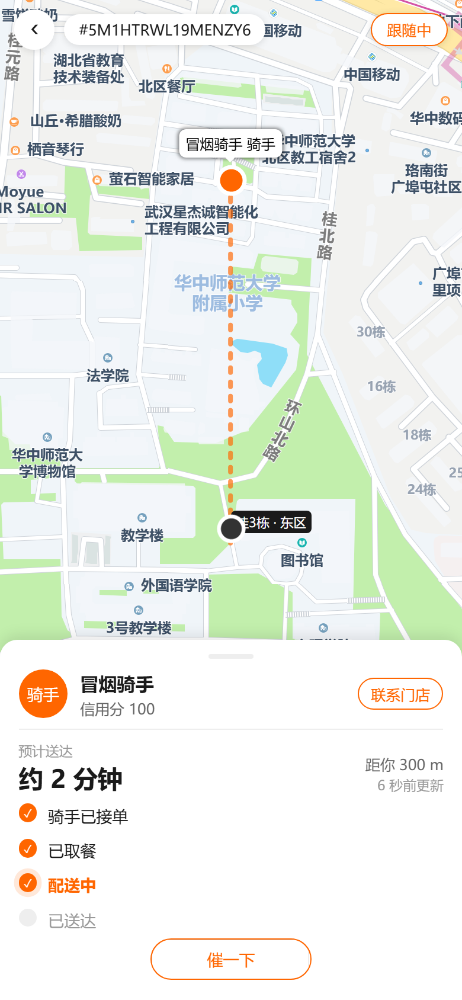
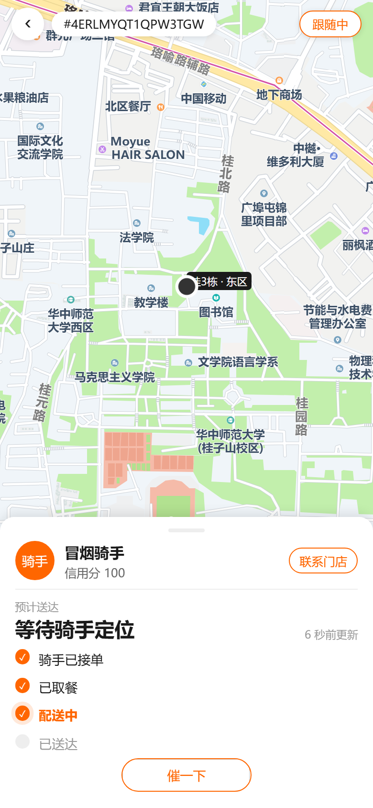
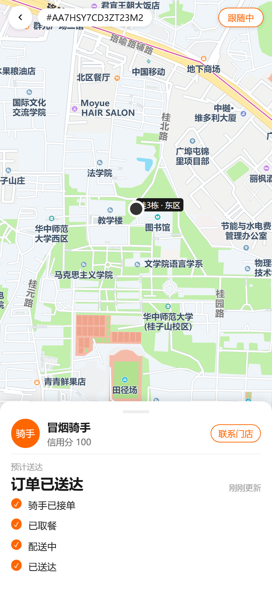
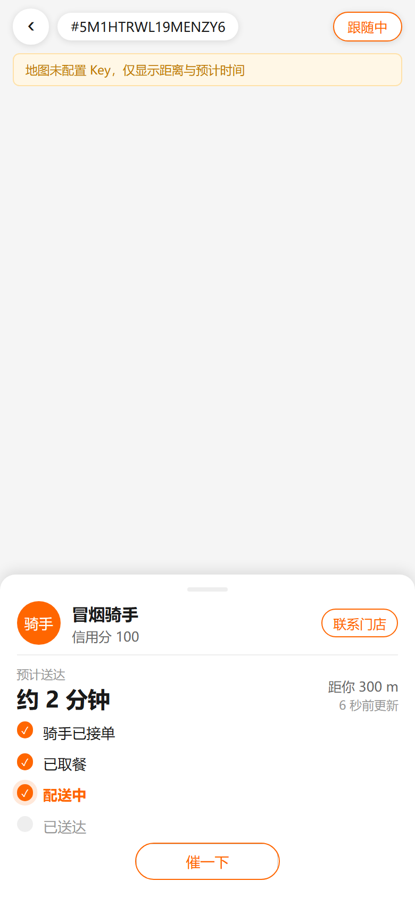

# 拾光达 骑手 GPS 跟踪（顾客端）操作手册

> 适用范围：顾客端 H5（`https://www.yourbao.cn/waimai/`，手机浏览器 / 微信内打开）
> 上线日期：2026-10-21
> 规格文档：`docs/superpowers/specs/2026-10-21-rider-gps-tracking/spec.md`
> 冒烟脚本：`node .secrets/rider-tracking-e2e.cjs`（建单 → 抢单 → 配送中 → 上报位置 → 顾客侧断言）
> 截图脚本：`node .secrets/rider-tracking-shots.cjs`（Playwright 390×844 dpr=2，四态截图）

## 1. 功能概览

订单详情页骑手卡新增「实时跟踪 ›」入口（仅骑手已接单且配送中显示），
进入全屏地图跟踪页（版式 B：全屏底图 + 底部抽屉）：

- **地图**：骑手实时位置（橙点）、目标楼栋（黑点 + 楼栋名标签）、骑手到楼栋的虚线；
  骑手移动时前端在会话内连成橙色轨迹（8m 去抖，最多 60 点，不落库）。
- **底部抽屉**：骑手姓名 / 信用分、预计送达（ETA）、直线距离、更新时间、四步时间线、催单。
- **轮询**：10 秒一次 `campusOrderRider`；切后台自动停止，回前台恢复；订单终态停止。
- **隐私**：仅下单人本人可查；位置仅在 `assigned` / `in_progress` 返回，送达后不再暴露（目标楼栋仍保留）。

## 2. 顾客操作流程

1. 下单并等待骑手接单；
2. 打开「我的订单 → 订单详情」，骑手卡出现「实时跟踪 ›」；
3. 点击进入跟踪页，地图自动框选骑手与楼栋；
4. 拖动地图会退出「跟随中」（右上角按钮可重新跟随）；
5. 需要时点「催一下」（10 分钟内重复催单会被拒绝）。





## 3. 降级与兜底

| 场景 | 页面表现 |
|---|---|
| 未配置地图 Key | 顶部黄色提示「地图未配置 Key，仅显示距离与预计时间」，抽屉数据照常显示 |
| 楼栋未维护坐标 | 地图只显示骑手；无距离/ETA，显示「等待骑手定位」 |
| 骑手未上报位置 | 地图显示目标楼栋；ETA 显示「等待骑手定位」 |
| 尚未指派骑手 | 抽屉显示「正在为你匹配骑手」；无坐标时地图区显示占位卡 |
| 已送达 / 异常 / 取消 | 停止轮询，ETA 区显示终态文案，位置不再返回 |
| 轮询失败 | 保留上一次数据，更新时间处标红「更新失败，重试中」 |



## 4. 配置项

### 4.1 腾讯位置服务 Key（必配才有底图）

1. 腾讯位置服务控制台 → 密钥管理 → 新建/编辑 Key，启用 **WebService API / JavaScript API v2**；
2. **域名白名单**填写站点域名：`www.yourbao.cn`（H5 地图 SDK 会校验来源域名）；
3. 将 Key 写入 `d:\zhao\waimai\.env.production`：

   ```ini
   VITE_QQMAP_KEY=你的Key
   ```

4. 重新构建并部署：`node .secrets/deploy-waimai.mjs`（Key 会烧入 `assets/index-*.js`，
   运行时注入 `window.__uniConfig.qqMapKey` 与 `sdkConfigs.maps.qqmap.key`）；
5. 校验：打开跟踪页，地图有底图即生效；置空 Key 则出现黄色提示条（无报错）。

> Key 属于前端可见凭据，必须配置域名白名单；更换 Key 后必须重新构建部署。

### 4.2 楼栋坐标维护（GCJ-02）

楼栋坐标是跟踪页目标点与距离/ETA 的唯一来源，需按真实坐标维护：

```graphql
# POST /admin-api，Header: Authorization: Bearer <admin-token>
mutation {
  campusUpdateBuilding(id: "1", input: { lat: 30.5200, lng: 114.3600 }) {
    id
    name
    detail
    lat
    lng
  }
}
```

- 支持只传需要修改的字段（`name` / `detail` / `lat` / `lng` 均可选）；
- 新建楼栋：`campusCreateBuilding(name, zoneId, detail, lat, lng)`；
- 坐标系必须与骑手端上报一致（**GCJ-02**，即腾讯/高德坐标），否则距离与 ETA 会偏。

> 当前生产库 `campus_building.id = 1`（桂3栋）为冒烟测试坐标 `30.52 / 114.36`，
> 业务上线前须替换为真实楼栋坐标。

### 4.3 接口字段

`campusOrderRider(orderId)` 返回：`realName`、`credit`、`location{lat,lng}`、
`destination{name,detail,lat,lng}`、`distanceMeters`、`etaMinutes`、`deliveryStatus`。

- 距离为球面直线距离（haversine，米）；ETA 按电瓶车 15km/h（4.2 m/s）粗估，< 30m 记为 0 分钟；
- 非下单人查询返回 Forbidden；未登录同样拒绝。

## 5. 验证记录（2026-10-21）

- 后端接口回归：`node .secrets/rider-tracking-e2e.cjs`（PASS：位置 / 目标 / 300m / ETA 2 分钟 / 越权拒绝）；
- 送达回归：`node .secrets/rider-tracking-e2e.cjs deliver <orderId>`（PASS：送达后 `location=null`、目标保留、越权拒绝）；
- 轮询启停：前台 12s 内 2 次请求，后台 22s 内 0 次，回前台 12s 内 2 次（PASS）；
- 手机视口截图：390×844 dpr=2，四态见第 2、3 节。

> 截图说明：生产站默认渠道为 `__default_channel__`，冒烟单在餐饮渠道 A；
> 截图脚本通过 Playwright 路由注入 `vendure-token: canteen-a-token` 与学生 Token 取单，不影响线上真实用户。
